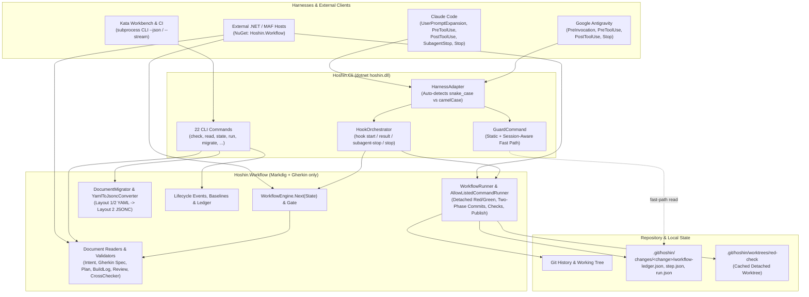
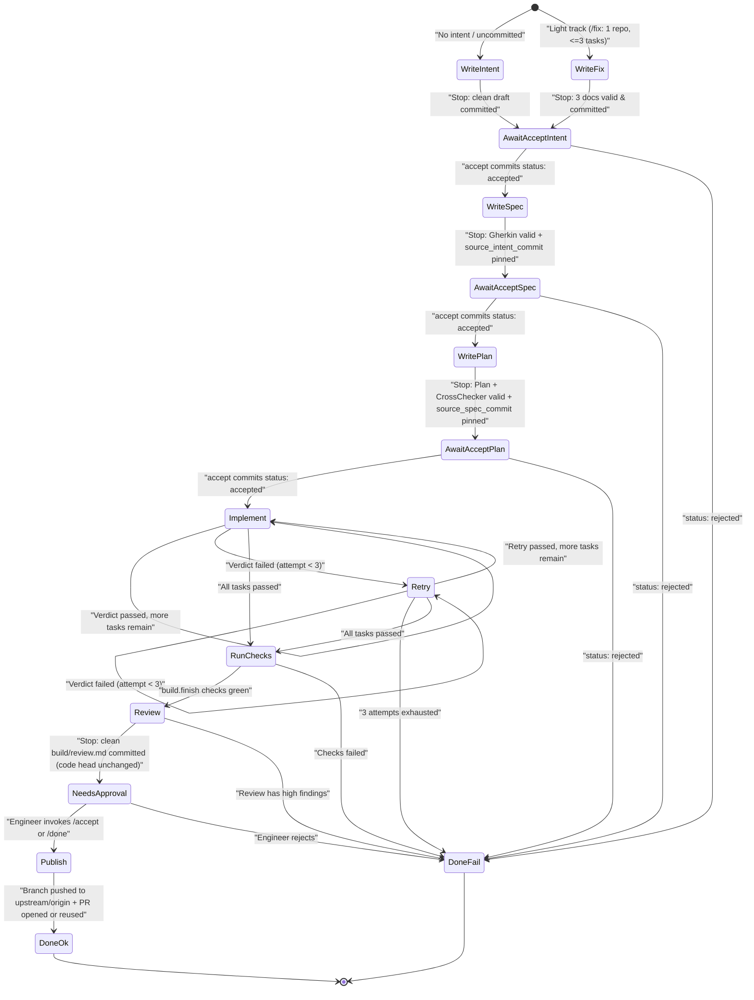
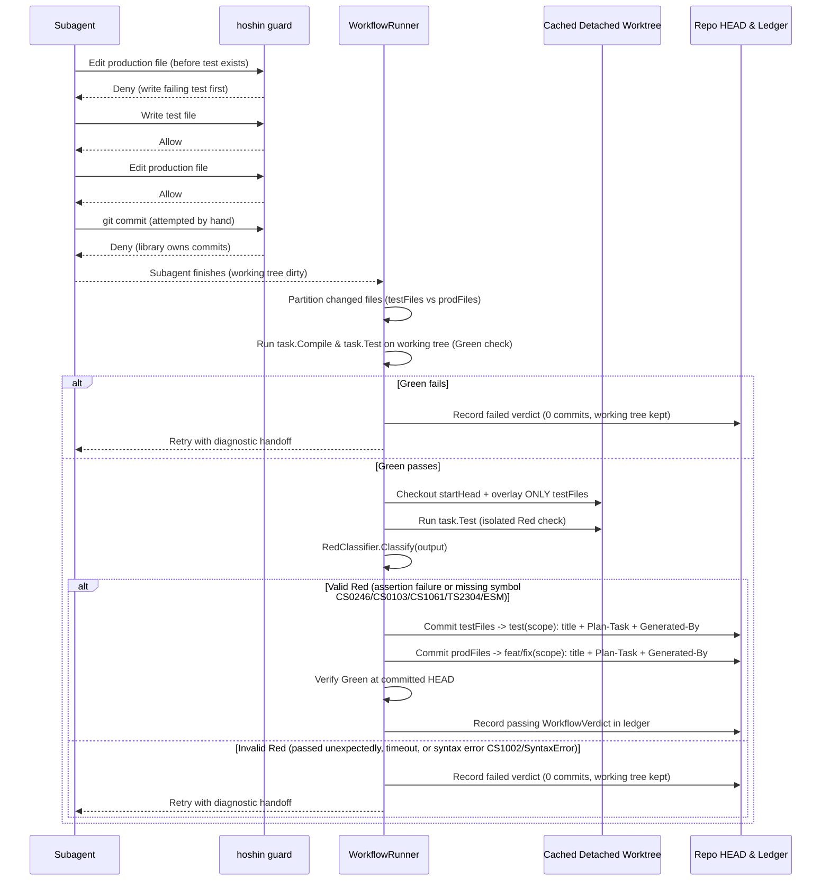
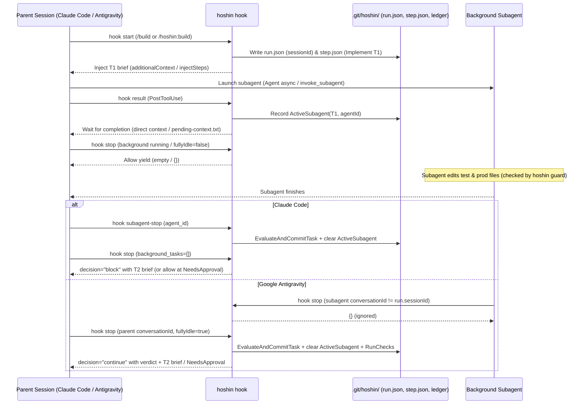

# Hoshin.Net Design

**Version:** `2.0.0`  
**Runtime:** .NET 10 (`net10.0`, `RollForward=Major`)  
**Author:** @Satishkrishna Pilla

## 1. Overview

Hoshin.Net is the .NET 10 backbone of the Hoshin engineering workflow: one core library (`Hoshin.Workflow`) and one portable CLI (`hoshin.dll`) that drive both **Claude Code** (`.claude-plugin/`) and **Google Antigravity** (`.agents/`) through native hooks, while preserving the full CLI contract (`CLIENTS.md`) for external callers such as the Kata Workbench and CI pipelines.

The core architectural shift from Hoshin v1.x (`tools/hoshin.ts`) is **who owns orchestration**:

- **The library owns determinism:** document parsing and schema validation, state computation, step ordering (`WorkflowEngine.Next`), retry caps, gating, detached-worktree Red/Green verification, two-phase atomic commits, `build.finish` checks, guard rules, and publishing.
- **The model owns judgment:** interviewing product owners, drafting specs and plans, writing tests and production code, and reviewing changes. Skill procedures in `skills/*/procedure.md` contain zero YAML front matter, zero CLI commands, zero workflow sequencing, and zero harness tool names.
- **JSONC replaces YAML everywhere:** line-1 fenced ```` ```jsonc ```` front matter, ```` ```jsonc ```` record blocks in `plan.md`, `build/*.md`, and `build/review.md`, and `change.jsonc` instead of `change.yml`.

## 2. System Architecture

`Hoshin.Workflow` has strictly two NuGet dependencies (`Markdig` and `Gherkin`; `System.Text.Json` handles JSON/JSONC natively) and zero references to Claude Code, Google Antigravity, or Microsoft Agent Framework. All harness-specific payload normalization and response formatting live in `Hoshin.Cli`.



### Design Invariants

| Concern | Implementation |
| :--- | :--- |
| **Single source of workflow order** | `WorkflowEngine.Next(WorkflowState)` and `WorkflowEngine.Gate(WorkflowState, skill)` in `Hoshin.Workflow/Engine/WorkflowEngine.cs`. |
| **Minimal library surface** | `Hoshin.Workflow.csproj` references only `Markdig` (`1.6.0`) and `Gherkin` (`43.0.0`). |
| **SOLID seams** | External boundaries are constructor-injected interfaces: `IJsonSchemaValidator`, `ICommandRunner`, `IGitClient`, `IPullRequestClient`, `IAllowListedCommandRunner`, `IYamlToJsoncConverter`, `IDocumentMigrator`, `IWorkflowRunner`, and `IHookAdapter`. |
| **No-shell, secret-free execution** | `AllowListedCommandRunner` invokes processes directly (`UseShellExecute = false`) with an allow-listed OS environment, stripping model API keys and GitHub tokens. |
| **Crash-safe hooks** | Every `hoshin hook` and `hoshin guard` invocation reads/writes raw UTF-8 streams (safe against Windows OEM codepages), catches all errors to `stderr`, and exits `0`. |

## 3. Workflow State Machine (`WorkflowEngine.Next`)

`WorkflowState` is reconstructed cleanly from git, the change's JSONC documents, and `.git/hoshin/changes/<change>/workflow-ledger.json`. `WorkflowEngine.Next(WorkflowState)` is a pure function returning the single next `Step`:



### Step Contracts (`Hoshin.Workflow.Engine`)

- `WriteDocument(Document, Path, Brief)` — Conversational authoring for `intent`, `spec`, or `plan`.
- `AwaitAccept(Document, Path, Head)` — Committed draft awaiting `accept`.
- `WriteFix(ChangeFolder, Brief)` — Light-track drafting of `intent.md`, `spec.md`, and `plan.md` together (enforcing 1 repository and ≤ 3 tasks).
- `Implement(AgentTask)` / `Retry(AgentTask, Handoff)` — Agent work requests carrying the embedded/loaded role procedure and attempt brief.
- `RunChecks(Head)` — Library-executed `build.finish` blocking checks read strictly from the change's **base branch** ref (`git show <base>:...`), combining `.hoshin.json`, `intent/<system>/hooks.json` (via `HookConfigService`), and any committed per-change `hooks.jsonc`/`hooks.json` (defaulting `blocking` to `true` unless explicitly `false`), never from the working tree.
- `ReviewDocument(Path, Head, Brief)` — Required review gate after `RunChecks` passes, keyed by **code head** (latest commit touching paths outside `<change>/build/review.md`), written and committed to `build/review.md`. High findings stop with `Done(false)`; zero high findings advance to `NeedsApproval`.
- `NeedsApproval(Head, Reason)` — Built, checked, and cleanly reviewed change waiting for human approval at the current code head.
- `Publish(Head, Ref)` — Library-owned `git push` to the branch's upstream remote (defaulting to `origin`, branch `change/<change>` unless overridden in `change.jsonc`) plus opening or reusing a PR via `IPullRequestClient` (surfacing push and PR errors without recording publication).
- `Done(Success, Outcome)` — Terminal state.

## 4. Two-Phase Red/Green Verification & Commits

During `Implement` and `Retry`, agents edit only the working tree. `hoshin guard` blocks manual `git add`/`git commit`/`git push` and blocks production-file edits until at least one test file exists in the working tree. When the subagent completes, `WorkflowRunner.EvaluateAndCommitTask` verifies and commits atomically:



### Strongly-Typed Red Classification (`RedClassifier`)

- **Valid Red:**
  - Test assertion / runtime failure (`RedKind.AssertionFailure`).
  - Missing target symbol compilation errors (`RedKind.MissingSymbol`) that resolve cleanly in Green: C# (`CS0246`, `CS0103`, `CS1061`, `CS0117`, `CS0234`, `CS0115`, `CS0535`, `CS1501`, `CS1729`, `CS7036`), TypeScript (`TS2304`, `TS2305`, `TS2339`, `TS2551`, `TS2554`, `TS2614`), Rust (`error[E0425]`, `error[E0433]`, `error[E0412]`), Node ESM missing exports (`does not provide an export named`), and `Cannot find module` / `ERR_MODULE_NOT_FOUND` / `TS2307` **only** when the specifier is relative (`./`, `../`) or matches a path in the task's production changes.
- **Invalid Red (rejected without committing):**
  - Test passes without production changes (`RedKind.PassedUnexpectedly`).
  - Command could not run (`RedKind.CouldNotRun`): exit codes `126` / `127`, `could not start`, worktree preparation failures, and bare/non-target missing packages (`Cannot find module 'vitest'`, `TS2307` on a bare package).
  - Hard syntax or non-missing-symbol compile errors (`RedKind.SyntaxError`): C# (`CS1002`, `CS1513`, other `CSxxxx`), TypeScript (`TS1005`, other `TSxxxx`), Python (`SyntaxError:`, `IndentationError:`), Go (`syntax error:`, `*.go:<line>:<col>: expected`), Rust (`error: expected`, other `error[E0xxx]:`), and Java (`error: ';' expected`).
  - Timeout (`RedKind.TimedOut`).

### Test File Identification

A changed path is classified as a test file if it matches either the file paths referenced in the task's `test` command argv or the repository's configured `testPatterns` in `.hoshin.json` (default: `test/**`, `tests/**`, `*.test.*`, `*Tests.cs`, `*Test.cs`).

## 5. Dual-Harness Hook Protocol (Claude Code & Antigravity)

`HarnessAdapter` inspects `stdin` JSON and auto-detects **Google Antigravity** (`camelCase` protojson: `hookEventName`, `conversationId`, `toolCall`, `workspacePaths`, `fullyIdle`, etc.) vs. **Claude Code** (`snake_case`: `hook_event_name`, `session_id`, `tool_name`, `tool_input`, `tool_response`, `background_tasks`, etc.).

| Lifecycle Boundary | Claude Code Hook | Antigravity Hook | Command | Behavior |
| :--- | :--- | :--- | :--- | :--- |
| **Skill / Step Start** | `UserPromptExpansion`, `PostToolUse` (`Skill`) | `PreInvocation`, `PostToolUse` (`read_file` / `view_file` on `SKILL.md`) | `hoshin hook start` | Gates the invoked skill via `WorkflowEngine.Gate`, writes `run.json` + `step.json`, runs non-agent steps, and injects the active step brief (`< 10,000` chars). `accept` and `done` are strictly human-only (`disable-model-invocation: true` and user-sourced events only). |
| **Pre-Tool Guard** | `PreToolUse` (`Bash`, `Edit`, `Write`, `MultiEdit`, `NotebookEdit`) | `PreToolUse` (`run_command`, `write_file`, `edit_file`, `write_to_file`, `replace_file_content`, `multi_replace_file_content`) | `hoshin guard` | Enforces static protections always and session-aware fast-path step rules from `run.json` + `step.json` without recomputing `WorkflowState`. |
| **Subagent Result** | `PostToolUse` (`Agent`, `Task`) | `PostToolUse` (`invoke_subagent`, `manage_task`, `manage_subagents`) | `hoshin hook result` | Foreground: judges attempt immediately and injects next step. Async: records `ActiveSubagent` in ledger, refuses conflicting concurrent launches, instructs orchestrator to wait. |
| **Async Subagent Stop** | `SubagentStop` | Handled on parent `Stop` (`fullyIdle: true`) | `hoshin hook subagent-stop` | Judges completed background subagent by matching `agentId`. |
| **Turn End / Gate** | `Stop` | `Stop` | `hoshin hook stop` | Yields while background subagent runs (`background_tasks` running or `fullyIdle: false`); stays silent during open authoring interviews; validates, auto-wraps, pins, and commits clean drafts; blocks (`block` / `continue`) with diagnostics or next build step up to 3 consecutive stops; allows clean exit at `NeedsApproval` or `Done`. |

### Async Subagent Orchestration Across Both Harnesses



### Session-Aware Guard Isolation

`GuardCommand` scopes every rule — static protections (`git push`, `gh pr`, protected hook configs, `baseline approve/retake`) and step-specific rules (no manual `git commit`, Red-phase test-first, single-document lock) — strictly to repositories with an active, non-stale `.git/hoshin/run.json` (24-hour window) whose owning `session_id`/`conversationId` matches the incoming event or its registered active subagent. Outside an active run (including any plain git repository or unrelated session), `hoshin guard` and `hoshin hook` stay silent, create no `.git/hoshin/` directory, and write no `hooks.jsonl` trace. Static denials inside an active run are traced to `hooks.jsonl`. The shell regex guard is a fast-path speed bump; real workflow integrity is enforced in `Hoshin.Workflow` (`WorkflowHeadGuard` rejects any attempt where `HEAD` moved outside library-owned commits, and `EvaluateAndCommitTask` verifies Red/Green and protected paths before committing).

## 6. Document Formats, Validation & Migration

### Canonical JSONC Layout 2

All change documents are Markdown with JSONC structured blocks:

- **Front matter:** Line-1 fenced ```` ```jsonc ```` block. If an authoring agent writes a valid bare `{ ... }` JSONC object on line 1, `WorkflowRunner.TryAutoWrapBareJsonFrontMatter` wraps it in ```` ```jsonc ... ``` ```` fences automatically before validation and commit.
- **`intent.md`:** Validated by `IntentReader` (required metadata fields, scope match, required sections in order, non-empty sections, no leftover `<placeholder>` tokens outside inline code).
- **`spec.md`:** Validated by `SpecReader` using Cucumber's `Gherkin` parser (`@R<n>` + `@from:<source>` on every `Rule`, `@R<n>.<m>` matching parent rule on every `Scenario`, unique IDs, outline `<placeholder>` coverage in `Examples`, and unread-tag detection). Pinned with `source_intent_commit` on commit.
- **`plan.md`:** Validated by `PlanReader` (Markdig CommonMark fences + embedded JSON schemas `plan-task.schema.json` and `shared-decision.schema.json`) and `CrossChecker` (scenario coverage against `spec.md`, upward-only `depends_on`, valid `uses` ownership). Pinned with `source_spec_commit` on commit.
- **`build/<repo>.md` & `build/review.md`:** Validated by `BuildLogReader` (`build-log-entry.schema.json`) and `ReviewReader` (`review-header.schema.json`, `finding.schema.json`, mandatory `rule` on every `convention` finding).
- **`change.jsonc`:** Validated by `ChangeRecordStore`.

### Zero-Dependency Migration (`hoshin migrate`)

`Hoshin.Workflow/Migration` provides `YamlToJsoncConverter` (zero external YAML packages) and `DocumentMigrator`:

- Converts both **Layout 1** and **Layout 2** YAML documents (`intent.md`, `spec.md`, `plan.md`, `build/*.md`, `build/review.md`, `context/*.md`, `branch.md`) into canonical Layout 2 JSONC while preserving comments (`#` → `//`), key ordering, and all-digit commit hashes as strings.
- Converts `change.yml` → `change.jsonc` (refusing cleanly if both exist).
- Integrates with legacy `ai-sdlc` → `hoshin` workspace migration (`hoshin migrate --json [--write | --dry-run]`) and supports standalone directories/files (`hoshin migrate <path>... [--dry-run] [--write] [--json]`).
- Strictly idempotent: already-migrated files report `"current"` and remain byte-identical.

## 7. Packaging & Distribution

`packaging/package.ps1` builds all `v2.0.0` release artifacts cleanly from a single command:

| Artifact | Path | Contents |
| :--- | :--- | :--- |
| **Portable CLI** | `artifacts/portable/` | Framework-dependent `lib/` (`hoshin.dll`, `Hoshin.Workflow.dll`, `Markdig.dll`, `Gherkin.dll`, `Cucumber.Messages.dll`, runtimeconfig, deps) + `skills/`. Runs via Microsoft's signed `dotnet` host with no native executables or code-signing friction. |
| **NuGet Library** | `artifacts/nuget/Hoshin.Workflow.2.0.0.nupkg` | `Hoshin.Workflow.dll` with embedded JSON schemas, workspace templates, and all 11 role/skill procedures; depends only on `Markdig` and `Gherkin`. |
| **Claude Code Plugin** | `artifacts/claude-code/` | `.claude-plugin/plugin.json`, `hooks/hooks.json`, `lib/`, `roles/`, and one-line `skills/<name>/SKILL.md` wrappers + verbatim `references/procedure.md` for all 10 skills. |
| **Antigravity Bundle** | `artifacts/antigravity/.agents/` | `hooks.json` (unquoted relative paths for Windows `cmd /c` compatibility), `lib/`, `roles/`, and one-line `skills/<name>/SKILL.md` wrappers + verbatim `references/procedure.md` for all 10 skills. |

### Performance & Verification Summary

- **Fresh-clone verification (Windows, .NET 10.0.2):** `dotnet build Hoshin.sln` succeeds with **0 warnings, 0 errors**; `dotnet test` passes **129/129** (85 C# unit, migration, state-machine, example conformance, and dual-harness hook integration tests + all 44 ported black-box CLI conformance suites covering 558+ CLI cases).
- **Guard latency on Windows (portable Release build):** ~143–148 ms median on allow, ~176 ms median on red-phase deny (well below legacy Node.js `hoshin.ts guard` at ~293–333 ms).
- **External client compatibility:** Verified continuously by `tests/Hoshin.Tests/BlackBox/clients.test.mjs` against [CLIENTS.md](CLIENTS.md); Kata Workbench upgrade steps are documented in [docs/KATA_MIGRATION.md](docs/KATA_MIGRATION.md).
