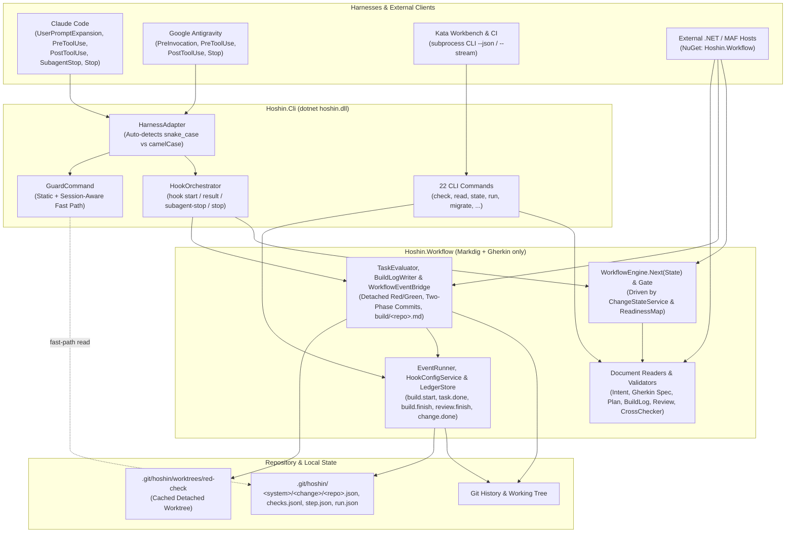

# Hoshin.Net Design

**Version:** `2.0.0`  
**Runtime:** .NET 10 (`net10.0`, `RollForward=Major`)  
**Author:** @Satishkrishna Pilla

## 1. Overview

Hoshin.Net is the .NET 10 backbone of the Hoshin engineering workflow: one core library (`Hoshin.Workflow`) and one portable CLI (`hoshin.dll`) that drive both **Claude Code** (`.claude-plugin/`) and **Google Antigravity** (`.agents/`) through native hooks, while preserving the full CLI contract (`CLIENTS.md`) for external callers such as the Kata Workbench and CI pipelines.

The core architectural shift from Hoshin v1.x (`tools/hoshin.ts`) is **who owns orchestration**:

- **The library owns determinism:** document parsing and schema validation, state computation, step ordering (`WorkflowEngine.Next`), retry caps, gating, detached-worktree Red/Green verification, two-phase atomic commits, `build.finish` checks, guard rules, and publishing.
- **The model owns judgment:** interviewing product owners, drafting specs and plans, writing tests and production code, and reviewing changes. Skill procedures in `skills/*/procedure.md` contain zero YAML front matter, zero CLI commands, zero workflow sequencing, and zero harness tool names.
- **JSONC replaces YAML everywhere:** line-1 fenced ```` ```jsonc ```` front matter, ```` ```jsonc ```` record blocks in `plan.md`, `build/*.md`, and `build/review.md`, and `change.jsonc` instead of `change.yml`.

## 2. System Architecture

`Hoshin.Workflow` has strictly two NuGet dependencies (`Markdig` and `Gherkin`; `System.Text.Json` handles JSON/JSONC natively) and zero references to Claude Code, Google Antigravity, or Microsoft Agent Framework. All harness-specific payload normalization and response formatting live in `Hoshin.Cli`.



### Design Invariants

| Concern | Implementation |
| :--- | :--- |
| **One unified workflow system** | Dual-harness hooks (`hoshin hook`, `hoshin guard`) and CLI commands (`hoshin state`, `hoshin fix-state`, `hoshin run`, `hoshin red`, `hoshin status`) share one domain model: `ChangeStateService`, `FixStateService`, `EventRunner`, `HookConfigService`, `RedClassifier`, `LedgerStore` (`RepoLedger`), and the narrow Git role interfaces (`ProcessGitClient`). |
| **Single source of workflow order** | `WorkflowEngine.Next` / `NextForSkill` and `WorkflowGate` (`WorkflowEngine.Gate` / `GateFixAccept`) in `Hoshin.Workflow/Engine/`. Every `Step` record (including `WriteFix`, `AwaitAcceptFix`, and `ReviewDocument`) is constructed exclusively inside `WorkflowEngine`; the hook orchestrator constructs zero steps. |
| **Minimal library surface** | `Hoshin.Workflow.csproj` references only `Markdig` (`1.6.0`) and `Gherkin` (`43.0.0`). YAML migration lives in `Hoshin.Migration` (`YamlDotNet`), referenced only by `Hoshin.Cli`. |
| **SOLID seams** | External boundaries are required, constructor-injected narrow interfaces wired lazily at one composition root (`HoshinServices`): `IGitRunner`/`IGitQuery`/`IGitStatus`/`IGitBranches`/`IGitWorktrees`/`IGitCommitter`, `ITaskEvaluator`/`ICheckRunner`/`IApprovalRecorder`/`IPublisher`/`IDocumentCommitter`, `IChangeStarter`, `ITaskRepoResolver`, `IWorkflowEventBridge`, `IJsonSchemaValidator`, `ICommandRunner`, `IAllowListedCommandRunner`, `IPullRequestClient`, `IFileSystem`, `TimeProvider`, and `IHookAdapter`. |
| **No-shell, secret-free execution** | Both `AllowListedCommandRunner` and `ProcessGitClient` invoke processes directly (`UseShellExecute = false`) with an allow-listed OS environment, stripping model API keys and secrets (keeping push credentials strictly on `git push`). |
| **Crash-safe hooks** | Every `hoshin hook` and `hoshin guard` invocation reads/writes raw UTF-8 streams (safe against Windows OEM codepages), catches all errors to `stderr`, and exits `0`. |

## 3. Workflow State Machine (`WorkflowEngine.Next`)

```mermaid
stateDiagram-v2
    [*] --> WriteIntent : "No intent / uncommitted (change.start)"
    WriteIntent --> AwaitAcceptIntent : "Stop: clean draft committed"
    AwaitAcceptIntent --> WriteSpec : "accept commits status: accepted"
    AwaitAcceptIntent --> DoneFail : "reject commits status: rejected"

    WriteSpec --> AwaitAcceptSpec : "Stop: Gherkin valid + source_intent_commit pinned"
    AwaitAcceptSpec --> WritePlan : "accept commits status: accepted"
    AwaitAcceptSpec --> WriteIntent : "reopen intent (pin breaks downstream)"

    WritePlan --> AwaitAcceptPlan : "Stop: Plan + CrossChecker valid + source_spec_commit pinned"
    AwaitAcceptPlan --> Implement : "accept commits status: accepted"
    AwaitAcceptPlan --> WriteSpec : "reopen spec (pin breaks plan)"

    [*] --> WriteFix : "Light track (/fix: 1 repo, <=3 tasks; FixState row 3)"
    WriteFix --> AwaitAcceptFix : "Stop: 3 docs valid & committed (FixState rows 4-7)"
    AwaitAcceptFix --> Implement : "accept / fix --accept pins & accepts all 3 (FixState row 8)"
    AwaitAcceptFix --> DoneFail : "reject (FixState row 1)"

    Implement --> Implement : "Verdict passed, more tasks remain (ScheduleCalculator)"
    Implement --> Retry : "Verdict failed (attempt < maxAttempts)"
    Retry --> Implement : "Retry passed, more tasks remain"
    Retry --> Retry : "Verdict failed (attempt < maxAttempts)"
    Retry --> DoneFail : "maxAttempts exhausted"

    Implement --> RunChecks : "All tasks passed"
    Retry --> RunChecks : "All tasks passed"

    RunChecks --> Review : "EventRunner build.finish checks green"
    RunChecks --> Implement : "onFailure: fix & retries <= gateRetries (FIX-CHECK-*)"
    RunChecks --> DoneFail : "Checks failed (onFailure: stop or gateRetries exhausted)"

    Review --> NeedsApproval : "Stop: clean build/review.md committed + review.finish"
    Review --> Implement : "/hoshin:build <instructions> after high findings (FIX-R*)"
    Review --> DoneFail : "Review has high findings (no fix instructions yet)"

    NeedsApproval --> Publish : "Engineer invokes /accept or /done"
    NeedsApproval --> DoneFail : "Engineer rejects"

    Publish --> DoneOk : "EventRunner change.done pushes & opens/reuses PRs"
    DoneOk --> [*]
    DoneFail --> [*]
```

`WorkflowState` is constructed by `WorkflowStateReader` from `ChangeStateService` (carrying documents with upstream `source_*_commit` pins, `ReadinessMap`, `FixStateService`'s 8-row light-track state, schedule, and committed build-log progress — with a fallback for standalone `.hoshin/` repos without `.hoshin.json`), git, and the unified per-change/per-repo `RepoLedger` at `.git/hoshin/<system>/<change>/<repo>.json` (managed atomically under `FileLock` by `LedgerStore`, mirroring task verdicts to `reds` and `runs` for `hoshin red show` and `hoshin status`). In Hoshin workspaces, committed `build/<repo>.md` entries are the source of truth for task completion (`WorkflowProgress.CompletedTaskIds`), while the local ledger acts as a cache of attempts and verdict details; if the ledger and committed build logs ever disagree, the logs win and the disagreement is reported once. Both `WorkflowEngine.Next` / `NextForSkill` and `WorkflowGate` stay pure — receiving the computed `ChangeStateItem`, `ReadinessMap`, and `FixStateResult` as values — and gating comes from `ChangeState` (`ReadinessMap`'s `SkillReadiness.Stop` reasons for stale pins, superseded plans, the light-track stop, uncommitted acceptance, and rejection/reopen guards, plus `FixStateService` rows 1–8 for `fix` and `fix --accept`) before falling back to step-owner gating:



### Step Contracts (`Hoshin.Workflow.Engine`)

- `WriteDocument(Document, Path, Brief)` — Conversational authoring for `intent`, `spec`, or `plan` (also re-entered automatically when an accepted document is reopened or an upstream commit pin breaks).
- `AwaitAccept(Document, Path, Head)` — Committed draft awaiting human `accept` (or human `reject` / `reopen`).
- `WriteFix(ChangeFolder, Brief)` — Light-track drafting of `intent.md`, `spec.md`, and `plan.md` together (enforcing 1 repository and ≤ 3 tasks; `FixState` row 3).
- `AwaitAcceptFix(ChangeFolder, Head, NextDocument)` — Committed light-track fix documents awaiting human `accept` or `fix --accept` (`FixState` rows 4–7), accepting all remaining docs in order with `source_intent_commit` and `source_spec_commit` pins to reach row 8.
- `Implement(AgentTask)` / `Retry(AgentTask, Handoff)` — Agent work requests carrying the embedded/loaded role procedure and attempt brief, scheduled across repositories via `ScheduleCalculator` and executed in each task's repository checkout (`ITaskRepoResolver`).
- `RunChecks(Head)` — Executes `EventRunner` `build.finish` hooks per repository (read strictly from the base branch via `HookConfigService`, writing `checks.jsonl`) in Hoshin workspaces, with `BaseBranchChecksReader` fallback in standalone `.hoshin/` repos. When a `build.finish` hook fails with `onFailure: "fix"`, `PostBuildFixEngine` dispatches a bounded fix step (`FIX-CHECK-*`, up to `gateRetries`) targeting the failing repository before re-running checks; once `gateRetries` is exhausted, the step ends in `Done(false)`.
- `ReviewDocument(Path, Head, Brief)` — Required review gate after `RunChecks` passes, keyed by **composite code head** (`WorkflowCodeHead`: sorted `<repo>=<HEAD>` across all touched product repositories in multi-repo workspaces, or the single-repo `CodeHead` excluding `build/review.md` and `change.jsonc` so neither review commits nor `change.done`'s `change.jsonc` PR-record commit invalidate checks, reviews, or published state), written and committed to `build/review.md` and firing `review.finish`. High findings stop with `Done(false)` until the engineer invokes `/hoshin:build <instructions>` from the target repository, which dispatches a fix subagent (`FIX-R<n>`) carrying the findings and instructions, commits the fix (`test(...)` / `fix(...)`), moves that repository's head in the composite code head, re-runs `build.finish` checks, and advances to the next review; zero high findings advance to `NeedsApproval`.
- `NeedsApproval(Head, Reason)` — Built, checked, and cleanly reviewed change waiting for human approval at the current code head. Once approved and published (`Done(true)`), `StartHandler` clears `run.json` and turn files so every subsequent hook across all workspace sessions remains quiet and `/hoshin:build` dispatches nothing.
- `Publish(Head, Ref)` — Fires `EventRunner` `change.done` (`ChangeDoneStep`) in Hoshin workspaces (pushing every repository on `change/<change>` and opening/reusing PRs via `IPullRequestClient`), with direct push + PR fallback in standalone `.hoshin/` repos.
- `Done(Success, Outcome)` — Terminal state.

## 4. Two-Phase Red/Green Verification & Commits

During `Implement` and `Retry`, agents edit only the working tree. `hoshin guard` blocks manual `git add`/`git commit`/`git push` and blocks production-file edits until at least one test file exists in the working tree. When the subagent completes, `WorkflowRunner.EvaluateAndCommitTask` verifies and commits atomically:

```mermaid
sequenceDiagram
    participant Agent as Subagent
    participant Guard as hoshin guard
    participant Runner as WorkflowRunner
    participant WT as Cached Detached Worktree
    participant Git as Repo HEAD & Ledger

    Agent->>Guard: Edit production file (before test exists)
    Guard-->>Agent: Deny (write failing test first)

    Agent->>Guard: Write test file
    Guard-->>Agent: Allow
    Agent->>Guard: Edit production file
    Guard-->>Agent: Allow

    Agent->>Guard: git commit (attempted by hand)
    Guard-->>Agent: Deny (library owns commits)

    Agent-->>Runner: Subagent finishes (working tree dirty)
    Runner->>Runner: Partition changed files (testFiles vs prodFiles)
    Runner->>Runner: Run task.Compile & task.Test on working tree (Green check)

    alt Green fails
        Runner->>Git: Record failed verdict (0 commits, working tree kept)
        Runner-->>Agent: Retry with diagnostic handoff
    else Green passes
        Runner->>WT: Checkout startHead + link gitignored deps + overlay ONLY testFiles
        Runner->>WT: Run task.Compile (if set) then task.Test (isolated Red check)
        Runner->>Runner: RedClassifier.Classify(output)
        Runner->>WT: Unlink gitignored deps + clean worktree
        alt Valid Red (assertion failure or missing symbol CS0246/CS0103/CS1061/TS2304/ESM)
            Runner->>Git: Commit testFiles -> test(scope): title + Plan-Task + Generated-By
            Runner->>Git: Commit prodFiles -> feat/fix(scope): title + Plan-Task + Generated-By
            Runner->>Runner: Verify Green at committed HEAD
            Runner->>Git: Append & commit build/&lt;repo&gt;.md entry (red: observed)
            Runner->>Git: Record verdict & fire EventRunner task.done
        else Invalid Red (passed unexpectedly, timeout, or syntax error CS1002/SyntaxError)
            Runner->>Git: Record failed verdict (0 commits, working tree kept)
            Runner-->>Agent: Retry with diagnostic handoff
        end
    end
```

### Strongly-Typed Red Classification (`RedClassifier`)

Before running the task's `test` command in the detached Red worktree (`.git/hoshin/worktrees/red-check`), `RedWorktree` temporarily links gitignored dependency directories (`node_modules`, `.venv`, `venv`, plus any relative folders listed in `.hoshin.json` `build.linkDirs`) from the main checkout into the worktree without copying files (symbolic links on Unix/Windows, falling back to NTFS directory junctions on Windows when symlink creation is unprivileged) and unlinks them before cleaning the worktree so nothing from them is ever modified or committed. If the task defines a `compile` command, `RedWorktree` runs `compile` in the worktree first; a compile failure counts as valid Red only when `RedClassifier` classifies it as `RedKind.MissingSymbol` (any other compile failure is rejected as invalid Red).

- **Valid Red:**
  - Test assertion / runtime failure (`RedKind.AssertionFailure`).
  - Missing target symbol compilation errors (`RedKind.MissingSymbol`) that resolve cleanly in Green: C# (`CS0246`, `CS0103`, `CS1061`, `CS0117`, `CS0234`, `CS0115`, `CS0535`, `CS1501`, `CS1729`, `CS7036`), TypeScript (`TS2304`, `TS2305`, `TS2339`, `TS2551`, `TS2554`, `TS2614`), Rust (`error[E0425]`, `error[E0433]`, `error[E0412]`), Node ESM missing exports (`does not provide an export named`), and `Cannot find module` / `ERR_MODULE_NOT_FOUND` / `TS2307` **only** when the specifier is relative (`./`, `../`) or matches a path in the task's production changes.
- **Invalid Red (rejected without committing):**
  - Test passes without production changes (`RedKind.PassedUnexpectedly`).
  - Command could not run (`RedKind.CouldNotRun`): exit codes `126` / `127`, `could not start`, worktree preparation failures, and bare/non-target missing packages (`Cannot find module 'vitest'`, `TS2307` on a bare package).
  - Hard syntax or non-missing-symbol compile errors (`RedKind.SyntaxError`): C# (`CS1002`, `CS1513`, other `CSxxxx`), TypeScript (`TS1005`, other `TSxxxx`), Python (`SyntaxError:`, `IndentationError:`), Go (`syntax error:`, `*.go:<line>:<col>: expected`), Rust (`error: expected`, other `error[E0xxx]:`), and Java (`error: ';' expected`).
  - Timeout (`RedKind.TimedOut`).

### Test File Identification

A changed path is classified as a test file if it matches either the file paths referenced in the task's `test` command argv or the repository's configured `testPatterns` in `.hoshin.json` (default: `test/**`, `tests/**`, `*.test.*`, `*Tests.cs`, `*Test.cs`).

### Tasks Without Testable Behavior (`test: null`)

Plan tasks may omit `test` or set `"test": null` for non-testable work (configuration, documentation). `WorkflowRunner.EvaluateAndCommitTask` dispatches through `ITaskVerdictPolicy`:
- `RedGreenPolicy` handles tasks with a `test` command (two-phase test + production commits with isolated detached-worktree Red).
- `NoTestPolicy` handles tasks with `test: null`: skips Red/Green (`red: "skipped: no testable behavior"`), requires at least one non-test change, refuses any test-file modification (`order: a task with no test must not change test files`), and records one `<type>(<scope>): <title>` commit. The repository's `build.finish` checks still run afterward to verify the change.

## 5. Dual-Harness Hook Protocol (Claude Code & Antigravity)

`HarnessAdapter` inspects `stdin` JSON and auto-detects **Google Antigravity** (`camelCase` protojson: `hookEventName`, `conversationId`, `toolCall`, `workspacePaths`, `fullyIdle`, etc.) vs. **Claude Code** (`snake_case`: `hook_event_name`, `session_id`, `tool_name`, `tool_input`, `tool_response`, `background_tasks`, etc.).

| Lifecycle Boundary | Claude Code Hook | Antigravity Hook | Command | Behavior |
| :--- | :--- | :--- | :--- | :--- |
| **Skill / Step Start** | `UserPromptExpansion`, `PostToolUse` (`Skill`) | `PreInvocation`, `PostToolUse` (`read_file` / `view_file` on `SKILL.md`) | `hoshin hook start` | Gates the invoked skill via `WorkflowEngine.Gate`, writes `run.json` + `step.json`, runs non-agent steps, and injects the active step brief (`< 10,000` chars). `accept` and `done` are strictly human-only (`disable-model-invocation: true` and user-sourced events only). |
| **Pre-Tool Guard** | `PreToolUse` (`Bash`, `Edit`, `Write`, `MultiEdit`, `NotebookEdit`) | `PreToolUse` (`run_command`, `write_file`, `edit_file`, `write_to_file`, `replace_file_content`, `multi_replace_file_content`) | `hoshin guard` | Scoped strictly to repositories with an active, non-stale `.git/hoshin/run.json` matching the calling session (or its active subagent); enforces static protections and fast-path step rules from `step.json` without recomputing `WorkflowState`, staying silent outside active runs. |
| **Subagent Result** | `PostToolUse` (`Agent`, `Task`) | `PostToolUse` (`invoke_subagent`, `manage_task`, `manage_subagents`) | `hoshin hook result` | Foreground: judges attempt immediately and injects next step. Async: records `ActiveSubagent` in ledger, refuses conflicting concurrent launches, instructs orchestrator to wait. |
| **Async Subagent Stop** | `SubagentStop` | Handled on parent `Stop` (`fullyIdle: true`) | `hoshin hook subagent-stop` | Judges completed background subagent by matching `agentId`. |
| **Turn End / Gate** | `Stop` | `Stop` | `hoshin hook stop` | Yields while background subagent runs (`background_tasks` running or `fullyIdle: false`); stays silent during open authoring interviews; validates, auto-wraps, pins, and commits clean drafts; blocks (`block` / `continue`) with diagnostics or next build step up to 3 consecutive stops; allows clean exit at `NeedsApproval` or `Done`. |

### Async Subagent Orchestration Across Both Harnesses

```mermaid
sequenceDiagram
    participant Host as Parent Session (Claude Code / Antigravity)
    participant Hook as hoshin hook
    participant Ledger as .git/hoshin/ (run.json, step.json, ledger)
    participant Sub as Background Subagent

    Host->>Hook: hook start (/build or /hoshin:build)
    Hook->>Ledger: Write run.json (sessionId) & step.json (Implement T1)
    Hook-->>Host: Inject T1 brief (additionalContext / injectSteps)

    Host->>Sub: Launch subagent (Agent async / invoke_subagent)
    Host->>Hook: hook result (PostToolUse)
    Hook->>Ledger: Record ActiveSubagent(T1, agentId)
    Hook-->>Host: Wait for completion (direct context / pending-context.txt)

    Host->>Hook: hook stop (background running / fullyIdle=false)
    Hook-->>Host: Allow yield (empty / {})

    Note over Sub: Subagent edits test & prod files (checked by hoshin guard)
    Sub-->>Host: Subagent finishes

    alt Claude Code
        Host->>Hook: hook subagent-stop (agent_id)
        Hook->>Ledger: EvaluateAndCommitTask + build/&lt;repo&gt;.md + task.done event
        Host->>Hook: hook stop (background_tasks=[])
        Hook-->>Host: decision="block" with T2 brief (or build.finish -> Review)
    else Google Antigravity
        Sub->>Hook: hook stop (subagent conversationId != run.sessionId)
        Hook-->>Sub: {} (ignored)
        Host->>Hook: hook stop (parent conversationId, fullyIdle=true)
        Hook->>Ledger: EvaluateAndCommitTask + task.done + build.finish event (checks.jsonl)
        Hook-->>Host: decision="continue" with verdict + T2 brief / Review / NeedsApproval
    end
```

### Session-Aware Guard Isolation

`GuardCommand` and every `hoshin hook` subcommand resolve the active run through a single injected `IHookRunResolver` (`HookRunResolver`), and all workspace marker detection goes through one `IWorkspaceLocator` (`WorkspaceLocator` over `WorkspaceResolver`) regardless of the master folder's name. Ledger coordinates are always extracted from `intent/<system>/<change>` rather than `scope`. When `/hoshin:build` runs in a session started inside a product repository, `WorkflowEngine` dispatches only that repository's tasks and tells the engineer which repository (or `review`) comes next once that repository's tasks finish. In a Hoshin workspace, `run.json`, `step.json`, `hooks.jsonl`, and per-repo ledgers live in one canonical location — `<master-git-common-dir>/hoshin/` — which the master checkout, every change copy worktree (`.hoshin/copies/<change>`), and every declared product repository all resolve to; `WorkflowRepo.Root` always points to the checkout that actually holds the active change folder (the copy when one exists). `GuardCommand` scopes every rule — static protections (`git push`, `gh pr`, protected hook configs, `baseline approve/retake`) and step-specific rules (no manual `git commit`, Red-phase test-first, single-document lock) — strictly to repositories with an active, non-stale `run.json` (24-hour window) whose owning `session_id`/`conversationId` matches the incoming event or its registered active subagent. Outside an active run (including any plain git repository or unrelated session), `hoshin guard` and `hoshin hook` stay silent, create no `.git/hoshin/` directory, and write no `hooks.jsonl` trace. Static denials inside an active run are traced to `hooks.jsonl`. If `hoshin hook` hits an internal error in `start`, `result`, or `stop`, it still exits `0` and writes to `stderr`, but also emits a visible harness message (non-blocking on `stop` so a crash never traps the session) and records the exception in `hooks.jsonl`. The shell regex guard is a fast-path speed bump; real workflow integrity is enforced in `Hoshin.Workflow` (`WorkflowHeadGuard` rejects any attempt where `HEAD` moved outside library-owned commits, and `EvaluateAndCommitTask` verifies Red/Green and protected paths before committing).

## 6. Document Formats, Validation & Migration

### Canonical JSONC Layout 2

All change documents are Markdown with JSONC structured blocks:

- **Front matter:** Line-1 fenced ```` ```jsonc ```` block. If an authoring agent writes a valid bare `{ ... }` JSONC object on line 1, `WorkflowRunner.TryAutoWrapBareJsonFrontMatter` wraps it in ```` ```jsonc ... ``` ```` fences automatically before validation and commit.
- **`intent.md`:** Validated by `IntentReader` (required metadata fields, scope match, required sections in order, non-empty sections, no leftover `<placeholder>` tokens outside inline code).
- **`spec.md`:** Validated by `SpecReader` using Cucumber's `Gherkin` parser (`@R<n>` + `@from:<source>` on every `Rule`, `@R<n>.<m>` matching parent rule on every `Scenario`, unique IDs, outline `<placeholder>` coverage in `Examples`, and unread-tag detection). Pinned with `source_intent_commit` on commit.
- **`plan.md`:** Validated by `PlanReader` (Markdig CommonMark fences + embedded JSON schemas `plan-task.schema.json` and `shared-decision.schema.json`) and `CrossChecker` (scenario coverage against `spec.md`, upward-only `depends_on`, valid `uses` ownership). Pinned with `source_spec_commit` on commit.
- **`build/<repo>.md` & `build/review.md`:** Validated by `BuildLogReader` (`build-log-entry.schema.json`) and `ReviewReader` (`review-header.schema.json`, `finding.schema.json`, mandatory `rule` on every `convention` finding).
- **`change.jsonc`:** Validated by `ChangeRecordStore`.

### YAML-to-JSONC Migration (`Hoshin.Migration` / `hoshin migrate`)

YAML parsing is isolated in the separate `src/Hoshin.Migration` assembly (`YamlDotNet 16.3.0`), referenced only by `Hoshin.Cli` so `Hoshin.Workflow` keeps strictly `Markdig` and `Gherkin`. `YamlToJsoncConverter` and `DocumentMigrator`:

- Convert both **Layout 1** and **Layout 2** YAML documents (`intent.md`, `spec.md`, `plan.md`, `build/*.md`, `build/review.md`, `context/*.md`, `branch.md`) into canonical Layout 2 JSONC while preserving comments (`#` → `//`), key ordering, and all-digit commit hashes as strings, and fail closed on unsupported constructs.
- Convert `change.yml` → `change.jsonc` (verifying key-set preservation and refusing cleanly if both exist).
- Integrate with legacy `ai-sdlc` → `hoshin` workspace migration (`hoshin migrate --json [--write | --dry-run]`) and support standalone directories/files (`hoshin migrate <path>... [--dry-run] [--write] [--json]`).
- Remain strictly idempotent: already-migrated files report `"current"` and stay byte-identical.

## 7. Packaging & Distribution

`packaging/package.ps1` runs cross-platform under PowerShell 7 (`pwsh`) using `Join-Path`, defaults `-Version` from `Directory.Build.props` (`VersionPrefix`), stamps `-Version` into `plugin.json`, and builds all release artifacts from a single command:

| Artifact | Path | Contents |
| :--- | :--- | :--- |
| **Portable CLI** | `artifacts/portable/` | Framework-dependent `lib/` (`hoshin.dll`, `Hoshin.Workflow.dll`, `Hoshin.Migration.dll`, `Markdig.dll`, `Gherkin.dll`, `Cucumber.Messages.dll`, `YamlDotNet.dll`, runtimeconfig, deps) + `skills/`. Runs via Microsoft's signed `dotnet` host with no native executables or code-signing friction. |
| **NuGet Library** | `artifacts/nuget/Hoshin.Workflow.<version>.nupkg` | `Hoshin.Workflow.dll` with embedded JSON schemas, workspace templates, and all 11 role/skill procedures; depends only on `Markdig` and `Gherkin`. |
| **Claude Code Plugin** | `artifacts/claude-code/` | `.claude-plugin/plugin.json` (version stamped from `-Version`), `hooks/hooks.json`, `lib/`, `roles/`, and one-line `skills/<name>/SKILL.md` wrappers (`disable-model-invocation: true` on `accept` and `done`) + verbatim `references/procedure.md` for all 10 packaged user skills (`intent`, `spec`, `plan`, `build`, `review`, `fix`, `done`, `accept`, `setup`, `context`). |
| **Antigravity Bundle** | `artifacts/antigravity/.agents/` | `hooks.json` (unquoted relative paths for Windows `cmd /c` compatibility), `lib/`, `roles/`, and one-line `skills/<name>/SKILL.md` wrappers + verbatim `references/procedure.md` for all 10 packaged user skills. |

### Verification & Contract Guarantees

- **Cross-platform CI (Linux `ubuntu-latest` + Windows `windows-latest`):** `.github/workflows/ci.yml` runs `dotnet build Hoshin.sln -warnaserror`, the full `dotnet test` suite (unit tests, `ArchitectureTests` SOLID/dependency rules, migration tests, dual-harness hook tests, `Packager_*` under `pwsh`, and all 44 ported black-box CLI conformance suites), plus changed-line coverage enforcement (`dotnet-coverage` + `diff-cover --fail-under=90` across `src/**`).
- **Behavioral reference:** Detailed document-layout, `state`, `fix-state`, event, and refusal rules are documented in [docs/GRAMMAR.md](docs/GRAMMAR.md).
- **External client compatibility:** Verified continuously by `tests/Hoshin.Tests/BlackBox/clients.test.mjs` against [CLIENTS.md](CLIENTS.md); Kata Workbench upgrade steps are documented in [docs/KATA_MIGRATION.md](docs/KATA_MIGRATION.md).
