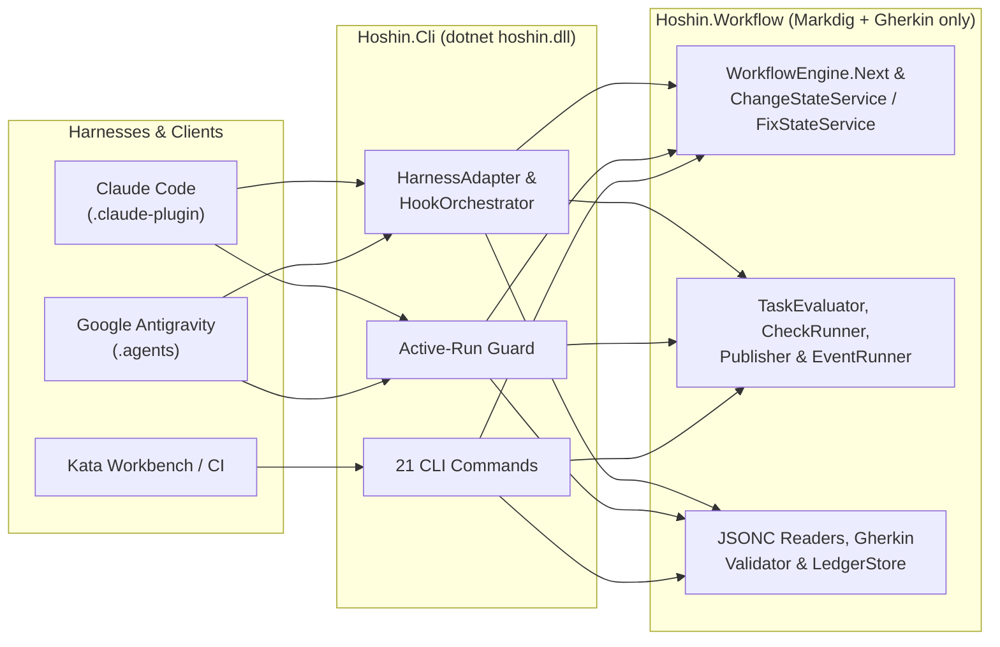
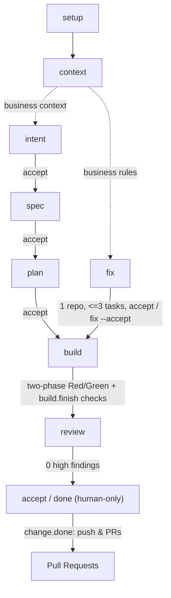

# Hoshin.Net

A deterministic **.NET 10** workflow library and portable CLI (`hoshin.dll`) that drives the Hoshin engineering workflow (**`intent` → `spec` → `plan` → `build` → `review` → `done`**) through native hooks in both **Claude Code** and **Google Antigravity**, with all structured documents in **Layout 2 JSONC**.

## How Hoshin.Net Works

Models handle judgment (interviewing, specifying, planning, writing tests and code, reviewing). **`Hoshin.Workflow` and `hoshin.dll` handle everything mechanical**: state computation (`ChangeStateService` and `FixStateService`), step ordering (`WorkflowEngine.Next`), retry caps, gating (`WorkflowGate`), detached-worktree Red/Green verification (`RedClassifier`), two-phase atomic commits, base-branch lifecycle events (`EventRunner`: `change.start`, `build.start`, `task.done`, `build.finish`, `review.finish`, `change.done`), session-scoped guard enforcement, and PR publishing.



### Workflow Lifecycle



- **No YAML in documents:** Front matter is a fenced ```` ```jsonc ```` block on line 1 (bare line-1 JSONC written during authoring is auto-wrapped before commit); plan tasks, build logs, and review findings use ```` ```jsonc ```` blocks; change records use `change.jsonc`.
- **Verified Red/Green commits:** Agents edit only the working tree (`hoshin guard` applies strictly during an active hoshin run for the calling session, blocking premature production edits and manual `git commit`/`git push`). When a task finishes, `TaskEvaluator` verifies Green on the working tree, verifies Red on a cached detached worktree containing only the task's test files (using `RedClassifier`, shared with `hoshin red record`), commits `test(<scope>): ...` followed by `<type>(<scope>): ...` with `Plan-Task` and `Generated-By: hoshin` trailers, writes a `build/<repo>.md` log entry, and fires `task.done`. Tasks with `"test": null` follow `NoTestPolicy` (no test edits; proved by `build.finish` checks).
- **Harness-neutral skills:** The 10 packaged user skills (`intent`, `spec`, `plan`, `build`, `review`, `fix`, `done`, `accept`, `setup`, `context` — replacing v1's separate `start` skill with direct change creation from `intent`/`fix` and adding human-only `accept`) plus the `implement` role live once in `skills/*/procedure.md` with zero YAML, CLI invocations, or harness tool names. Human-only `reject` and `reopen` flows are also supported via hooks.

## Solution Layout

| Path | Purpose |
| :--- | :--- |
| `src/Hoshin.Workflow` | Core library (`Markdig` + `Gherkin` only): `WorkflowEngine`, `WorkflowGate`, `TaskEvaluator`, `CheckRunner`, `Publisher`, `DocumentCommitter`, `ChangeStateService`, `FixStateService`, `EventRunner`, `LedgerStore`, JSONC/Gherkin readers & validators, embedded schemas, templates, and role procedures. |
| `src/Hoshin.Cli` | Portable CLI (`hoshin.dll`): all 21 `CLIENTS.md` commands, dual-harness `hoshin hook <start\|result\|subagent-stop\|stop>`, and active-run `hoshin guard`. |
| `skills/` | Single source of truth for all 11 harness-neutral procedures (`procedure.md`). |
| `packaging/` | Claude Code & Antigravity hook manifests and cross-platform `package.ps1` (`pwsh`) release packager. |
| `tests/Hoshin.Tests` | Unit tests, `ArchitectureTests` (SOLID & dependency gates), dual-harness hook tests, and 44 black-box CLI conformance suites. |

## Quick Start

Requires **.NET 10 SDK** (or .NET 10+ runtime for running packaged `hoshin.dll`; `RollForward=Major` is enabled), `git`, and PowerShell 7 (`pwsh`) for packaging.

```powershell
# Build solution (warnings treated as errors)
dotnet build Hoshin.sln

# Run full test suite (unit, architecture, dual-harness hooks, and all 44 black-box suites)
dotnet test tests/Hoshin.Tests/Hoshin.Tests.csproj

# Build release artifacts (portable CLI, NuGet package, Claude Code & Antigravity bundles)
pwsh -NoProfile -ExecutionPolicy Bypass -File packaging/package.ps1
```

## Known Limitations

- **Condensed skill guidance, templates, and evals (`EPIC-B`):** Skill procedures under `skills/*/procedure.md` are currently concise harness-neutral summaries. Restoring the full per-skill judgment guidance, reference templates, and an automated eval runner requires human editorial review per skill and is tracked separately as `EPIC-B` in [docs/review/TASKS.md](docs/review/TASKS.md).
- **Local plugin bundles (no published marketplace manifest yet):** `packaging/package.ps1` builds ready-to-install local bundles under `artifacts/claude-code/` and `artifacts/antigravity/.agents/`, but this repository does not yet publish a Claude Code `marketplace.json` catalog (`hoshin@hoshin`).
- **PreToolUse shell guard is a fast-path speed bump:** Regex-based shell inspection in `hoshin guard` catches common bypasses quickly, while authoritative workflow integrity is enforced inside `Hoshin.Workflow` (`WorkflowHeadGuard`, detached Red/Green verification, base-branch check loading, and human-only approval/acceptance/rejection/reopen).

## Documentation

- [DESIGN.md](DESIGN.md) — Full unified architecture, state machine, Red/Green runner, and dual-harness hook design.
- [docs/GRAMMAR.md](docs/GRAMMAR.md) — Behavioral specification for document layouts, `state`/`fix-state`, events, and refusals (with v2.0.0 JSONC deltas).
- [AGENTS.md](AGENTS.md) — Repository instructions and invariants for coding agents.
- [CLIENTS.md](CLIENTS.md) — External CLI contract for Kata Workbench and CI callers.
- [docs/KATA_MIGRATION.md](docs/KATA_MIGRATION.md) — Breaking-change migration guide for `v2.0.0` (`hoshin.ts` → `hoshin.dll`, YAML → JSONC; no upgrade command).
- [CHANGELOG.md](CHANGELOG.md) — Release notes.
