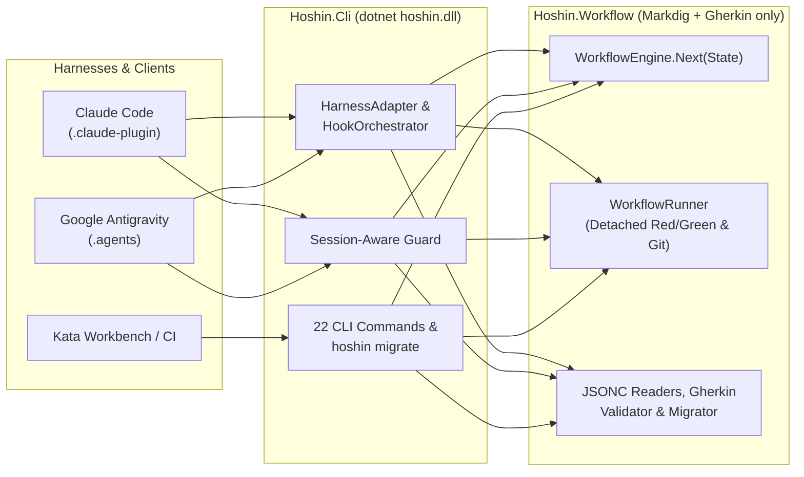
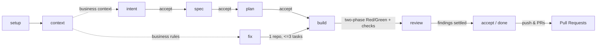

# Hoshin.Net

A deterministic **.NET 10** workflow library and portable CLI (`hoshin.dll`) that drives the Hoshin engineering workflow (**`intent` → `spec` → `plan` → `build` → `review` → `done`**) through native hooks in both **Claude Code** and **Google Antigravity**, with all structured documents in **Layout 2 JSONC**.

## How Hoshin.Net Works

Models handle judgment (interviewing, specifying, planning, writing tests and code, reviewing). **`Hoshin.Workflow` and `hoshin.dll` handle everything mechanical**: state computation, step ordering (`WorkflowEngine.Next`), retry caps, gating, detached-worktree Red/Green verification, two-phase atomic commits, `build.finish` checks, guard enforcement, and publishing.



### Workflow Lifecycle



- **No YAML in documents:** Front matter is a fenced ```` ```jsonc ```` block on line 1 (bare line-1 JSONC written during authoring is auto-wrapped before commit); plan tasks, build logs, and review findings use ```` ```jsonc ```` blocks; change records use `change.jsonc`.
- **Verified Red/Green commits:** Agents edit only the working tree (`hoshin guard` blocks premature production edits and manual `git commit`/`git push`). When a task finishes, `WorkflowRunner` verifies Green on the working tree, verifies Red on a cached detached worktree containing only the test files (accepting assertion failures and strongly-typed missing-symbol errors such as `CS0246`/`CS0103`/`CS1061`/`TS2304`, rejecting syntax errors), and atomically commits `test(<scope>): ...` followed by `<type>(<scope>): ...` with `Plan-Task` and `Generated-By: hoshin` trailers. Failed attempts commit nothing and return diagnostics as a `Retry` handoff.
- **Harness-neutral skills:** All 10 user skills (`intent`, `spec`, `plan`, `build`, `review`, `fix`, `done`, `accept`, `setup`, `context`) and the `implement` role live once in `skills/*/procedure.md` with zero YAML, CLI invocations, or harness tool names.

## Solution Layout

| Path | Purpose |
| :--- | :--- |
| `src/Hoshin.Workflow` | Core library (`Markdig` + `Gherkin` only): `WorkflowEngine.Next`, `WorkflowRunner`, JSONC/Gherkin readers & validators, `DocumentMigrator`, embedded schemas, templates, and role procedures. |
| `src/Hoshin.Cli` | Portable CLI (`hoshin.dll`): all 22 `CLIENTS.md` commands, `hoshin migrate`, dual-harness `hoshin hook <start\|result\|subagent-stop\|stop>`, and session-aware `hoshin guard`. |
| `skills/` | Single source of truth for all 11 harness-neutral procedures (`procedure.md`). |
| `packaging/` | Claude Code & Antigravity hook manifests and `package.ps1` release packager. |
| `tests/Hoshin.Tests` | Unit tests, `WorkflowEngine.Next` tests, migration exit-gate tests, dual-harness hook integration tests, and 44 black-box CLI conformance suites. |

## Quick Start

Requires **.NET 10 SDK** (or .NET 10+ runtime for running packaged `hoshin.dll`; `RollForward=Major` is enabled) and `git`.

```powershell
# Build solution
dotnet build Hoshin.sln

# Run full test suite (unit, migration, dual-harness hooks, and all 44 black-box suites)
dotnet test tests/Hoshin.Tests/Hoshin.Tests.csproj

# Build v2.0.0 release artifacts (portable CLI, NuGet package, Claude Code & Antigravity bundles)
powershell -NoProfile -ExecutionPolicy Bypass -File packaging/package.ps1
```

### Migrating Legacy YAML Repositories

```powershell
# Dry run (no files modified)
dotnet hoshin.dll migrate <path-to-repo> --dry-run --json

# Rewrite Layout 1 & Layout 2 YAML documents and change.yml to Layout 2 JSONC & change.jsonc (idempotent)
dotnet hoshin.dll migrate <path-to-repo> --json
```

## Documentation

- [DESIGN.md](DESIGN.md) — Full architecture, state machine, Red/Green runner, and dual-harness hook design.
- [AGENTS.md](AGENTS.md) — Repository instructions and invariants for coding agents.
- [CLIENTS.md](CLIENTS.md) — External CLI contract for Kata Workbench and CI callers.
- [docs/KATA_MIGRATION.md](docs/KATA_MIGRATION.md) — Breaking-change migration guide for `v2.0.0` (`hoshin.ts` → `hoshin.dll`, YAML → JSONC).
- [CHANGELOG.md](CHANGELOG.md) — Release notes.
