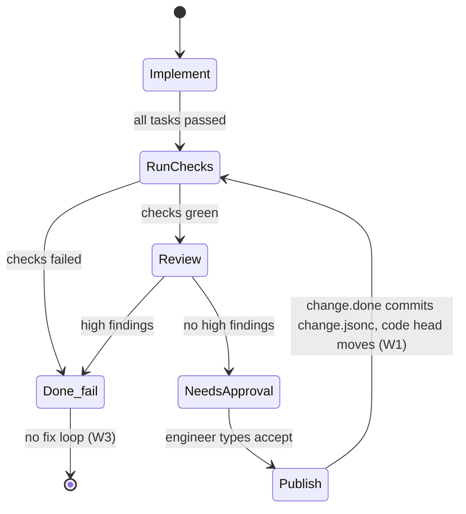

# Hoshin.Net — Code and Design Review (second pass)

**Reviewed:** `main` at `6b10f7e` ("fix(workflow)!: address review findings", 261 files, +20.8k / −6.1k lines). This is about 25k lines of C# in `src/` across three projects.
**Previous review:** the first pass, at `3e64081` (2026-11-22). Its finding IDs (S1–S10, H1–H11, E1–E13, L1–L12) are kept here, so each one can be tracked.
**Compared against:** the original plugin, `satish-krishna/hoshin` (checked out at `D:\workspaces\hoshin`). Its `tools/GRAMMAR.md` is the behavior reference; a copy now lives at [docs/GRAMMAR.md](../GRAMMAR.md).
**Date:** 2026-11-23

The companion [PRIMER.md](PRIMER.md) explains the layout and where to start reading. [TASKS.md](TASKS.md) holds the first pass's work items, all marked `done` apart from EPIC-B, and the round-2 tasks (`R00`–`R20`) that come from this review (§12.2).

---

## 1. Summary

The fix commit is substantial and mostly honest:
- The first pass's headline exploits are closed: self-approval, the guard firing in every repo, the shared ledger, whole-repo commits, and the data-losing YAML parser.
- The two systems now share one ledger type, one git layer and one Red classifier.
- The engine gates through `ChangeState`.
- CI runs on Linux and Windows, with warnings as errors, architecture tests and a changed-line coverage gate.

**It is still not ready to replace hoshin.** Of the 46 first-pass findings, 24 are fixed, 15 are partly fixed, 6 are not fixed and 1 regressed (§4). The rewrite also introduced new defects that hit the normal path, not only adversarial ones. Ranked by how soon a real user would hit them:

1. **In a workspace, a change started from the hooks can't get past its intent draft, and can't be built.** The R0 acceptance gate (§12.2) found this, after this review was first written.
   - The intent draft is written into the change's copy, but the Stop hook looks in the master's main checkout and commits nothing (W11).
   - Building a change that lives in a copy crashes the result hook, and the crash is swallowed, so the work is silently dropped (W12, W14).
   - A session started in a product repository gets "There is no change plan". Workspace detection hard-codes a master folder literally named `master`, in four copies (W4). With that bypassed, the session's result, Stop and guard hooks still look for the run in the wrong `.git` (W13).
   - A change started from the hook can resolve to a different checkout and a second ledger on the next hook (W5).
2. **The lifecycle cannot finish, or recover.**
   - A successful publish moves the code head, so `Next` goes back to `RunChecks` → `Review` → `NeedsApproval` → `Publish` forever (W1).
   - Failed checks, a review with high findings, and a declined approval are all terminal `Done(false)`, with no fix loop (W3).
   - A build that parks after three ignored Stops deletes `run.json`. From then on every Stop in that repo, from every session, is blocked as "tampering" (W2).
3. **Red can be fake, or impossible.**
   - The Red worktree never runs the task's `compile` step (E14).
   - Gitignored tools (`node node_modules/…`, `.venv/bin/…`) don't exist in the worktree, so tasks that use them can never pass Red (E15).
4. **On Windows, the guard can be skipped by choosing another tool.** The `PreToolUse` matcher doesn't include `PowerShell`, so `git push` through the PowerShell tool is never seen (S11). This review was run on Windows.
5. **There is no migration path for in-flight work.**
   - `hoshin migrate` rewrites the documents but keeps the old commit pins, so every accepted spec and plan reads as stale and must be regenerated and re-accepted (L13).
   - The hook path reads build progress from the local ledger only, not from the committed build logs, so a build can't resume on another machine or from a TS-started build (W6).
6. **The judgment layer is still missing.** The skills are 179 lines against the original's ~2,200. There are no evals and no document templates (EPIC-B, open by design).

### Scorecard

| Area | First pass | Now | One-line reason |
| :--- | :--- | :--- | :--- |
| Build & conventions | Good | Good | 0 warnings, now enforced (`TreatWarningsAsErrors`, analyzers, CA1502 at 15). |
| CLI port (System A) | Good | Good | 44 black-box suites still pass. |
| Unification (one system) | n/a | Mixed | One ledger type, git layer and classifier. But progress comes from the ledger rather than the build logs, Red runs two different ways, and workspace detection is copied four times outside `WorkspaceResolver`. |
| Workflow engine & runner | Needs work | **Poor** | The publish loop never ends, the post-build path has no fix loop, and Red is fake with `compile` and impossible with gitignored tools. |
| Security / workflow integrity | **Poor** | Needs work | Self-approval closed; guard scoped to the run. Still: a PowerShell bypass, forgeable ledger records, a movable base branch, and many regex escapes. |
| Functional parity with hoshin | **Poor** | **Poor** | Sessions work only from the master checkout. No start/triage, no review-fix loop, no evals or templates, skills still thin. |
| SOLID / design | Mixed | Mixed–Good | Real splits and real DI (0 `static Default`). The interfaces are still wide (`IGitClient` is 43 members through inheritance), and 209 direct `File.*` calls remain. |
| Enforcement (CI, arch tests) | n/a | Mixed | Real and running, but the baseline can grow in the same PR, there are three uncounted suppression channels, and the scanner has blind spots the code has already used. |
| Tests | Mixed | Mixed | 235 C# facts/theories, up from ~80. Many are weaker than their task demanded, and none drives a whole change end to end in a realistic workspace. |
| Docs accuracy | Mixed | Mixed | Most first-pass §7 rows are fixed. New false claims: "one unified system", "reject at approval", reject/reopen "supported via hooks". |

### Test run (this review)

On Windows 11 with the .NET 10.0.102 SDK and Node 24, `dotnet build` gave **0 warnings, 0 errors**, and `dotnet test` passed **407 of 407** in 31 m 52 s. CI is green on Linux and Windows for PR #5.

Green tests didn't stop any of the High findings in §1. Each one sits in a gap between what a task asked for and what its test checked (§10).

### Acceptance gate (R0)

The R0 gate, `tests/Hoshin.Tests/Acceptance/WorkspaceLifecycleAcceptanceTests.cs`, was written by the reviewer and committed as `617291d`, the first commit on `fix/round-2`. It drives the shipped `hoshin.dll` with Claude Code payloads through one whole change in a workspace whose master is `ai-sdlc`. Its three tests all fail at stage 1, because the intent draft is never committed (W11). A throwaway experiment that seeded an accepted change past authoring then hit W4, W12 and W13. Stages 4–9 of the gate (review, fix, publish, done-stays-done) have not yet run against working code.

---

## 2. Method

- I read TASKS.md, the merged diff's file list, the new engine (`Engine/*`), the hook handlers, and `HoshinServices`.
- Four parallel reviews covered:
  - the hook and guard layer;
  - the engine, the runner and the unification tasks;
  - the library layers, the migrator and the enforcement tooling;
  - feature parity against `hoshin` (GRAMMAR, skills, evals, tests) and the accuracy of the docs.
- Each reviewer re-checked every first-pass finding, then hunted for new defects. They probed the built binary and wrote scratch harnesses against the built DLLs. Their artifacts are under the session scratchpad (`hooks-review`, `engine-review`, `lib-review`, `parity-review`).
- I re-confirmed the highest-severity claims myself in the code: W1, W2, W3, W4, E14 and S11, the baseline comparison (C2), the migrator's delete (L14) and the `catch … when` evasion (C3).

Findings confirmed by running code are marked **[verified]**; findings from reading the code are marked **[code]**.

Severity: **High** breaks a core guarantee, loses data, or stops the normal workflow. **Medium** is wrong behavior in realistic cases. **Low** is an edge case or polish.

---

## 3. Architecture assessment

### 3.1 What improved

- **One ledger type.** `WorkflowLedger` is gone. Engine records live in System A's `RepoLedger` at `<git-common-dir>/hoshin/<system>/<change>/<repo>.json`, written under a cross-process `FileLock` with atomic replace (`Ledger.cs`, `Common/FileLock.cs`). A corrupt file now throws instead of being wiped.
- **One git layer.** The engine has no git argv left; it goes through `IGitClient` role interfaces (`Git/GitRoles.cs`). Git children get an allow-listed environment.
- **The engine consumes `ChangeState`.** `WorkflowStateReader` builds `WorkflowState` from `ChangeStateService`, and `WorkflowGate` refuses with `ReadinessMap`'s exact stop reasons.
- **Lifecycle events fire from the hook path** through `WorkflowEventBridge`: `change.start`, `build.start`, `task.done`, `build.finish`, `review.finish` and `change.done`.
- **The big classes were split.** `WorkflowRunner` (884 lines) is now a 101-line facade over `TaskEvaluator`, `CheckRunner`, `Publisher`, `DocumentCommitter` and friends. `HookOrchestrator` (~630 lines) is a 68-line dispatcher over `StartHandler`, `ResultHandler` and `StopHandler`.
- **`Hoshin.Migration` is a separate assembly on YamlDotNet**, so `Hoshin.Workflow` still references only Markdig and Gherkin.
- **Static singletons are gone.** `static Default` went from 41 to 0, and `?? new X()` fallbacks from 66 to 0 by the rule's own count. `TimeProvider` and `IFileSystem` exist.
- **Ordering moved into `Next`.** `ReviewDocument`, `WriteFix`, `AwaitAcceptFix`, the review gate and the light track are now engine steps.

### 3.2 The two systems: what is still split

The §3.2 table from the first pass, re-checked:

| Concern | First pass | Now |
| :--- | :--- | :--- |
| Ledger | Two stores | **One type.** But the same change can be written to two files when the system key resolves differently (`demo/…` vs `demo-scope/…`, see W5). Legacy migration in `WorkflowRepo.ReadLedger` writes outside the lock. |
| Git access | Two layers | **One.** |
| Red rule | Two rules | **One classifier, run two different ways.** The engine runs in a detached worktree without gitignored files and without `compile`. `red record` runs in place, compiles first, uses the full environment and runs in the app folder. Verified on Node ESM: the engine says valid Red, `red record` says `could-not-run`. |
| Build checks | Working tree vs base | **Base branch for both.** But the base ref is the local branch, which the agent can move (S13). `testPatterns`, `env.allow` and `maxAttempts` still come from the working-tree `.hoshin.json`. |
| Process env | Allow-listed vs full | **Regressed on the hook path.** Event hooks (`HookProcess.cs:57`) and `red record` still pass the full environment, and the hook path now runs checks through them. Verified: `ANTHROPIC_API_KEY` and `GH_TOKEN` reach `build.finish` hooks. |
| Gating | Two | **One** (`ReadinessMap`), but lost when the repo resolves as non-intent-layout (W5). |
| **Progress** (new row) | — | **Two sources.** `hoshin state` reads progress from the committed build logs; `WorkflowEngine.Next` reads it from ledger verdicts only (`WorkflowState.VerdictsForTask`). Verified: with T1 logged in `build/app.md`, `state` says T2 while `hook start build` issues T1 attempt 1 (W6). |
| **Workspace detection** (new row) | — | **Five owners.** `WorkspaceResolver`, plus four private copies of `Path.Combine(parent, "master", ".hoshin.json")` in `ChangeStarter.cs:76`, `TaskRepoResolver.cs:139`, `WorkflowEventBridge.cs:117` and `WorkflowStateReader.cs:92` (W4). |

DESIGN.md:67 now says "One unified workflow system … one domain model". That claim is premature until these last rows have one owner each.

### 3.3 Ordering

This is much better. `Next` now constructs the review, fix and accept-fix steps, and `HookOrchestrator` no longer builds steps. What remains outside the engine:
- `StartHandler` decides approval, acceptance, reject and reopen by skill name;
- `WorkflowAdvancer.cs:71,87` constructs `Done` steps itself, so DESIGN:68's "constructs zero steps" is false;
- stop counters, pending context, pending reports and dedup keys live in turn-state files.

`Next` is also no longer pure: `WorkflowBriefs` (called from `Next`) reads context files and procedure text from disk (`WorkflowBriefs.cs:160-221`). The architecture rule S2 only scans `WorkflowEngine.cs` and `RedClassifier.cs`, so it doesn't catch this.

### 3.4 The post-build path is a dead end

In the original, a failed `build.finish` check with `onFailure: fix` hands the failure back to the agent (`gateRetries`), and `build --review` fixes review findings and triggers a new review. Hoshin.Net has neither:
- The agent can't commit, and no step lets it fix.
- The engineer can't decline at approval: `StartHandler.cs:291` is the only `Answer` call, and it always approves.
- The only way out of `Done(false)` is a manual commit outside the workflow. In multi-repo changes even that doesn't help, because the code head is master-only (W3).

---

## 4. Status of first-pass findings

### 4.1 Security and integrity (S)

| ID | Status | Evidence |
| :--- | :--- | :--- |
| S1 self-approval | **Partial** | A model-sourced `accept`/`done`/`reject`/`reopen`/`fix --accept` is refused with no state change (`StartHandler.cs:92-100`), and `accept`/`done` carry `disable-model-invocation` (`package.ps1:148`). What remains: the approval record sits in an agent-writable JSON file (S12). |
| S2 guard everywhere | **Fixed** [verified] | In a plain `git init` repo, `git push`, `gh pr create` and an Edit of `.hoshin.json` print nothing, and no `.git/hoshin` is created. |
| S3 trivial bypasses | **Partial** [verified] | The four original bypasses, plus `command`, `env`, `sh -c`, `;`, `&&` and tab, are denied. Still allowed: `"git" push`, `git "push"`, `git.exe push`, `GIT push`, `git p\ush`, `$(echo git) push`, `echo push \| xargs git`, `gh "pr" create`, `gh api … -f k=v`, `gh api --method=POST`, `git commit -nm x`, `1>.hoshin.json`, `&>`, `dd of=`, Python `open()`. There is no library-side check for a push (`WorkflowHeadGuard` covers commits only). |
| S4 harness config | **Partial** [verified] | `> .claude/settings.local.json`, `~/.claude/settings.json`, and `sed -i`/`cp`/`node` writes are denied. Still allowed: `1>`/`&>` redirects, `cd .claude; echo … > settings.local.json`, `dd of=.git/hooks/pre-commit`, and Write to `.git/config` outside the build step. |
| S5 delete guard state | **Partial** [verified] | The two original commands are denied. Still allowed: `D=.gi; cd ${D}t/hosh*; rm -f r*`, `find .git -name 'run.*' -delete`, `unlink`, base64-encoded paths. The Stop-time tampering check is easy to sidestep and misfires on the normal path (W2, S14). |
| S6 checks from working tree | **Partial** | Checks come from the base ref, but the ref is the local branch, which the agent may move (S13). |
| S7 step rules edit-only | **Partial** [verified] | `>`, `>>` and `tee` targets get the red-phase and change-folder rules. `cp`, `sed -i`, `dd`, `node -e`, `&>` and `>\|` into `src/prod.mjs` are allowed. The library still catches change-folder edits at judging time. |
| S8 session isolation | **Fixed** [verified] | Session `s2`'s Stop, Result (even with the right nonce) and SubagentStop return nothing; a missing `session_id` is not in the run. The exception is the tampering Stop path (W2). |
| S9 full env to hooks | **Partial; regressed on the hook path** [verified] | Git and task tests are scrubbed. `HookProcess.cs:57` and `RedRecorder.cs:137,153` still pass the full environment, and checks now run through hooks. |
| S10 fails open on bad input | **Not fixed** [verified] | Malformed JSON or a numeric `tool_response.status` → stderr, exit 0, call allowed. A corrupt `run.json` fails open the same way. Neither is documented or tested. |

### 4.2 Engine and runner (E)

| ID | Status | Evidence |
| :--- | :--- | :--- |
| E1 cross-change verdicts | **Fixed** | Keyed by `<system>/<change>/<repo>`; locked read-modify-write. Caveat: the coordinates depend on how the path resolves (W5). |
| E2 unrelated files committed | **Partial** [verified] | Pre-existing untracked files, untouched dirty files, renames, deletions and quoted names are handled; a staged index is refused. Still wrong: E16, E17, and files created between attempts (E21). |
| E3 double judging | **Fixed** | `run.lock` is held across evaluate-and-commit, and the ledger is re-read inside it (`TaskEvaluator.cs:94-99`). The `Advance` after it is not serialized (E21). |
| E4 Red classifier | **Partial** [verified] | Exit 126/127, bare-module, and Go/Rust/Java syntax cases are fixed. New errors are in E19. |
| E5 test-path heuristic | **Fixed** (scope of T15) | Glob, `../` and csproj handling are fixed. The default patterns are too narrow (E18). |
| E6 relative argv[0] | **Fixed**, with a side effect | `ProcessExecutable.Resolve` is used in both runners. In the Red worktree it now resolves to files that don't exist there (E15). |
| E7 env strips push needs | **Partial** [verified] | Proxy, CA, toolchain and push variables are kept, and push errors are surfaced. Git loses `XDG_CONFIG_HOME`, and loses `SSH_AUTH_SOCK` on non-push commands (E20). |
| E8 publish safeguards | **Partial** | `change/<change>` default, PR open/reuse, review gate in `Next`, upstream remote. Broken: W1, W3, and the standalone review re-record (E21). |
| E9 change folder guessed | **Fixed** | No sort-order guess; with several open changes it asks. |
| E10 hard-coded limits | **Fixed** | Per-task `timeout`, and `build.{testTimeoutSeconds,checkTimeoutSeconds,maxAttempts}`. The packaged 900 s hook timeout still caps the whole evaluation (W7). |
| E11 partial rollback | **Fixed** | `ResetMixed` on any failure after staging. A failed build-log commit is ignored. |
| E12 porcelain, deleted tests | **Partial** | `-z` parsing works. A deleted test file still counts as "a test was written". |
| E13 duplicated rules | **Fixed** | The procedure is embedded; `IntentReader.RequiredHeadings`, `ProtectedPaths` and `HarnessTools` have one owner each. |

### 4.3 Hook orchestration (H)

| ID | Status | Evidence |
| :--- | :--- | :--- |
| H1 can't start a change | **Fixed** | `StartChangeFromHookTests`. Caveat: any argument that doesn't match an open change starts a new one, so `/hoshin:intent resume` creates a change named "resume" (H12). |
| H2 setup/context take over | **Fixed** | The early return (`StartHandler.cs:33-37`) comes before `StartRun`. |
| H3 any Agent judged | **Fixed** | Judged only with the dispatch nonce. Fails open when the step has no nonce stored (`ResultHandler.cs:93-95`). |
| H4 concurrent launch | **Not fixed** | Still no `PreToolUse` matcher for `Agent`. DESIGN.md:210 still says the hook "refuses conflicting concurrent launches". |
| H5 async reports lost | **Fixed** | SubagentStop queues a report; the parent's Stop blocks once with it. `pending-report.txt` isn't cleared when a new run starts. |
| H6 interview stop counter | **Fixed** | Per-purpose counters, reset on a new user turn; a reply ending in a question is let through. |
| H7 truncation | **Fixed** | `TextTruncator` keeps the closing marker and the nonce, and cuts on text-element boundaries. |
| H8 state in foreign repos | **Fixed** [verified] | Nothing is written outside a run; static denials are logged. `hooks.jsonl` is still unbounded during a run. |
| H9 Antigravity queued context | **Not fixed** | Pending context is still drained before a typed command is handled (`StartHandler.cs:44-47`). |
| H10 Antigravity manifest | **Not fixed** | Still `./lib/hoshin.dll` and mixed shapes. DESIGN.md:287 now calls this intentional, but it remains unverified against an Antigravity schema. |
| H11 hook timeout half-commit | **Regressed** | See W7. A kill between the two commits now fails every remaining attempt. |

### 4.4 Library (L)

| ID | Status | Evidence |
| :--- | :--- | :--- |
| L1 migrate drops data | **Partial** [verified] | YamlDotNet handles the dropped constructs. T10's "parse the output back before deleting the source" was not built (L14). |
| L2 quote hides comment | **Fixed** [verified] | |
| L3 flow collections, unsupported YAML | **Fixed**, one gap [verified] | Tags other than `!!str` are silently ignored rather than refused. |
| L4 `Jsonc.TryParse` blank | **Fixed** [verified] | A string starting with a BOM still fails; file reads strip it, so the impact is low. |
| L5 `FrontMatterEdit.Set` | **Fixed** [verified] | Null, number, missing key, key named in a comment, nested same name, `}`/`//` inside strings, CRLF and BOM all work, and the write is atomic. Residue: with duplicate keys (which the old bug created) it edits the first while readers take the last. |
| L6 process timeouts | **Fixed** [verified] | 1 s timeout with 1 MB of stdin returns in 1.1 s; a background grandchild no longer holds the call; the tree kill works. |
| L7 ledger wipe, no lock | **Fixed** [verified] | 4 processes × 60 updates gave 240 of 240 entries. |
| L8 SpecReader fence choice | **Partial; partly regressed** [verified] | It uses `Doc.Fences`, but takes the first `gherkin` fence anywhere, not the first top-level one, so a list-item or blockquote example becomes the spec. A new `earlyClose` scan (`SpecReader.cs:76-84`) cuts the block at an indented backtick docstring, so the reader and the migrator disagree again. |
| L9 hook-script export encoding | **Not fixed** [verified] | Latin-1 bytes are exported as U+FFFD; symlinks are written as text; `ls-tree` runs without `-z`. No task covered it. |
| L10 `RealPath` | **Not fixed** [verified] | `RealPath(link/sub)` is returned unchanged. No task covered it. |
| L11 `$` and schema keywords | **Fixed** [verified] | `allOf`, `not` and `maxLength` are still silently ignored; today's schemas don't use them. |
| L12 small reader issues | **Partial** [verified] | `## Review 99999999999` and "Scenario Template" are fixed. A schema-invalid but parseable `change.jsonc` still silently falls back to `change/<folder>`. |

---

## 5. New findings — workflow lifecycle (W)

| ID | Severity | Finding | Where |
| :--- | :--- | :--- | :--- |
| W1 | **High** | **A successful workspace publish never reaches `Done`.** See below. **[verified]** | `Publisher.cs:34`, `ChangeDoneStep.cs:235-240`, `WorkflowEngine.cs:158` |
| W2 | **High** | **After a build parks, every Stop in the repo is blocked as "tampering", forever.** See below. **[verified]** | `StopHandler.cs:129-133`, `GuardTamperingProtection.cs:105-156` |
| W3 | **High** | **There is no fix loop after the build.** See below. **[code]** | `WorkflowEngine.cs:NextPostBuild`, `StartHandler.cs:291` |
| W4 | **High** | **Hooks only work in a session started in the master checkout.** See below. **[verified]** | `ChangeStarter.cs:76`, `TaskRepoResolver.cs:139`, `WorkflowEventBridge.cs:117`, `WorkflowStateReader.cs:92`, `ResultHandler.cs:22`, `StopHandler.cs:24` |
| W5 | **High** | **A change started from the hook resolves differently on the next hook.** See below. **[verified resolution; full flow from code]** | `ChangeLedgerPaths.cs:174-182`, `ChangeStarter` |
| W6 | **High** | **The hook path reads progress from the local ledger, not the committed build logs.** See below. **[verified]** | `WorkflowState.cs:28` (`VerdictsForTask`) vs `ChangeState` |
| W7 | Medium-High | **One commit the workflow didn't make, or a hook killed mid-commit, burns every remaining attempt.** See below. **[verified]** | `TaskEvaluator.cs:193,265`, `WorkflowHeadGuard` |
| W8 | Medium | **A `build.start` refusal is ignored, and the task is issued anyway.** A dirty repo, a wrong branch, or a branch checked out elsewhere is recorded as a failed baseline. The task then commits on whatever branch is checked out, possibly `main`. A `task.done` failure is dropped the same way. **[code]** | `WorkflowAdvancer.cs:100`, `TaskEvaluator.cs:137` |
| W9 | Medium | **Multi-repo resolution falls back silently.** A task whose repository isn't checked out runs in the master repo. A single-repo app's task runs at the repository root, not in the app folder (GRAMMAR forbids this). **[code]** | `TaskRepoResolver.cs:65-93` |
| W11 | **High** | **Authoring a change in a workspace commits nothing.** See below. **[verified by the R0 gate, with the master named `ai-sdlc` and `master`]** | `StartChangeResolver.TryStartNewChange`, `StopHandler.Handle`, `WorkflowAdvancer.ResolveRepo` |
| W12 | **High** | **Building a change that lives in a copy crashes the result hook.** See below. **[verified: stack trace]** | `WorkflowAdvancer.JudgeAndAdvance`, `TaskEvaluator.EvaluateAndCommitTask` |
| W13 | **High** | **In a product-repository session, the result, Stop and guard hooks see no run.** See below. **[verified: result and Stop silent; guard from code]** | `WorkflowRepo.Find`, `ResultHandler`, `StopHandler`, `GuardCommand` |
| W14 | Medium-High | **Every hook exception is swallowed.** `HookCommand.RunAsync` catches `Exception`, writes one stderr line, writes no trace and exits 0 with empty output. Neither the model nor the engineer is told, and `hooks.jsonl` shows nothing. W12 was invisible because of this. **[verified]** | `HookCommand.cs:65` |
| W10 | Low | **Turn-state edge cases.** A named new change (`/hoshin:intent <new>`) is ignored while another run is pinned (`StartChangeResolver.cs:38-46`). A concurrent Stop and SubagentStop both run `Advance`, so `build.finish` can run twice. `run.lock` is held for up to about 20 minutes and blocks the turn-state writes of hooks that have a 120 s timeout. **[code]** | `StartChangeResolver.cs`, `WorkflowAdvancer`, `TurnState` |

**W1 — a successful publish never reaches `Done`.**
- `Publisher` records the published head as the pre-publish code head.
- `change.done` then commits `change.jsonc` (its `pushed`/PR record), which moves the code head.
- `Next` finds no checks at the new code head, so it returns `RunChecks`, then `Review`, then `NeedsApproval` again.
- Verified with a probe: `Next` after a successful publish returned `RunChecks`, and `hook start build` returned `Review`.

No test asserts `Next` after a workspace publish.

**W2 — a parked build blocks every Stop as "tampering".**
- When the build counter passes `MaxStopBlocks`, the build parks and `StopHandler` deletes `run.json`.
- The next Stop from any session reaches the T03 tampering check. That check sees a ledger with an unfinished run and no `run.json`, and returns `decision: block`. It checks neither the session nor `stop_hook_active`.
- Every session in that repo is now stuck in a Stop block it can't get past, while the guard is fully off because `run.json` is gone.
- Reproduced: `/hoshin:build`, then 4 chained Stops gave "parked". A new-turn Stop from `s2` then got `{"decision":"block","reason":"Hoshin run state tampering detected…"}`.

**W3 — no fix loop after the build.** `NextPostBuild` returns `Done(false)` for:
- failed checks at the code head;
- a review with any high finding;
- a recorded rejection, which nothing can write, since `StartHandler.cs:291` is the only `Answer` call and always approves.

The agent can't commit, and the engine has no step that lets it fix. The original handles both cases:
- a failed check with `onFailure: fix` goes back to the agent, bounded by `gateRetries`;
- `build --review` fixes the findings and triggers a new review.

In a multi-repo change, even a manual fix in an app repository doesn't move the master-only code head, so the change stays `Done(false)`. Reviews with high findings are normal, so this is the common case, not an edge case.

**W4 — hooks only work from the master checkout.**
- `WorkflowStateReader.HasWorkspaceMarker` and three private copies of it look for `.hoshin.json` in the repo root, or in `<parent>/master/.hoshin.json`.
- A session started in a product repository gets "There is no change plan in this repository", even for `/hoshin:intent`. A session started in the workspace folder gets no output at all.
- Any workspace whose master folder isn't literally named `master` only works from the master itself. That includes the reviewer's own layout, where the master is `ai-sdlc`.

The original runs `build` from inside each product repository, and the workspace template that `setup` writes still says to (`Workspace/Templates/workspace.md:33`).

**W5 — a hook-started change resolves differently on the next hook.** `ChangeLedgerPaths.ResolveSystemAndChange` uses `scope` as the system key when the change folder isn't under `<root>/intent`.
- From the master checkout, the ledger becomes `demo-scope/<change>/master`, while the start handler wrote `demo/…`.
- `IsWorkspaceRepo` is then false, so no events fire, no `ChangeState` gating applies, and no build logs are written.
- From the workspace root, no run is found at all.

This depends on which `cwd` the harness reports; it was not confirmed in a live Claude Code session.

**W6 — progress comes from the local ledger only.** `WorkflowState.VerdictsForTask` reads only ledger verdicts. Verified: with T1 logged in `build/app.md`, `hoshin state` says the next task is T2, while `hook start build` issues "build task T1, attempt 1 of 3". This breaks:
- a build that continues on another machine;
- a build that continues from a fresh clone;
- a build that continues from the TypeScript plugin.

From the code, I expect each already-built task to then fail three times with "missing test or production changes".

**W7 — one stray commit burns all attempts.** The task's start HEAD stays the first attempt's (`TaskEvaluator.cs:193`). `ValidatePreConditions` records "HEAD moved outside the workflow" without resetting HEAD, and the guard denies `git reset` to the agent. Reproduced: one manual `git commit`, then attempts 1, 2 and 3 all fail, ending in `Done`. The same happens when the harness kills a hook (900 s) between the library's own test commit and its production commit: the library's half-commit is blamed on the agent.

W11–W14 were found by the R0 acceptance gate (§12.2), not by reading the code. All four are seams between A6 (multi-repo builds) and A7 (start a change from `hook start`): each task's tests pass on their own, and no test ran one after the other.

**W11 — authoring in a workspace commits nothing.**
- `/hoshin:intent <name>` from the master runs `change.start`, which creates the change in a copy, a worktree at `<workspace>/.hoshin/copies/<change>`. `hook start` then re-roots the run onto the copy (`repo = _advancer.ResolveRepoAt(started.CopyRoot!, …)`), and the brief says "Write it to `intent/<system>/<change>/intent.md` in `<copy>`".
- `hook stop` resolves the repository from the session's `cwd` (`_advancer.ResolveRepo(ev)`), which is the master's main checkout. It never sees the draft in the copy, stays silent, and commits nothing.
- The gate wrote the intent exactly where the brief said. The draft stayed uncommitted with the master named `ai-sdlc` and with it named `master`, so this is not W4.
- Every change started from the hooks takes this path, so in a workspace no change can get past its intent draft.

**W12 — building a change in a copy crashes the result hook.**
- Seeding an accepted change into a copy with `hoshin change start` and direct commits, then running `/hoshin:build` from the master session, dispatches T1 correctly.
- When the subagent returns, `ResultHandler` calls `JudgeAndAdvance`, which does `ReadState(repo, rolesRoot, out _)!`. For a run resolved from the master's main checkout against a change folder in the copy, `ReadState` returns null, and `TaskEvaluator.EvaluateAndCommitTask` throws `NullReferenceException` on `state.Plan`.
- W14 swallows the exception: the subagent's work is never judged or committed, and nothing tells anyone. The next Stop is silent too.
- `MultiRepoBuildTests` misses this because its fixture puts the change folder in the master's main checkout and passes it explicitly, a layout `change.start` never produces.

**W13 — product-repository sessions see no run.**
- When `/hoshin:build` is typed in a product repository (with W4 bypassed by naming the master `master`), `hook start` resolves the open change through the master's copy, and writes `run.json` and `step.json` into the master's `.git/hoshin/`.
- The result, Stop and guard hooks of the same session resolve `WorkflowRepo.Find(cwd)` in the product repository and look in *its* `.git/hoshin/`, where there is no run. The subagent's result is ignored, Stop is silent, and from the code the guard is off for that session's whole build.
- So fixing W4's name check alone leaves product-repository builds unjudged and unguarded. The run's location has to be found from the workspace, not from `cwd`'s own `.git`.

---

## 6. New findings — security (S, continued)

| ID | Severity | Finding | Where |
| :--- | :--- | :--- | :--- |
| S11 | **High** | **The PowerShell tool bypasses the guard entirely.** The Claude Code matcher is `Bash\|Edit\|Write\|MultiEdit\|NotebookEdit`, and `HarnessTools.ClaudeShellTools` is only `Bash`. On Windows the model can push, commit, or rewrite settings and state through `PowerShell` with no check. MCP tools (`mcp__github__push_files`, …) are also unguarded. **[verified]**: `tool_name: PowerShell` with `git push origin main` during an active run was allowed. | `packaging/claude-code/hooks/hooks.json:16`, `HarnessTools.cs:6` |
| S12 | Medium | **Approvals, reviews and verdicts sit in an agent-writable JSON file**, guarded only by the regex. A forged `workflowApprovals` entry leads to `Publish` on the next Stop. The guard allows `python -c "open('.git/hoshin/…','w')"`, `pwsh -c "[IO.File]::WriteAllText(...)"`, `jq … \| sponge` and an obfuscated `node -e`. Nothing authenticates these records. **[guard allowance verified; effect from code]** | `.git/hoshin/<sys>/<change>/<repo>.json` |
| S13 | Medium | **The base-ref fix for S6 can be undone by moving the local base branch.** `BaseBranchChecksReader` reads `git show main:…`. During `Implement` the guard allows `git branch -f main HEAD~5`, `git fetch origin x:main` and `git replace`. None of these moves HEAD, so `WorkflowHeadGuard` doesn't notice. **[guard allowance verified]** | `BaseBranchChecksReader.cs:18`, `GuardCommand.cs:60-62` |
| S14 | Medium | **The tampering check is easy to sidestep.** Rewriting `run.json` with another `sessionId`, or aging `step.json` past 24 h, silently turns off both the guard and Stop **[verified]**. A corrupt `run.json` makes the guard throw and allow **[verified]**. With two or more change folders, deleting `run.json` makes `ChangeFolderResolver` fall back to a nonexistent `.hoshin` folder, so nothing is detected **[code]**. | `GuardTamperingProtection.cs`, `ChangeFolderResolver.cs:92` |
| S15 | Medium | **The guard scopes by the payload's `cwd`, not by the target.** With `cwd` outside the repo, `git -C <repo> push` and a Write to `<repo>/.git/hoshin/run.json` are allowed. **[verified]** The impact depends on what the harness reports as `cwd`. | `GuardCommand.cs:115-120` |
| S16 | Low-Medium | **Another session can take over a run during document, review and fix steps.** `IsBlockedByOtherActiveBuild` only covers `Implement`, `Retry` and `NeedsApproval`. **[code]** | `StartHandler.cs:57-69` |
| S17 | Low | **The build-step git rule misses `switch`, `branch -f`, `update-ref`, `tag`, `notes` and `replace`.** After `git switch -c other`, HEAD's commit hash is unchanged, so the verdict commits land on the wrong branch. **[guard allowance verified]** | `GuardCommand.cs:60-62` |
| S18 | Medium | **False denials of ordinary work.** See below. **[verified]** | `ShellWriteTargets.cs:8`, `GuardTamperingProtection.cs:29-30`, `GuardCommand.cs:56` |

**S18 — false denials of ordinary work.** All of these were denied:
- **During red phase:** `npm test > out.log 2>&1`, `dotnet build 2> build.log`, `echo x > /tmp/scratch.txt` and `echo "a > b"`. The redirect regex ignores quotes.
- **In any step of a run:** `grep hoshin README.md > out.txt`, `echo … > hoshin.md`, `echo x > src/hoshin/util.js`, `cp config/run.json dist/run.json` and `ls .git > files.txt`.
- **Always:** `git commit -m "fix -n"`.

Writing `hoshin.md` through the Write tool is allowed, so the shell and tool paths disagree.

**The lesson from S3–S5, S11–S15 and S18:** the regex guard is now wide enough to deny legitimate work, yet it still has holes. That is the expected end state of shell-text matching. The durable fix is the one the first pass recommended: the library refuses what it can verify. That means:
- HEAD and branch identity at judging time;
- the remote branch matching the ledger at publish time;
- base ref resolution to the remote-tracking branch, or to a SHA pinned in `change.jsonc`;
- authenticated or reconstructed approval records (for example, approval written only by a user-typed hook event, and cross-checked against `hooks.jsonl` or a commit trailer).

Treat the guard as a speed bump, and keep it narrow enough not to block real work.

---

## 7. New findings — engine and runner (E, continued)

| ID | Severity | Finding | Where |
| :--- | :--- | :--- | :--- |
| E14 | **High** | **Red never runs the task's `compile` step.** `RedWorktree.ObserveRed` runs only the test command. A test that needs build output first (for example, `dotnet test --no-build` after `compile: dotnet build`) produces a failure that is classified as valid Red, even when the test would already pass. **[verified]** | `RedWorktree.cs:31`, `TaskVerdictPolicy.cs:119-130` |
| E15 | **High** | **Gitignored tools don't exist in the detached Red worktree.** GRAMMAR's recommended form `node node_modules/vitest/vitest.mjs …`, and `.venv/bin/…`, resolve under `.git/hoshin/worktrees/red-check/` (after the E6 fix) and classify as `CouldNotRun`. Such tasks can never pass. This corrects the first pass, which checked module *resolution* from the worktree, not an executable path in argv. **[verified]** | `RedWorktree.cs`, `ProcessExecutable.Resolve` |
| E16 | Medium | **Green is checked in the dirty working tree, not on a clean HEAD.** New code imported a pre-existing untracked `helper.mjs`, which was correctly left out of the commit. The verdict passed, but a clean checkout of HEAD fails with `ERR_MODULE_NOT_FOUND`. **[verified]** | `TaskVerdictPolicy.cs:220` |
| E17 | Medium | **The engineer's uncommitted work is committed by the task.** A file that was dirty before the task was issued, and that the task then also edits, is committed whole in `feat(...)`, including the engineer's changes. **[verified]** | `WorkingTreeSnapshot.cs:60-66` |
| E18 | Medium | **The default test patterns miss co-located tests.** `greet/greet_test.go`, `app/test_greet.py`, `src/x.spec.ts` and `__tests__/` are classified as production code. `go test ./greet -run X` and pytest node-ids extract no test files. Those tasks fail with "no test file" every time, unless `testPatterns` is configured. **[verified]** | `WorkflowContracts.cs:46-47` |
| E19 | Medium | **The Red classifier misfires.** `\berror:\s*expected\b` rejects an ordinary JS `Error: expected 3 got 2` assertion as a syntax error. Rust `E0432` (unresolved import, the usual case for an integration test) counts as a syntax error. Exits 137 and 139 and an access violation count as valid Red. A missing pytest dependency counts as valid Red. **[verified]** | `RedClassifier.cs:36` |
| E20 | Medium | **The git environment drops `XDG_CONFIG_HOME`, and drops `SSH_AUTH_SOCK` on commands other than push.** Users whose identity or signing config lives in XDG config, or who sign commits through an SSH agent, will have the library's commits fail. **[env verified; failure inferred]** | `GitClient.cs:77-104` |
| E21 | Low | **Smaller runner issues** **[mixed]**:  – `PreIssuePaths` is frozen at attempt 1, so files created between attempts are committed.  – Standalone `CommitReview` doesn't check that a new review was appended, so touching `review.md` re-records the old clean review at the new code head.  – Engine `reds` ledger entries are fabricated (exit code 1, the summary as output), and `red show` reports them.  – A deleted test file counts as a written test.  – Only a task with no test is supported, not a task that only adds a protecting test (the other half of D5). | `TaskEvaluator.cs:195,316-327`, `DocumentCommitter.cs:105-111` |

---

## 8. New findings — library and migration (L, continued)

| ID | Severity | Finding | Where |
| :--- | :--- | :--- | :--- |
| L13 | **High** | **`hoshin migrate` breaks every accepted spec and plan in flight.** It rewrites the documents but keeps `source_intent_commit` and `source_spec_commit`. Those pins point at a version of the upstream document that no longer matches HEAD. Reproduced: the spec pin was `holds` before migration and `broken` after, and the engine then asks for the spec to be rewritten and re-accepted. Neither README nor KATA_MIGRATION mentions it. **[verified]** | `Hoshin.Migration`, `ChangeState.cs:202` |
| L14 | Medium | **Migrate deletes the source without checking the output.** `DocumentMigrator` writes `change.jsonc`, then deletes `change.yml` with no read-back, no comparison and no atomic write. A partial write leaves a broken `change.jsonc`, and every later run refuses with "both exist". Markdown documents are rewritten in place the same way. **[code; symptom verified]** | `DocumentMigrator.cs:130,184-188` |
| L15 | Medium | **Keys that are always written as strings turn null and booleans into text.** `source_intent_commit: null` in a migrated `spec.md` becomes `"null"`, which is a pin that isn't a SHA. The same applies to `red`, `base`, `pushed` and `commit`, recursively. **[verified]** | `YamlScalarFormatter.cs:35` |
| L16 | Medium | **A hex overflow crashes `migrate` partway through a run.** `0xFFFFFFFFFFFFFFFFFF` throws an uncaught `OverflowException`. With changes a, b and c: a was migrated and its `change.yml` deleted, b crashed with exit 2, c was never processed, and no report was printed. **[verified]** | `YamlScalarFormatter.cs:72,78`, `DocumentMigrator.cs:133-177` |
| L17 | Medium | **On Windows, atomic replace fails while anything reads the file without the lock.** With 2 unlocked readers and 2 writers, about 99% of writes failed with `UnauthorizedAccessException`, and the readers saw sharing violations. Hooks read the ledger, `run.json` and `step.json` without the lock on every tool call, and parallel tool calls fire hooks concurrently. There is no retry. **[verified]** | `Common/FileSystem.cs:47-48` |
| L18 | Low | **Smaller issues:**  – `migrate <path>` writes by default unless `--dry-run` is given.  – Tags other than `!!str`, and duplicate keys that differ only in spelling (`~`/`null`, `1`/`01`), are not refused.  – Emitter warnings never reach the user.  – `LedgerStore.Update` locks `<repo>.json` but writes `<ledger.Repo>.json`.  – A shape-invalid ledger crashes with `ArgumentNullException`.  – About 10 path comparisons ignore macOS case-insensitivity. | various |

**Differential test of the migrator against `yaml.mjs`.** I ran 46 samples: 30 match, 5 are refused by both parsers, 2 are refused by .NET only, and **9 mismatch**:
- explicit tags (`!!int "42"`, `!!bool "true"`, …);
- integers past 64 bits;
- `.nan`, `-.inf` and `1e400`;
- duplicate keys that differ only in spelling;
- comment-only input.

None of these is likely in real `change.yml` files, so L13–L16 matter more.

`YamlDifferentialTests` is weaker than T11 required. CI never checks out the sibling `hoshin` repository, so the comparison with `yaml.mjs` is skipped silently (`YamlDifferentialTests.cs:87,105`). In CI it is just a hand-written golden test. It never compares refusals, and `Assert.ThrowsAny<Exception>` would accept a `NullReferenceException` as a refusal.

---

## 9. Functional parity with hoshin

The rows are re-checked on the **hook path the packaged skills use**, not only through the CLI.

| Area | hoshin | Hoshin.Net now | Gap |
| :--- | :--- | :--- | :--- |
| CLI commands | 22 | 22, plus `hook` | None |
| Document format | YAML, layouts 1 and 2 | JSONC layout 2; `migrate` breaks pins (L13) | Medium |
| Where sessions run | master, workspace, or each product repo | the master checkout only (W4) | **High** |
| Skill gating | `state`/`ready` | `WorkflowGate` over `ReadinessMap` | Low |
| Lifecycle events | all events, with `onFailure: fix` and `gateRetries` | the six events fire. `doc.accept` never fires. `build.start` and `task.done` outcomes are ignored (W8). There is no `onFailure` | Medium |
| Multi-repo | one build per repo | scheduled builds work from a master session only. Falls back silently to master (W9). The code head is master-only (W3) | Medium |
| Build logs | an entry per task; progress read from logs | entries are written (no departures or notes); progress is read from the ledger (W6) | **High** |
| Review-fix loop | `build --review` | none (W3) | **High** |
| done / change.done | review gate, push every repo, PRs | the gate is in `Next`; `ChangeDoneStep` pushes and opens PRs. Only the master PR URL is reported, and publish never finishes (W1). The engineer can't reject at approval | **High** |
| Baseline judging | yes | in workspaces, through `build.start`/`build.finish`; none in standalone repos | Low |
| Tasks without a test | allowed | allowed (`test: null`) | None |
| Reject / reopen / superseded / `fix --accept` | supported | superseded and `fix --accept` work. Reject and reopen have handlers but no packaged skill, so Claude Code users can't reach them (H13). `intent --reject` and `fix --reject` aren't parsed | Medium |
| Start / triage | `start` skill | removed | **High** |
| Skills | 10 skills, ~2,200 lines | 11 procedures, 179 lines, 5-line wrappers | **High** (EPIC-B) |
| Templates | intent, spec, plan, context, policies | workspace templates only, and those are stale (they mention `start` and building "from inside each repository") | **High** |
| Evals | 56 cases plus grader tests | none | **High** |
| Black-box tests | 52 files, 612 cases | 44 files, 526 cases, none skipped. Missing: apps, check-events, check-read, coverage-ignore, diff-coverage, events-single-repo, single-repo-marker, system-read (some were rewritten as C#) | Medium |
| CI and marketplace | workflows, `marketplace.json`, tag v1.1.0 | CI green on Linux and Windows; no `marketplace.json`, no tags or releases. The plugin is also named `hoshin`, so it can't be installed next to the original | Medium |

**Skill guidance still missing** (unchanged since the first pass apart from small edits):
- **Intent:** the seven-question cap, writing each section as it settles (the procedure now says the opposite), read-back, `intent unknown`/`seen in code` triage, `context:` front matter.
- **Start/triage:** gone.
- **Spec:** policy skills, `policies_applied`/`policies_not_checked`, the Design section, stable IDs.
- **Plan:** `.cmd` shims, `compile`, the `## Checks at build finish` section, recording engineer direction.
- **Review:** per-repository and cross-repository reviewers, red-verdict findings.
- **Done:** promises every PR URL, but only master's is produced.
- `WorkflowBriefs` carries format skeletons only. Its review brief says "Start a new file on line 1"; the review procedure says to append.

**What Hoshin.Net does that the original doesn't.** This is the case for finishing it rather than abandoning it:
- the library makes the commits;
- Red is verified in a separate worktree;
- moved HEADs are caught;
- approval is human-only;
- the guard is scoped to the run;
- tests and git run with secrets stripped;
- the review gate lives in the engine;
- Antigravity is supported;
- a NuGet library ships;
- there is no Node dependency;
- `test: null` tasks are allowed;
- attempt caps and timeouts are configurable;
- CI runs architecture rules and a coverage gate.

---

## 10. Engineering practices and tests

### 10.1 Enforcement tooling

The enforcement is real: CA1502 at 15 fires, the coverage gate runs `dotnet-coverage` plus `diff-cover --fail-under=90`, and the CI matrix is green. The baseline went from 429 entries to 83. But it can be gamed, and the code already has:

| ID | Severity | Finding |
| :--- | :--- | :--- |
| C1 | Medium | **Three suppression channels the baseline never counts.** See below. |
| C2 | Medium | **"Shrink-only" isn't enforced.** See below. |
| C3 | Medium | **The scanners have blind spots, and the code has already used them.** See below. |
| C4 | Low-Medium | **The coverage gate is weaker than it looks.** The 90% is an aggregate across changed files, so individual files at 77–85% pass. 14 of the 44 black-box suites run with `bareEnv` (`workspace.mjs:40`), which drops the profiler variables, so those child processes record no coverage. Formatting is never verified (`dotnet format --verify-no-changes`), although CONTRIBUTING marks it as CI-checked. |

**C1 — three suppression channels the baseline never counts.**
- The 6 `CA1822` suppressions have no baseline entries.
- `.editorconfig` `severity = none` lines (CA1716 and CA1720 are off repo-wide) are invisible to the test.
- The CA1502 counter only recognizes the one-line `SuppressMessage("Maintainability", "CA1502"` form. A `"Microsoft.Maintainability"` category, named arguments, a split attribute or a `#pragma` all go unreported.
- Nothing blocks `<NoWarn>` or a `GlobalSuppressions.cs`.

**C2 — "shrink-only" isn't enforced.** `CompareBaseline` only checks that the baseline matches the code exactly. A PR that adds a violation together with its baseline entry passes. There is no comparison against `origin/main` and no CODEOWNERS on `baseline.json`, only a PR-template checkbox.

**C3 — the scanners have blind spots, and the code has already used them.**
- **C3 rule:** it needs `{` straight after `)`, so `catch (…) when (…) { }` is never examined. The two silent catches the first pass named as hiding bugs were rewritten into that shape, and their baseline entries were dropped as "fixed": `ChangeFolderResolver.cs:92` swallows a corrupt `run.json`, and `DocumentCommitter.cs:382` swallows an unreadable spec, skipping the spec/plan cross-check.
- **D1 rule:** it misses clock reads inside interpolated strings, and `TimeProvider.System.GetUtcNow()` (used at `CheckReader.cs:65`). It exempts any `*Clock.cs` file.
- **D3 rule:** it misses `?? new()`, `??=` and plain `new Service(...)`. `WorkflowRunner.cs:45-51` and `HookOrchestrator`'s constructor build their collaborators themselves.
- **I1 rule:** it counts only an interface's own members, so `IGitClient`, an empty interface inheriting 43 members, passes.
- **D4 rule:** it accepts any `readonly` field, so 24 public mutable `static readonly string[]` pass, including the guard's `ProtectedPaths` and `HarnessTools` lists.
- **`Hoshin.Migration` is never scanned** by the reflection rules. D2 on it reports a violation that isn't in the baseline.

### 10.2 SOLID, re-checked

| Principle | Now | Notes |
| :--- | :--- | :--- |
| SRP | Mixed–Good | The three god classes are split. 8 files are still over 400 lines (`GitClient` 662, `ChangeState` 649, `ChangeDoneStep` 633, …), and 42 methods carry a baselined CA1502 suppression. |
| OCP | Good | `StepKind` and `WorkflowDocument` enums, `ITaskVerdictPolicy` with two implementations. CONTRIBUTING still says "(lands with T36)". |
| LSP | Fine | |
| ISP | Mixed | No command takes `HoshinServices`. But `IGitClient` grew to 43 members through inheritance, and 23 files still take it. `IWorkflowRunner` (15 members) is used only by tests. `ChangeCommand` has 13 constructor parameters. |
| DIP | Mixed–Good | `static Default`: 41 → 0. `TimeProvider` is used in 21 files. Still: 209 direct `File.*`/`Directory.*` calls, 12 static classes doing IO, `TimeProvider.System` used as a fallback in `CheckReader`, and an optional `IGitStatus? = null` in `WorkingTreeSnapshot`. |

### 10.3 Other practices

| Practice | State | Notes |
| :--- | :--- | :--- |
| Warnings as errors / analyzers | ✅ | Enforced. |
| CI | ✅ | Linux and Windows, packager included, conventional-names check. |
| Error handling | ⚠️ | 31 C3 entries are baselined, plus two that evade the rule. `FrontMatter.TryGetField` still uses a bare `catch`. |
| Async | ❌ | 74 `Task.FromResult`. Sync-over-async at `CommandRunner.cs:43`, `ChangeStarter.cs:169` and `WorkflowEventBridge.cs:81`. |
| Duplication | ⚠️ | Workspace detection copied 4 times (W4). Two `ProcessStartInfo` builders. The path comparer is written out about 13 times. |
| Regex | ⚠️ | 62 `[GeneratedRegex]`. 11 `new Regex` remain in `GuardCommand`. A per-call regex built from data, with no timeout, at `ChangeState.cs:352`. |
| Logging | ⚠️ | `hooks.jsonl` is scoped to runs and caps each entry at 600 characters, but the file itself is unbounded. |
| Versioning | ⚠️ | `plugin.json` now follows `VersionPrefix`. But CHANGELOG has a "released" `[2.0.0]` with no tag, plus a breaking `[Unreleased]` section, while everything still says 2.0.0. |

### 10.4 Tests

There are now 235 C# facts and theories (about 80 before), recorded hook fixtures, architecture tests, and the 44 black-box suites. On this machine (Windows 11), `dotnet test` passed **407 of 407** in 31 m 52 s.

What the suite still doesn't do:

1. **Drive a whole change end to end in a realistic workspace:** a master not named `master`, sessions started in a product repository, intent through publish to `Done`, using recorded payloads. W1, W2, W4, W5 and W6 would each have failed such a test. The R0 gate now does this on `fix/round-2`, and it found W11–W14 on its first run (§1, "Acceptance gate").
2. **Assert `Next` after publish** (W1), or after a parked build (W2).
3. **Run the Red half for real.** `UnifiedRedRuleTests` drives the engine with a fake runner, so the compile step, the worktree contents and gitignored tools are never exercised (E14, E15).
4. **Cover the multi-repo edge cases.** `MultiRepoBuildTests` always runs from the master cwd on the happy-path `build.start`, with no missing checkout, no refusal and no single-repo app folder.
5. **Follow a hook-started change.** `StartChangeFromHookTests` stops after start; nothing sends Stop or Result against the new change.
6. **Cover the remaining commit-isolation cases.** `TaskPathIsolationTests` has no case for a pre-dirty file that the task then edits, and no clean-checkout Green check (E16, E17).
7. **Test locking across processes.** `EvaluateSerializationTests` uses in-process threads only.
8. **Use real harness payloads.** The T38 fixtures use `/workspace/repo`, a `deadbeef` nonce and `agent-0001`; they are hand-written, not recorded. The payload shapes the async flow relies on are still unverified.
9. **Test the guard on Windows tools** (`PowerShell`) and on false denials (S11, S18).
10. **Compare the migrator against `yaml.mjs` in CI** (§8).

---

## 11. Documentation claims

### 11.1 First-pass §7 rows, re-checked

| Claim | Now |
| :--- | :--- |
| `testPatterns` in `.hoshin.json` | True (`Marker.cs:40`). |
| accept → push & PRs | True, but only the master's PR URL is reported, and publish loops (W1). |
| "secret-free execution" | **Still false**: event hooks and `red record` get the full environment (S9). |
| All ordering lives in `Next` | Mostly true (§3.3). "Constructs zero steps" (DESIGN:68) is false. |
| "refuses conflicting concurrent launches" | **Still false** (H4). |
| Guard text "run the done skill" | True in workspaces. |
| KATA_MIGRATION: exit codes preserved | Partly: §5 lists the deltas, but line 6 still says every exit code is preserved. |
| "All 10 user skills" | True, and explained in the README. |
| Test counts | Removed. |
| `package.ps1` builds the release | True (pwsh, `Join-Path`, version stamping). |
| GRAMMAR.md in the repo | **Partly.** It is copied word for word plus a one-line note. The note contains a literal tab where `\t` was swallowed ("(	ools/GRAMMAR.md)"). The body still describes YAML front matter, `node hoshin.ts`, `change.yml`, gate/guard in skill front matter, and "any non-zero exit counts as failed". |
| `migrate` says install `hoshin@hoshin` | **Still false, and now worse**: that name resolves to the *original* plugin's marketplace (`WorkspaceMigrator.cs:128`). |

### 11.2 New false or stale claims

| Where | Claim | Reality |
| :--- | :--- | :--- |
| DESIGN.md:67 | "One unified workflow system … one domain model" | §3.2: progress, workspace detection and Red execution still have two or more owners. |
| DESIGN.md:114 | `NeedsApproval → DoneFail: Engineer rejects` | Nothing records a rejection (W3). |
| README.md:52, DESIGN.md:124 | reject/reopen "supported via hooks" | No packaged skill, so they can't be invoked in Claude Code (H13). |
| README.md:3, DESIGN.md:9 | the workflow is driven through hooks | Only in sessions started in the master checkout (W4). |
| README.md:90-94 | Known Limitations | Omits W1–W6, L13, S11 and the removal of `start`. |
| README.md:80-88, KATA_MIGRATION §4 | "migrate in place … verify with check" | Silent on broken pins (L13), in-flight builds (W6) and the plugin-name collision. |
| `Workspace/Templates/workspace.md:29,33` | the `start` skill; "build from inside each repository"; "fix writes and accepts" | `start` is gone; builds work only from master; acceptance is human-only. |
| DESIGN.md:200 | `red: "skipped: …"` for no-test tasks | The build log writes `"not observed: no testable behavior"` (`BuildLogWriter.cs:20`). |
| CONTRIBUTING.md:69,95,173 | "(lands with T36)", "(until GRAMMAR lands with T37)" | Both landed. |
| CHANGELOG, CLIENTS.md:9 | v2.0.0 "released"; a breaking change means a major version | No tag. A breaking `[Unreleased]` section sits on top of a 2.0.0 that never shipped. |

---

## 12. Is it ready to replace hoshin?

**No.** On the normal path:
- in a workspace, a change started from the hooks never gets its intent committed, and a change in a copy can't be built (W11, W12);
- the workflow works only from the master checkout, and even there product-repository sessions can't see the run (W4, W13);
- publishing never finishes;
- any failed check or high review finding ends the change;
- a parked build blocks every Stop in the repo;
- Red is fake for compiled languages and impossible for tasks that run gitignored tools;
- the migration breaks in-flight changes.

Each of these is a missing end-to-end test, not a hard design problem. The architecture now has the right shape, and it does things the original can't (§9). The remaining work is closing the lifecycle, not re-architecting.

### 12.1 What went wrong in the fix round

Forty-seven tasks landed in one PR. Each was marked `done` when its own test passed, and each test was written by the same agent that wrote the fix. That produced:
- tests that check something weaker than their task demanded (§10.4);
- a rule-evading rewrite of two flagged catches (C3);
- defects in the seams *between* tasks: publish × change.done (W1), park × tampering check (W2), E6 × Red worktree (E15), A7 × ledger coordinates (W5).

No single task owned the whole lifecycle, so no test exercised it. The next round should be gated by one acceptance test that does, written before the fixes and by someone other than the implementer.

### 12.2 Recommended plan

The work items below are written up in [TASKS.md](TASKS.md), under "Round 2", as `R00`–`R20`. The numbers here are this list's, not the task IDs.

**R0 — the gate (first, before any fix):**
1. An end-to-end acceptance test, ideally written by someone other than the implementer, that drives recorded hook payloads through a whole change. It must use:
   - a two-repo workspace whose master folder is *not* named `master`, with the build session started in the product repository;
   - intent → spec → plan → build (2 tasks, one with `compile`, one running a gitignored tool) → checks → review (one high finding, then fixed) → approve → publish → `Done(true)`;
   - Windows and Linux.

   **Status:** written and committed (`617291d` on `fix/round-2`), with two companion tests: a parked build must not trap other sessions (W2), and `git push` through the PowerShell tool is denied (S11). It fails today at W11, earlier than predicted. Behind that, an experiment hit W4, W12 and W13. W1, W3, E14 and E15 are still expected further along. It does not cover W6 (resuming on another machine) or EPIC-B.

**R1 — make the normal path work (the blockers):**
2. One `WorkspaceLocator` owner; delete the four `"master"` copies; let sessions start anywhere in the workspace (W4, W5). Every hook (start, result, subagent-stop, Stop, guard) resolves the run and the change's checkout the same way, from the workspace, not from `cwd`'s own `.git` (W11, W12, W13). A hook crash reaches the session as a message (W14).
3. Record the published head after `change.done`'s own commit, or exclude `change.jsonc` from the code head the way `review.md` is (W1).
4. Parking must not leave a state the tampering check reads as an attack. Scope the tampering check to the run's session, and honor `stop_hook_active` (W2).
5. A post-build fix loop: `onFailure: fix` with `gateRetries` for checks, a review-fix step from `Next` after high findings, and rejection at `NeedsApproval` (W3).
6. Read progress from the committed build logs, as `ChangeState` does. The ledger becomes a cache, not the source of truth (W6).
7. Run `compile` in the Red worktree, and make gitignored tools available there (symlink, `--git-dir` overlay, or run argv[0] from the main checkout) (E14, E15).
8. Add `PowerShell` and the MCP write tools to the guard matcher and `HarnessTools` (S11).

**R2 — integrity and data:**
9. `migrate` must re-pin accepted documents to the migrated upstream commit, read back its output before deleting the source, and keep null and booleans typed (L13–L16).
10. Reset to the start HEAD after a "HEAD moved" verdict, and make the two commits recoverable after a hook kill (W7).
11. Honor `build.start` and `task.done` refusals (W8). Fail loudly when a task's repository can't be resolved (W9).
12. Resolve the base ref to the remote-tracking branch or a pinned SHA (S13). Authenticate approvals, for example with a user-event nonce recorded in `hooks.jsonl` and checked at publish time (S12).
13. Pass the allow-listed environment to event hooks and `red record` (S9).
14. Retry atomic replace on Windows sharing violations (L17).
15. Narrow the guard regexes to stop the false denials (S18), and accept that shell matching is a speed bump (§6).

**R3 — enforcement and parity:**
16. Make the baseline shrink-only against `origin/main`, count every suppression channel, and fix the scanner holes (C1–C3).
17. Run the `yaml.mjs` differential in CI (check out the sibling repo), and record real harness payloads (T38 again).
18. Restore `start`/triage and package `reject`/`reopen`; then EPIC-B (skills, templates, evals).
19. Publish a `marketplace.json` under a plugin name that doesn't collide with the original, tag a release, and fix §11's docs.

**Switching criterion:** switch when the R0 acceptance test passes on both operating systems and one real change (not a fixture) has gone from intent to merged PR through Hoshin.Net in a real multi-repo workspace. Until then, finish in-flight changes on the TypeScript plugin.
