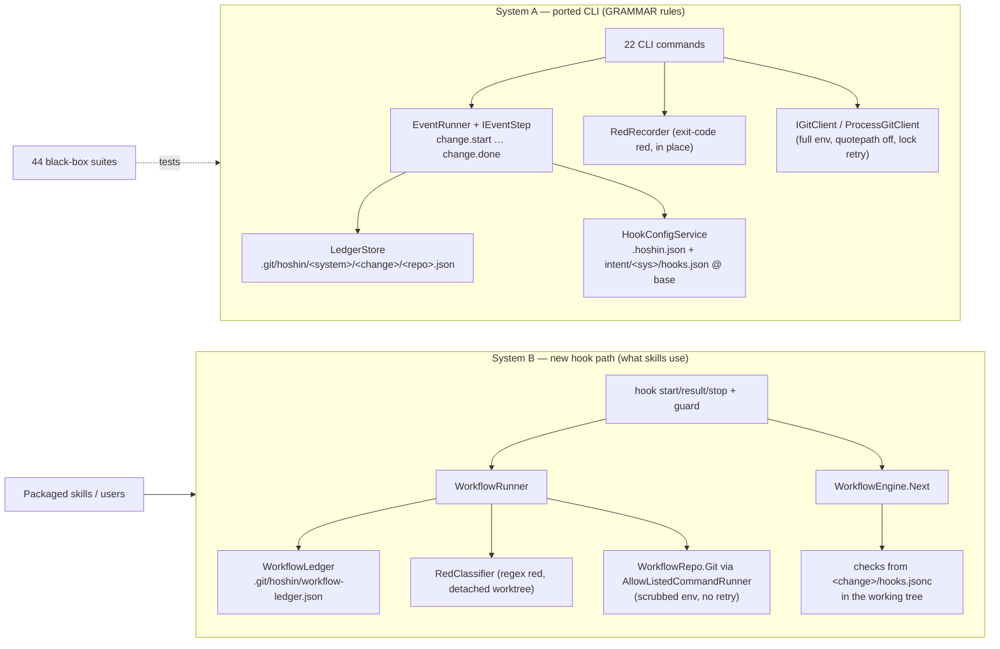

# Hoshin.Net — Code and Design Review

**Reviewed:** `main` at `3e64081` (7 commits, ~20k lines of C# in `src/`, ~13k lines of tests)
**Compared against:** the original plugin, `satish-krishna/hoshin` at `19db71c` (behavior reference: `tools/GRAMMAR.md`)
**Date:** 2026-11-22

The companion document [PRIMER.md](PRIMER.md) explains the layout and where to start reading. This document is the verdict and the findings. [TASKS.md](TASKS.md) turns the findings into work items a coding agent can act on, and lists the decisions that need an engineer.

---

## 1. Summary

Hoshin.Net is a well-organized, carefully named, buildable .NET 10 codebase. It ports all 22 commands of the original `hoshin.ts` CLI and passes the ported black-box conformance suites. It also adds a new architecture: a pure state machine (`WorkflowEngine.Next`), a library-owned Red/Green runner, and a hook driver for two harnesses. The ideas behind the new architecture are good. Moving sequencing and commits out of the model and into deterministic code is the right direction for hoshin.

**It is not yet ready to replace hoshin.** Four problems block that:

1. **The repository holds two workflow systems that don't share a model.** The ported CLI ("System A") implements GRAMMAR's rules: `state`/`ready` gates, lifecycle events, base-branch hooks, multi-repo workspaces, build logs and baselines. The new hook path ("System B") is what the packaged skills actually drive, and it bypasses nearly all of those rules. It has its own ledger, its own git layer, its own Red rules and its own check configuration. The black-box suites, where most of the test effort went, exercise only System A.
2. **The workflow's integrity guarantees can be defeated by the agent it is meant to constrain.**
   - The model can invoke `accept` itself. That records "approved by the engineer" and pushes.
   - The guard can be bypassed with trivial shell variations.
   - Hooks can be disabled through `.claude/settings.local.json`.
   - The build checks come from a file in the working tree that the agent can edit.
3. **Installing the plugin breaks unrelated work.** The guard's static rules run in every repository, in every session. `git push` and `gh pr create` are denied on any project once the plugin is installed. I confirmed this against the built binary.
4. **Large functional gaps against the original:**
   - The workflow cannot start a change from scratch.
   - It has no multi-repo build, no review gate before publishing, no PR creation, no reject/reopen flow, and no evals.
   - The skill guidance was cut from about 2,200 lines to about 180.

### Scorecard

| Area | Rating | One-line reason |
| :--- | :--- | :--- |
| Build & conventions | Good | Clean build, 0 warnings, nullable enabled, consistent naming, small focused files in most places. |
| CLI port (System A) | Good | Commands, options and refusals match GRAMMAR; 44 black-box suites pass. |
| New engine (System B) | Needs work | Sound core idea, but several correctness bugs, and it isn't reconciled with System A. |
| Security / workflow integrity | **Poor** | Self-approval, guard bypasses, harness config left unprotected, checks the agent can edit. |
| Functional parity with hoshin | **Poor** | No way to start a change, single-repo only, no review gate or PRs, thin skills, no evals. |
| SOLID / design | Mixed | Interfaces exist at the edges, but the DI is mostly nominal: static singletons, `?? new X()` fallbacks, a service-locator composition root. |
| Tests | Mixed | Good black-box coverage of System A. Thin, scenario-style coverage of System B. No negative security tests. No CI. |
| Docs accuracy | Mixed | DESIGN.md is readable, but several claims are false (see §7). |

### Test run (this review)

On Linux with the .NET 10.0.404 SDK and Node 22: `dotnet build` gave **0 warnings, 0 errors**, and `dotnet test` passed **128 of 129** in 7.3 minutes. The one failure is `Packager_EmitsOneLineSkillWrappersForAll10SkillsInBothBundles`. It shells out to Windows `powershell`, so the suite can't pass on Linux or macOS. There is no CI to catch that.

---

## 2. Method

- I read DESIGN.md, AGENTS.md, CLIENTS.md, the CHANGELOG and KATA_MIGRATION.md.
- I read the engine (`Engine/*`), the CLI composition root and the commands myself.
- Three parallel reviews covered the rest of the code:
  - the hook and guard layer;
  - the library layers (`Documents`, `Changes`, `Events`, `Git`, `Migration`, …);
  - feature parity against `hoshin/tools/GRAMMAR.md`, its skills, its evals and its tests.
- Claude Code hook event names and payload fields were checked against the official hooks reference.
- I confirmed the most important claims by running code:
  - the guard binary against crafted payloads in a plain git repo;
  - a probe program that calls `WorkflowRunner.EvaluateAndCommitTask` directly;
  - a differential test of the YAML converter against the original plugin's own YAML parser (34 samples, 18 differ).

  Findings checked this way are marked **[verified]**. Findings from reading the code only are marked **[code]**.

Severity: **High** means it breaks a core guarantee or loses data. **Medium** means wrong behavior in realistic cases. **Low** means an edge case or polish.

---

## 3. Architecture assessment

### 3.1 What works well

- **The layering is sound.** `Hoshin.Workflow` takes only two dependencies (Markdig and Gherkin). All harness-specific code is confined to `Hoshin.Cli/Hooks`. The library could be consumed by other hosts.
- **`WorkflowEngine.Next` is a pure function** over a snapshot record (`WorkflowState`). That makes it easy to unit-test, and it is the right shape for the "library owns sequencing" idea.
- **Step types are a closed set of records** (`WriteDocument`, `Implement`, `Retry`, `RunChecks`, …). Hosts switch on the type instead of parsing strings.
- **Process execution avoids the shell** (`UseShellExecute=false`, `ArgumentList`). This removes a whole class of injection bugs.
- **The ledger uses atomic writes and a lock file**: `WorkflowRepo.WriteAtomic` and `AcquireLock`.
- **The black-box suites were ported from the original**, so the CLI contract is protected by an independent, language-agnostic test harness. That was a good decision.

### 3.2 The central problem: two systems



`HoshinServices` wires both systems side by side. They share only the document readers and `IPullRequestClient`. As a result, each of these concerns has two implementations that disagree:

| Concern | System A | System B |
| :--- | :--- | :--- |
| Ledger | `Events/LedgerStore`, per system/change/repo, **no lock** | `WorkflowLedger`, one file per repo, locked, **no change key** |
| Git access | `IGitClient` (`-c core.quotepath=off`, `--no-optional-locks`, `GIT_TERMINAL_PROMPT=0`, index.lock retry) | `WorkflowRepo.Git` via `IAllowListedCommandRunner` (none of those) |
| Red rule | `RedRecorder`: a compile failure is **not** red | `RedClassifier`: missing-symbol compile errors **are** red |
| Build checks | `.hoshin.json` + `intent/<sys>/hooks.json` from the **base branch**, validated, with timeouts | `<change>/hooks.jsonc` from the **working tree**, unvalidated, two shapes with different `blocking` defaults |
| Process env | full parent environment (secrets included) | allow-listed (secrets stripped) |
| Gating | `ChangeState` / `ready` (pins, superseded plans, light track, …) | `WorkflowEngine.Gate` (none of those) |

The README describes Hoshin.Net as one system, so this split is the most important thing a reviewer should know.

**Recommendation:** decide which model is canonical. My suggestion:
- Keep System B's architecture: the pure engine, library-owned commits and the harness adapter.
- Drive it from System A's domain services: `ChangeState`, `EventRunner`, `HookConfigService` and `LedgerStore`. Use one git abstraction and one ledger.
- Then delete the duplicates.

### 3.3 "Single source of workflow order" isn't true

DESIGN.md says all step ordering lives in `WorkflowEngine.Next`. In practice:
- `Next` never returns `ReviewDocument` or `WriteFix`. `HookOrchestrator` builds them itself (`HookOrchestrator.cs:89,96`).
- Accept, approve and publish are decided in the orchestrator, by which skill was invoked (`HookOrchestrator.cs:105-122`).
- Stop-block counting, last-start dedup and pending-context queuing live in unlocked side files, not in the engine.

Ordering is therefore spread across `Next`, `Gate`, `HookOrchestrator` and turn files on disk.

---

## 4. Findings — security and workflow integrity

| ID | Severity | Finding | Where |
| :--- | :--- | :--- | :--- |
| S1 | **High** | **The model can approve and publish on its own.** See below. | `packaging/package.ps1:141`, `HookOrchestrator.cs:105-122, 464-516` |
| S2 | **High** | **The guard applies to every repo on the machine.** See below. **[verified]** | `GuardCommand.cs:93-97`, `packaging/claude-code/hooks/hooks.json:14-25` |
| S3 | **High** | **Simple variations get past the guard's shell rules.** See below. **[verified]** | `GuardCommand.cs:18-50` |
| S4 | **High** | **The agent can turn the harness off.** See below. **[code]** | `GuardCommand.cs:22-29, 48-50` |
| S5 | **High** | **The agent can delete the guard's state.** See below. **[code + regex verified]** | `GuardCommand.cs:48-50, 105-115` |
| S6 | **High** | **Build checks come from a file the agent can edit.** See below. **[code]** | `WorkflowRepo.cs:277-324` |
| S7 | Medium | **Step rules only cover the edit tools.** See below. **[code]** | `GuardCommand.cs:174-190, 255-266`, `WorkflowRunner.cs:855-863` |
| S8 | Medium | **Session isolation is broader than documented.** See below. **[code]** | `GuardCommand.cs:150-170`, `HookOrchestrator.cs:144-303` |
| S9 | Medium | **Some hook scripts and test runs get the full environment.** See below. **[verified]** | `Git/CommandRunner.cs:74-80`, `Red/RedRecorder.cs:118-130` |
| S10 | Low | **The guard fails open on malformed input**, and that isn't documented or tested. See below. | `HarnessAdapter.cs:89,108,421` |

**S1 — the model can approve and publish on its own.** The generated `SKILL.md` wrappers are model-invocable: they have no `disable-model-invocation: true`.
- In Claude Code, the model can call `Skill("hoshin:accept")`. `PostToolUse(Skill)` runs `hook start`, which at `NeedsApproval` calls `Answer(approved: true, "approved by the engineer…")`, then `Advance` → `Publish` → `git push`.
- In Antigravity, simply *reading* `.agents/skills/accept/SKILL.md` matches `AgySkillPath` and does the same.
- Document acceptance (`AwaitAccept` → `status: accepted`) has the same hole.
- Nothing checks that a human initiated the step.

Fix: mark `accept`/`done` as user-only; accept approval only from `UserPromptExpansion`/`UserPromptSubmit` (typed by the user), never from `PostToolUse(Skill)`.

**S2 — the guard applies to every repo on the machine.** `StaticRefusal` runs before any repo or `.hoshin.json` check, and the hook is plugin-wide. I tested a plain `git init` repo that has never used hoshin:
- `git push origin main` → **deny**;
- `gh pr create` → **deny**, with "run the hoshin done skill".

The original guard was declared only in the front matter of the build, review, fix and done skills. GRAMMAR says calls from skills that don't declare the guard go ahead.

Fix: return "allow" unless the cwd is inside a hoshin workspace *and* a run is active for this session.

**S3 — simple variations get past the guard's shell rules.** The guard parses shell text with regexes. These were allowed by the built binary:
- `git -c alias.p=push p origin`
- `git --git-dir .git --work-tree . push`
- `g""it push`
- `echo '{}' >.hoshin.json` (no space after `>`)

These are not tested (code-read): `git commit -m x -n`, `dd of=…`, `python -c "open(...)"`, `gh api -f k=v` (which turns into a POST), MCP tools such as `mcp__github__push_files`.

Regex-over-shell can't be made airtight. Treat it as a speed bump, and put the real enforcement where the library owns the action: refuse to record a verdict if HEAD moved, and verify at `Publish` that the remote branch matches the ledger.

**S4 — the agent can turn the harness off.** Neither the protected patterns nor `ProtectedRunDirs` cover `.claude/settings.json`, `.claude/settings.local.json` or `~/.claude`. During a build, `echo '{"disableAllHooks":true}' > .claude/settings.local.json` is allowed. `.git/hooks/*` is protected only while a run is active.

**S5 — the agent can delete the guard's state.** The protected-dir regex needs `.git/` inside one token. `cd .git && cd hoshin && rm run.json step.json` and `rm -r "$(git rev-parse --git-common-dir)/hoshin"` both get through. Without `run.json`, `Evaluate` allows everything, `HandleStop` sees "no run", and manual commits are open again.

**S6 — build checks come from a file the agent can edit.** `ReadChecksFromHooks` reads `<change>/hooks.jsonc` or `hooks.json` from the working tree. That folder is protected by neither the guard nor `IsProtectedPath`. An implement subagent can add, remove or neuter the `build.finish` checks. System A reads checks from the **base branch** for exactly this reason.

**S7 — step rules only cover the edit tools.**
- Red-phase ordering and the single-document lock only look at `Edit`/`Write`. `cat > src/prod.cs <<EOF` during `Implement` is allowed.
- In the standard `intent/<sys>/<change>/` layout, the change's own `plan.md` is protected by neither the guard nor `IsProtectedPath`. An implement subagent can rewrite its own task's `test` argv.

**S8 — session isolation is broader than documented.**
- While `step.AgentId` is set, or whenever an event carries `agent_id`, *every* session counts as "in the run". Unrelated sessions in the repo then get red-phase and no-commit rules.
- The reverse also happens: Claude Code's `HandleStop` and `HandleResult` never check the session. So an unrelated session's Stop is answered with "build task T2", and its Explore subagent is judged as T1's attempt.
- The end-to-end test at `DualHarnessHookIntegrationTests.cs:268-283` asserts that a second session can accept and publish.

**S9 — some hook scripts and test runs get the full environment.** `ProcessCommandRunner` passes the full parent environment to children; `ANTHROPIC_API_KEY` reached a child process. It runs hook scripts, baseline checks and `hoshin red` task tests. DESIGN's "secret-free execution" is true only for System B's `AllowListedCommandRunner`.

**S10 — the guard fails open on malformed input.** Invalid JSON, or a non-string `tool_response.status`, throws. The hook exits 0 with no output, so the guard allows the call. That's acceptable for availability, but neither documented nor tested.

---

## 5. Findings — correctness

### 5.1 Engine and Red/Green runner (`src/Hoshin.Workflow/Engine`)

| ID | Severity | Finding |
| :--- | :--- | :--- |
| E1 | **High** | **Verdicts from different changes collide.** `WorkflowVerdict`, `WorkflowIssued` and `WorkflowCheckRun` have no change key, and `.git/hoshin/workflow-ledger.json` is shared by the whole repository (`WorkflowContracts.cs:109-146`, `WorkflowRepo.cs:31`). A second change whose first task is also `T1` reads as already passed, and `Next` skips it. **[code]** |
| E2 | **High** | **Unrelated working-tree files get committed.** `GetWorkingTreeChanges` uses `git status --porcelain -uall` over the **whole repository**, and every non-test path becomes a production change (`WorkflowRunner.cs:740-778, 196-197`). Local notes, editor files, generated output that isn't gitignored, or another task's leftovers all land in the `feat(...)` commit. The `git commit` calls also have no pathspec (`:252, :270`), so anything already staged goes in too. **[code]** |
| E3 | **High** | **The subagent-stop and parent-stop hooks can judge the same attempt twice.** `EvaluateAndCommitTask` checks for an existing verdict against a `state` snapshot read *before* any lock (`WorkflowRunner.cs:169`). Only `RecordVerdict` is locked, so it dedups the ledger row, not the git commits. `SubagentStop` and the parent `Stop` can both run Red/Green, commit, and share the one `worktrees/red-check` directory. **[code]** Whether Claude Code runs these two hooks concurrently is unverified. Fix: hold a run-level lock across evaluate-and-commit, and re-read the ledger inside it. |
| E4 | Medium | **The Red classifier treats nearly any non-zero exit as valid Red** (`RedClassifier.cs:48-92`). See below. |
| E5 | Medium | **Test-file detection is heuristic and can misclassify.** See below. |
| E6 | Medium | **A relative executable in a task's argv resolves against the wrong directory.** .NET resolves argv[0] containing `/` against the *hoshin process's* cwd, not `WorkingDirectory`. A task with `test: [".venv/bin/pytest", …]` fails Green whenever hoshin isn't run from the repo root. In the Red worktree it resolves to the *main* repo's file. **[verified]** with a probe: Green reported "could not start .venv/bin/runtests … No such file or directory". |
| E7 | Medium | **Secret scrubbing also strips what `git push` and test runners need.** `AllowListedCommandRunner` keeps only about 30 variables. `SSH_AUTH_SOCK`, `GIT_SSH_COMMAND`, `HTTPS_PROXY`/`HTTP_PROXY`/`NO_PROXY`, `SSL_CERT_FILE`, `JAVA_HOME`, `GOPATH`, `VIRTUAL_ENV`, `PYTHONPATH` and npm config all disappear. `Publish` pushes through this runner (`WorkflowRunner.cs:355`), so SSH-agent remotes and proxied networks fail. Push failure returns `null` with no diagnostic. |
| E8 | Medium | **Publishing skips safeguards and doesn't match the docs.** `Publish` pushes to a hard-coded `origin` and `refs/heads/hoshin/<change>`; GRAMMAR's default is `change/<change>`. It never opens a PR: `openPullRequest` defaults to false and the orchestrator never passes true (`HookOrchestrator.cs:435`). It has no review gate (GRAMMAR requires a review with no high findings), and it ignores PR-creation failures. |
| E9 | Medium | **The change folder is guessed, not resolved.** See below. |
| E10 | Medium | **`MaxAttempts`, the 5-minute test timeout and the 10-minute check timeout are hard-coded** (`WorkflowEngine.cs:230`, `WorkflowRunner.cs:217,225,303,324`). Real test suites exceed 5 minutes, and a timeout burns an attempt. |
| E11 | Low | **Rollback is partial.** If `StagePaths` fails before the first commit, the index is left half-staged with no reset. Rollback uses `reset --mixed`, which assumes nothing else was staged before the attempt. |
| E12 | Low | **Two other runner details are fragile.** `GetWorkingTreeChanges` parses porcelain output without `-z`, so quoted or escaped paths come back wrong. A deleted test file counts as "a test was written". |
| E13 | Low | **The default implement procedure is duplicated and has drifted.** `WorkflowBriefs.DefaultImplementProcedure` and `skills/implement/procedure.md` hold different text. The intent headings are duplicated between `WorkflowBriefs` and `IntentReader`. The protected-path list is duplicated (and different) between `WorkflowRunner.IsProtectedPath` and `GuardCommand`. |

**E4 — the Red classifier treats nearly any non-zero exit as valid Red.** Anything that doesn't match a C#/TypeScript syntax-error regex is classified as an `AssertionFailure`, and so it counts as Red:
- exit 127 (command not found);
- a crash;
- out of memory;
- a missing gitignored fixture in the detached worktree;
- in any language other than C# or TypeScript (Python, Go, Rust, Java), any compile or syntax error.

`Cannot find module` counts as a "missing symbol" Red even when the missing module is a *dependency*, not the code under test. It also misuses `RedKind.TimedOut` to report "could not prepare worktree".

I checked the most worrying version of this, Node dependencies missing from the worktree, and it is **not** a problem. The worktree lives inside `.git/`, so Node's module resolution walks up to the main repo's `node_modules`.

**E5 — test-file detection is heuristic and can misclassify.** `ExtractTestFilesFromArgv` treats any argv token containing `.` or `/` as a test file (`WorkflowRepo.cs:487-505`). With `dotnet test src/App/App.csproj`, a *production* change to `App.csproj` is classified as a test file. `TrimStart('.')` mangles `../x` and `.config/x`. The `**/` glob translation (`.*` then `/?`) lets `**/foo` match `barfoo`. `IsTestPath` and these helpers have **no unit tests**.

**E9 — the change folder is guessed, not resolved.** `ResolveChangeFolder` (`WorkflowRepo.cs:64-136`) first trusts `run.json`. Otherwise it picks the first system alphabetically and the *last* change name in descending ordinal order. The comment says "most recent". In a workspace with several open changes, the wrong one can be silently picked.

### 5.2 Hook orchestration (`src/Hoshin.Cli/Hooks`)

| ID | Severity | Finding |
| :--- | :--- | :--- |
| H1 | **High** | **A new idea can't start a change.** With no `change.jsonc`, `ReadState` returns null, and every skill, including `setup`, `context` and the first `intent`, is told "There is no change plan in this repository… end your turn" (`HookOrchestrator.cs:~71`). Nothing in System B runs `change start`. |
| H2 | Medium | **`setup`/`context` take over the session.** When a plan exists, `WriteRunMarker` and `ResetStops` run *before* the `setup`/`context` early return (`HookOrchestrator.cs:82-106`). After `/hoshin:context`, the guard enforces a stale `step.json`, and Stop starts sending build briefs. |
| H3 | Medium | **Any foreground `Agent`/`Task` call during `Implement` is judged as the task attempt.** Nothing checks the description or the subagent type. An orchestrator that first runs an Explore agent burns attempt 1 with "no working-tree changes". |
| H4 | Medium | **A "refused" second subagent has already started.** `TryRegisterActiveSubagent` runs in `PostToolUse`, after the second subagent has started; there is no `PreToolUse` matcher for `Agent`. DESIGN's "refuses conflicting concurrent launches" overstates this: the hook can only add a message. |
| H5 | Medium | **In the Claude async flow, verdicts and the end state are never reported.** `SubagentStop` judges and advances but returns nothing. The parent Stop then has no tracked agent id, so the verdict report is empty. At `NeedsApproval` it allows silently: the engineer is never told "ready for approval", or why an attempt failed. |
| H6 | Medium | **Interview turns use up the stop counter.** One stop counter is shared across all purposes. With a partial draft on disk, each question turn blocks and increments `stop-blocks`. After three turns the hook gives up silently. `stop_hook_active` is parsed but never read. |
| H7 | Medium | **Truncation can cut the subagent prompt's closing marker.** The text is truncated to 10,000 characters, then a verdict report is prepended and the result truncated again from the end. That can drop the `END SUBAGENT PROMPT` marker the model is told to copy up to. `text[..n]` can also split a surrogate pair. |
| H8 | Medium | **Hooks write state into repos that never used hoshin.** Every guard call and every Stop in *any* git repo creates `.git/hoshin/` and appends to an unbounded `hooks.jsonl`. **[verified]**: the file appeared in a plain repo after one guard call. Static denials return `repo=null`, so the decisions most worth auditing are the ones never logged. |
| H9 | Low | **Antigravity `PreInvocation` mishandles queued context and retyped commands.** A queued `pending-context.txt` swallows a typed `/accept`. The dedup key isn't cleared on several Stop paths, so retyping `/build` in a later turn is ignored. |
| H10 | Low | **The Antigravity manifest is inconsistent with itself.** `PreInvocation` and `Stop` use flat arrays, while `PreToolUse` and `PostToolUse` use `{matcher, hooks}`. The commands use `./lib/hoshin.dll`, a path relative to the hook's cwd. If the cwd isn't `.agents/`, every hook, the guard included, silently fails open. This could not be checked against an Antigravity schema. |
| H11 | Low | **Hook timeouts can leave a half-committed attempt.** The harness kills `PostToolUse(Agent)` and `Stop` at 900 s. A kill between the test commit and the production commit leaves history half-committed with no verdict recorded. |

The Claude Code event names and payload fields the adapter relies on are valid per the current hooks reference: `UserPromptExpansion` (with `command_name`), `Stop.background_tasks`, `SubagentStop.agent_id`, and `PostToolUse(Agent).tool_response.agentId` for async launches. The test payloads are hand-written, though, so a recorded-fixture test would protect against future drift.

### 5.3 Library layers (`Documents`, `Common`, `Migration`, `Events`, `Git`, …)

| ID | Severity | Finding |
| :--- | :--- | :--- |
| L1 | **High** | **`hoshin migrate` silently drops data.** See below. **[verified]** |
| L2 | **High** | **A quote anywhere in a plain YAML value hides the comment.** `title: It's a "test" # note` keeps `# note` in the title, because an apostrophe opens a "quoted" region (`YamlToJsoncConverter.cs:791-830`). **[verified]** |
| L3 | Medium | **Any YAML value starting with `[` or `{` is treated as a flow collection.** `title: [WIP] Fix bug` becomes `["WIP"]`. Unsupported YAML is also mistranslated instead of refused. See below. **[verified]** |
| L4 | **High** | **`Jsonc.TryParse` fails on empty or comment-only text**, contrary to its own documentation. `IsBlank` can never be true, because `Utf8JsonReader.Read()` throws on input with no tokens. A `## Shared decisions` block containing only `// none yet` reports "not valid JSONC". The readers' "empty block" branches are dead code (`Common/Jsonc.cs:44-56`). **[verified]** |
| L5 | **High** | **`FrontMatterEdit.Set` can lose a commit pin or leave a status unchanged without error.** Engine `WorkflowRunner` uses it for both. See below. **[verified]** |
| L6 | Medium | **`ProcessCommandRunner` timeouts don't hold.** Stdin is written synchronously *before* the timed wait, and output reads wait for end-of-file. Verified: a 1 s timeout took 6 s and reported `TimedOut=false`, and `sh -c "sleep 6 & echo"` with a 2 s timeout took 6 s (`Git/CommandRunner.cs:120-158`). Build servers such as MSBuild node reuse can hang hoshin this way. |
| L7 | Medium | **System A's ledger can be wiped.** `LedgerStore.Read` swallows parse errors and returns null. Callers write `Empty()` back, erasing runs, reds, approvals and gate-block counts. There is no inter-process lock (`Events/Ledger.cs:74-120`). |
| L8 | Medium | **`SpecReader` can pick an example block as the spec.** `FindBlock` scans fences with its own regex instead of the parsed `Doc.Fences`. A ` ```gherkin ` block inside a `~~~markdown` example is taken as the spec. The migrator uses `Doc.Fences`, so the reader and the migrator disagree on which block is the spec (`SpecReader.cs:60-88`). **[verified]** |
| L9 | Medium | **Exported hook scripts are corrupted if they aren't UTF-8.** They are read through a UTF-8 string, so binary and Latin-1 files get U+FFFD. Symlinks are written as text files. `ls-tree` runs without `-z` (`Events/HookScripts.cs:58-66`, `GitClient.cs:221`). |
| L10 | Medium | **`PathHelpers.RealPath` only resolves the last path component**, despite claiming parity with `realpathSync`. On macOS, `/var/...` won't equal git's `/private/var/...` (`Git/PathHelpers.cs:203-230`). **[verified]** |
| L11 | Low | **Regex `$` lets a trailing newline through.** In .NET it matches before a final `\n`, so `task: "T1\n"` passes schema validation. The schema validator silently ignores `$ref`, `oneOf`, `if` and `const` (`EmbeddedSchemaValidator.cs:107`). |
| L12 | Low | **Smaller reader issues:** <br>– `## Review 99999999999` throws an `OverflowException` (`ReviewReader`). <br>– "Scenario Template" skips the placeholder check (`SpecReader.cs:176`). <br>– `CrossChecker.IsSuperseded` re-reads the plan from disk instead of using the parsed result. <br>– An invalid `change.jsonc` silently falls back to the branch `change/<folder>`. |

**L1 — `hoshin migrate` silently drops data.** `ParseRoot` never checks that every line was consumed (`YamlToJsoncConverter.cs:146`). It stops early on:
- multi-line quoted strings;
- `- |` block scalars inside sequences;
- nested sequences;
- over-indented continuation lines.

Everything after the stopping point is discarded. Verified: a `change.yml` with a two-line quoted `notes:` was migrated with `--write`. The tool reported `done` and **deleted `change.yml`**. The new `change.jsonc` had lost `base` and `branch`. The output is still valid JSONC, so the migrator's validity check passes.

In a differential test against the original plugin's YAML parser (`tools/vendor/yaml.mjs`), **18 of 34** samples differ.

**L3 — unsupported YAML is mistranslated instead of refused.** All verified against `yaml.mjs`:
- Anchors, aliases and tags come out literally (`&b`, `*b`, `!!str 123`).
- A leading `---` throws "not a key-value pair".
- Duplicate keys are emitted twice instead of refused.
- `\e`, `\N` and `\U…` escapes become plain letters.
- `1e3`, `0x1F` and `.5` become strings instead of numbers.
- Trailing spaces in literal blocks are stripped.

**L5 — `FrontMatterEdit.Set` can lose a commit pin or leave a status unchanged without error.** All three parts verified:
- (a) It only matches existing **string** values. With `"source_intent_commit": null`, it inserts a duplicate key; the parser keeps the last value, so the pin reads back as null.
- (b) It also edits lines inside `//` comments. With `// was "status": "draft"` above the real field, the comment is rewritten and the field stays `draft`.
- (c) It converts CRLF to LF across the whole file, and the write isn't atomic (`Documents/FrontMatterTools.cs:163-193`).

My recommendation for L1–L3: replace the hand-written converter. Migration is a one-time, offline operation, so the "no YAML dependency" rule protects nothing there. Either move `migrate` into a separate tool or assembly that references YamlDotNet, or generate the JSONC once with the original plugin's parser. At a minimum, make the converter refuse any input it doesn't fully consume.

---

## 6. Functional parity with hoshin

| Area | hoshin | Hoshin.Net | Gap |
| :--- | :--- | :--- | :--- |
| CLI commands and options | 22 commands | All 22, same usage strings, plus `hook`; `migrate` gains `--dry-run`, `--documents` and paths | Low |
| Document format | YAML, layouts 1 and 2 | JSONC, layout 2 only (an intentional breaking change, documented) | Medium |
| Skill gating | every skill gates through `state`/`ready` (pins, superseded plans, reopen, light track) | ported in `ChangeState`, but the skills gate on `WorkflowEngine.Gate`, which ignores all of these | **High** |
| Lifecycle events and base-branch hooks | every skill runs `change.start` … `change.done` | only the CLI commands use `EventRunner`; System B runs its own checks | **High** |
| Multi-repo workspaces | one build per repository, with a schedule | `WorkflowTask` has no `repo`; everything runs in `repo.Root` | **High** |
| Build logs, `red record`, departures | an entry per task | never written by System B | **High** |
| `done` / `change.done` | review gate, pushes every repo, opens PRs | pushes the current repo only; no review gate, no PR | **High** |
| Baseline judging | red-on-base IDs and approvals | System B records a baseline but never uses it | **High** |
| Tasks without testable behavior | allowed (GRAMMAR) | refused: every task needs a `test`, and every attempt needs both test and production changes (`WorkflowRepo.cs:211`, `WorkflowRunner.cs:199-207`) | Medium |
| Reject / reopen / superseded / `fix --accept` | supported | no flow in System B | **High** |
| Skills | 10, including `start`; about 2,200 lines of SKILL.md and references | 10 plus `implement`; `start` dropped, `accept` added; 7–30 lines each | **High** |
| Templates | `references/templates/{intent,spec,plan,context,policies}.md` | only the workspace templates | **High** |
| Evals | 56 cases plus grader tests | none | **High** |
| Black-box tests | 52 files, about 632 cases | 44 files, about 542 cases; six suites were rewritten as smaller C# tests | Medium |
| CI and marketplace | `.github/workflows`, `marketplace.json` | neither | Medium |

**Skill guidance that was dropped and still matters.** The procedures are now very short, and the guidance below no longer exists anywhere in the repo:

- **Intent:**
  - the happy path before edge cases;
  - the seven-question cap;
  - triage of rules as `intent unknown` / `seen in code`;
  - writing each section as it settles;
  - the technology check;
  - read-back;
  - `context:` front matter.

  The brief also looks for context in `<change>/context*.md`. Real context lives in `intent/<system>/context/<repo>.md`, so the brief never finds it (`WorkflowBriefs.cs:~70`).
- **Start/triage:** removed entirely, including the "cannot route yet" verdict and the rule that a bug needs a root cause and a reproduction.
- **Spec:**
  - running policy skills and filling `policies_applied`/`policies_not_checked`;
  - the Design section;
  - mapping constraints to requirement numbers;
  - exhaustive Scenario Outlines;
  - stable IDs when regenerating.
- **Plan:**
  - rules for test and compile commands (one exact test filter, no shell, `.cmd` shims, no watch mode);
  - the `## Checks at build finish` section;
  - recording engineer direction.
- **Review:**
  - one reviewer per repository plus a cross-repository reviewer;
  - red-verdict findings;
  - verifying convention findings.

  The review brief also always says "Start a new file", which contradicts the append-only rule.
- **Done:** the procedure promises PR URLs that are never produced.

**Packaged `SKILL.md` wrappers.** The structure is valid (`name` and `description`), but only `build` uses "Use when…" trigger phrasing. `accept` and `done` need `disable-model-invocation: true` (see S1).

---

## 7. Documentation claims that are false or stale

| Claim | Reality |
| :--- | :--- |
| DESIGN §4: `testPatterns` is configured in `.hoshin.json` | `MarkerReader` rejects `testPatterns` as an unknown field (`Workspace/Marker.cs:38`), so `check .hoshin.json` fails if you use it. |
| README / DESIGN: "accept → push & PRs", "Publish (+ optional PR)" | A PR is never requested, and review is optional before publishing (E8). |
| DESIGN §2: "secret-free execution" | True only for System B (S9). |
| DESIGN §3: all ordering lives in `WorkflowEngine.Next` | See §3.3. |
| DESIGN §5: "refuses conflicting concurrent launches"; "unrelated sessions are never locked out" | See H4 and S8. |
| Guard messages: "pushing happens only in the change.done event … run the done skill" | The done skill never runs `change.done`. |
| KATA_MIGRATION §5: all 22 subcommands keep their exit codes | Layout 1 and YAML documents now exit 2, not 0 or 1. |
| "All 10 user skills" | A different set from the original's 10: `start` is gone, `accept` is new. |
| "129/129 tests pass" | 128 of 129 on Linux; the packager test needs Windows PowerShell. |
| `package.ps1` builds the release | It uses `\` paths and Windows `powershell`. It ignores `-Version` for `plugin.json`, which hard-codes 2.0.0. |
| Code comments cite `GRAMMAR.md` (`GuardCommand.cs`, `Doc.cs`, `ChangeState.cs`) | GRAMMAR.md isn't in this repo, and DESIGN.md doesn't replace it as the behavior reference. |
| `migrate`'s manual steps say to install `hoshin@hoshin` | There is no `marketplace.json`. |

---

## 8. SOLID and engineering practices

### 8.1 Single Responsibility — mixed

- **Good:** most files are small and named after one concept (`ChangeLocator`, `ChangeRename`, `BranchChecker`), and each CLI command is its own class behind `IHoshinCommand`.
- **Problem — very large classes.** Each of these mixes several concerns:

  | Class | Size | What it mixes |
  | :--- | :--- | :--- |
  | `WorkflowRunner` | 884 lines | task evaluation, git, worktree management, document commits, publishing, fix-track validation |
  | `HookOrchestrator` | ~630 lines | harness protocol, turn-file bookkeeping, workflow decisions |
  | `DocumentMigrator` | 1,250 lines | file discovery, IO, four per-kind transforms |
  | `YamlToJsoncConverter` | 1,178 lines | parser and emitter |
  | `ChangeStateService` | 646 lines, 8 dependencies | — |
  | `ChangeDoneStep` | 627 lines | — |

- **Problem — `WorkflowRepo` is several types in one:** repository locator, change-folder resolver, plan loader, check-config reader, ledger store, lock manager and glob matcher.

  Suggested split: `ChangeFolderResolver`, `WorkflowPlanLoader`, `WorkflowLedgerStore`, `TestPathClassifier`, and a thin `GitRepository`.

### 8.2 Open/Closed — mixed

- **Good:** `IEventStep` lets event steps be added without touching the runner, and the `Step` record hierarchy is closed and pattern-matched.
- **Problem:** behavior is chosen by strings in many places, so a new document kind or skill means editing several switches:
  - document names (`"intent"`, `"spec"`, `"plan"`) in `WorkflowState.Document`, `NextAuthoring`, `CommitDocument` and `WorkflowBriefs`;
  - `CurrentStep.Kind` as a string, with `Task` doubling as a document name;
  - outcomes as bare strings (`"passed"`, `"could-not-run"`, `"refused"`, `"current"`).

  Suggestion: introduce `enum DocumentKind`, a `StepKind`, and a small `IDocumentPolicy` per kind that holds its reader, brief and pin field.

### 8.3 Liskov — fine

Few hierarchies, and none misused. The `Step` records are a sound sum type.

### 8.4 Interface Segregation — weak

- **`HoshinServices` is a service locator.** It eagerly builds about 45 services for every invocation, and most commands receive the whole object and pick from it. Commands should take only what they use. For example, `CheckCommand` needs only an `IDocumentCheckService`.
- **`IWorkflowRunner` has 13 members** spanning attempt evaluation, checks, approval, publishing and three kinds of document commit. Split it along those lines: `ITaskEvaluator`, `ICheckRunner`, `IPublisher`, `IDocumentCommitter`.
- **`IHookAdapter` lacks `ReadFromStdin`**, so `HoshinServices` exposes the concrete `HarnessAdapter`.

### 8.5 Dependency Inversion — nominal

AGENTS.md says the external boundaries sit behind constructor-injected interfaces. In practice:

- There are **41 `static Default` singletons** and **66 `?? new X()` / `?? X.Default` fallbacks** in `src/`. Every constructor parameter is optional, so a forgotten argument silently means real git and real processes, which defeats test isolation.
  - `WorkflowRunner`'s constructor creates `new GhPullRequestClient()`, `new PlanReader()` and other readers by default.
  - `WorkflowRepo.ReadPlan` creates `new PlanReader()`.
  - `EventRunner.CreateDefaultSteps` duplicates the wiring in `HoshinServices` and hard-codes `GhPullRequestClient.Default`.
- **Most dependencies are concrete classes:** `AppService`, `ChangeLocator`, all readers, `LedgerStore`, `HookProcessRunner`.
- **Several components inject nothing at all:**
  - `GuardCommand` and `WorkflowRepo.Find` call `AllowListedCommandRunner.Default` and the filesystem directly.
  - `FrontMatterEdit`, `ChangeRecordStore`, `MarkerReader` and `CrossChecker` are static classes doing file IO.
  - There is **no filesystem or clock abstraction**; `DateTimeOffset.UtcNow` is called directly.
- **A circular dependency is wired through a setter:** `ChangeDoneStep.BindRunner`, plus a type check in `EventRunner`.
- **Production code reads test-only environment variables:** `HOSHIN_GIT_COUNT_FILE` appends to a file on every git call.

**Recommendation:**
- Use `Microsoft.Extensions.DependencyInjection` in `Hoshin.Cli` only, where the dependency is free.
- Remove the optional `?? Default` constructor parameters.
- Add `IFileSystem` and `TimeProvider` (built into .NET 8+).
- Make `WorkflowRepo` receive its runner, rather than finding one.

### 8.6 Other engineering practices

| Practice | State | Notes |
| :--- | :--- | :--- |
| Nullable reference types | ✅ | Enabled everywhere; a few `!` null-forgiving operators where a reader can legitimately return null (`ReadState(...)!` in `HookOrchestrator`). |
| Warnings as errors / analyzers | ❌ | No `TreatWarningsAsErrors`, no `AnalysisLevel`, no `.editorconfig`. A "0 warnings" claim isn't enforced. |
| CI | ❌ | No `.github/workflows`. The original has CI. Tests take about 7 minutes and need Node and git; a Linux plus Windows matrix would have caught the packager problem. |
| Error handling | ⚠️ | 35 bare `catch {}` blocks in `src/`. Several hide real bugs: `LedgerStore.Read`, `FrontMatter.TryGetField`, `ResolveChangeFolder`, `CheckPlanDocument`. |
| Async | ⚠️ | `IHoshinCommand.RunAsync` returns `Task`, but everything is synchronous (`Task.FromResult`). No `CancellationToken` reaches process runs. |
| Duplication | ⚠️ | Two process runners, two git layers, two ledgers, two lock implementations, two Red rules, two check configurations, the implement procedure twice, protected paths in three places, tool-name lists in four. |
| Regex performance | ⚠️ | Several regexes are built on every call (`Doc.Split` per fence, `FrontMatterEdit`, `KeyLine`). Use `[GeneratedRegex]`. |
| Logging and observability | ⚠️ | `hooks.jsonl` is unbounded, written into unrelated repos, and skips static denials. |
| Portability | ⚠️ | The packager and one test need Windows PowerShell. Path comparison uses `OperatingSystem.IsWindows()` but ignores case-insensitive macOS volumes. |
| Versioning | ⚠️ | `VersionPrefix` lives in `Directory.Build.props`, `plugin.json` hard-codes the version, and `package.ps1` takes a `-Version` it doesn't apply everywhere. |

---

## 9. Test gaps

What exists:
- 44 black-box suites (System A);
- about 80 C# facts, of which roughly 18 cover System B;
- an example-conformance theory over `Examples/`.

The System B tests are mostly long end-to-end scenario tests with many assertions each. That makes failures hard to locate, and edge cases aren't covered.

Missing, in priority order:

1. **Negative security tests for the guard:**
   - git aliases, `--git-dir`, redirects without a space, `cd .git`, `.claude/settings*`, MCP tools;
   - "the guard is silent in a non-hoshin repo";
   - "a model-invoked `accept` does not approve".
2. **Unit tests for the Red/Green building blocks:**
   - `IsTestPath`, `ExtractTestFilesFromArgv`, `MatchesGlob`;
   - `RedClassifier` with exit 127, Python, Go and Rust output;
   - `GetWorkingTreeChanges` with renames, quoted paths and untracked noise.
3. **Ledger behavior:**
   - two changes in one repo (E1);
   - concurrent evaluate-and-commit (E3);
   - a corrupt ledger file (L7).
4. **The YAML converter:**
   - differential tests against a reference YAML parser;
   - "must refuse" cases;
   - round-trip invariants. Today there are 3 direct unit tests.
5. **Library utilities:** `FrontMatterEdit`, `Jsonc.TryParse` on blank or comment-only input, `ProcessCommandRunner` timeouts, `PathHelpers.RealPath`, `EmbeddedSchemaValidator` on its own.
6. **Hook protocol fixtures:** recorded real Claude Code and Antigravity payloads, instead of hand-written JSON.
7. **Orchestrator edge cases:**
   - an unrelated session's Stop or Result;
   - `setup`/`context` with and without a plan;
   - more than `MaxStopBlocks` stops;
   - long-prompt truncation;
   - malformed JSON.
8. **Skill behavior evals:** the original had 56 eval cases; none were ported.
9. **Coverage measurement:** add `coverlet` and report coverage in CI.

---

## 10. Recommended plan

This is the summary. [TASKS.md](TASKS.md) is authoritative for order and scope. Since this review was first written, CI, the architecture tests and the SOLID fixes have been made mandatory ([CONTRIBUTING.md](../../CONTRIBUTING.md)). TASKS.md therefore runs the enforcement tasks first, and lists the SOLID fixes as required P1 work.

**P0 — before anyone installs v2.0.0:**

1. Scope the guard and all hooks to hoshin workspaces with an active run for the current session (S2, H8).
2. Make approval human-only: `disable-model-invocation` on `accept`/`done`, and approval only from user-typed prompts (S1).
3. Read build checks from the base branch (reuse `HookConfigService`), and protect `.claude/`, `.git/hoshin/` and the change folder (S4–S7).
4. Add the change id to every ledger record, or keep one ledger per change (E1).
5. Commit only the task's own paths: use a pathspec on `git commit`, and refuse unexpected untracked files instead of committing them (E2).
6. Make `migrate` refuse partial parses, and never delete the source unless the round trip is exact (L1–L3).

**P1 — to reach parity:**

7. Unify Systems A and B (§3.2): one ledger, one git abstraction, one Red rule, one check configuration. System B's engine should consume `ChangeState`, `EventRunner` and `LedgerStore`.
8. Restore `change start`, multi-repo builds, build logs, the review gate before publishing, PR creation and the reject/reopen flows.
9. Bring back the skill guidance, the templates and the evals from hoshin.
10. Make timeouts and attempt caps configurable, and fix the Red classifier (E4, E10).

**P2 — engineering hygiene:**

11. Add CI (Linux and Windows), `TreatWarningsAsErrors`, analyzers, `.editorconfig` and coverage.
12. Make the DI real: no `?? Default` fallbacks, commands take narrow interfaces, add filesystem and clock seams.
13. Split `WorkflowRunner`, `WorkflowRepo` and `HookOrchestrator` along the lines in §8.
14. Make the packager cross-platform (`pwsh`, or a .NET tool), and fix the stale doc claims (§7).
15. Port GRAMMAR.md, or write an equivalent behavior reference, so it is the single source of truth here as it is in hoshin.
