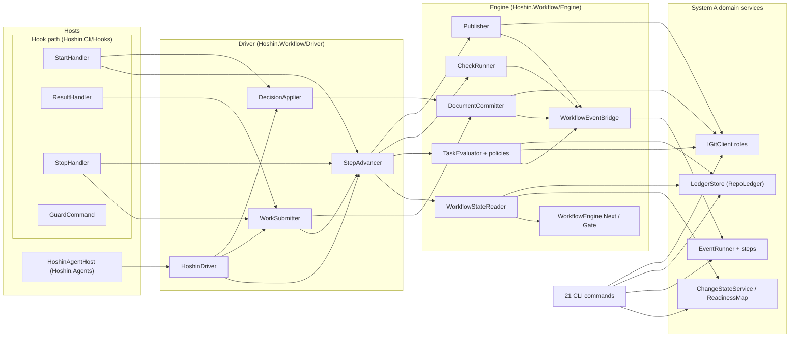

# Hoshin.Net — Reviewer's Primer

This is a guided entry point for reading and reviewing the Hoshin.Net code. It was written at `6b10f7e` (after the first review's fix round) and brought up to date on 2026-11-28 for round 4 (docs/review/TASKS.md: the driver, the Microsoft Agent Framework host, and `migrate` removed). It covers:
- what the system is;
- how the repository is laid out;
- which files to read first, and in what order;
- the main runtime flows, traced through the code;
- where state lives;
- how to build and test.

The findings are in [ANALYSIS.md](ANALYSIS.md). This document only describes.

---

## 1. What Hoshin.Net is, in one minute

**hoshin** (the original, `satish-krishna/hoshin`) is a Claude Code plugin. It runs an engineering workflow:

> **intent → spec → plan → build → review → done**

Each step is a skill: a Markdown procedure the model follows. A TypeScript CLI (`tools/hoshin.ts`) does the mechanical parts: validating documents, computing state, running lifecycle hooks and recording verdicts. The behavior is specified in GRAMMAR.md, now copied into this repo as [docs/GRAMMAR.md](../GRAMMAR.md).

**Hoshin.Net** is the .NET 10 successor. It does three things:

1. **Ports the CLI** to C#: the same contract (`CLIENTS.md`) and 21 commands (the original's `migrate` is not ported), with JSONC documents instead of YAML.
2. **Moves orchestration out of the model** into a library:
   - a pure state machine (`WorkflowEngine.Next`) decides the next step;
   - `TaskEvaluator` runs each task's test, verifies Red then Green, and makes the commits itself;
   - the model only writes documents, tests and code.
3. **Runs under any host** through one driver (`IHoshinDriver`): Claude Code and Google Antigravity through native hooks (`hoshin hook …`, `hoshin guard`), and Microsoft Agent Framework through `Hoshin.Agents`.

> **Key fact for reviewers:** the first review found points 1 and 2 to be two separate systems. The fix round merged them onto System A's domain services: one ledger type, one git layer, one Red classifier, `ChangeState`-based gating, and lifecycle events fired from the hook path. Round 4 then moved the loop that drives a change out of the hook handlers into the library (`Hoshin.Workflow.Driver`), so the hooks and the MAF host advance, commit and decide through the same three types. See §4.

---

## 2. Repository layout

```
Hoshin.Net/
├── Hoshin.sln, Directory.Build.props, global.json   # net10.0, nullable, warnings as errors, analyzers, version 2.0.0
├── .editorconfig, CodeMetricsConfig.txt             # style; CA1502 complexity threshold 15
├── README.md, DESIGN.md, AGENTS.md, CLIENTS.md, CHANGELOG.md, CONTRIBUTING.md
├── .github/workflows/{ci.yml, conventional.yml, gate-owner.yml}  # Linux + Windows build/test/package, coverage gate, conventional names; gate-owner runs only on fix/round-3
├── docs/GRAMMAR.md                                  # behavior reference copied from hoshin (with a v2 delta note)
├── docs/KATA_MIGRATION.md                           # v1 → v2 guide for external callers
├── docs/review/                                     # this review (PRIMER.md, ANALYSIS.md, TASKS.md)
├── skills/<name>/procedure.md                       # 11 harness-neutral role procedures (embedded into the DLL)
├── packaging/
│   ├── claude-code/{.claude-plugin/plugin.json, hooks/hooks.json}
│   ├── antigravity/hooks.json
│   └── package.ps1                                  # pwsh, cross-platform; builds artifacts/ (bundles, NuGet packages, a local marketplace)
├── src/
│   ├── Hoshin.Workflow/                             # the library (Markdig + Gherkin only), including the driver
│   ├── Hoshin.Agents/                               # Microsoft Agent Framework host (Microsoft.Agents.AI)
│   └── Hoshin.Cli/                                  # the CLI → hoshin.dll, and the hook adapters
└── tests/Hoshin.Tests/
    ├── Acceptance/                                  # R0 gate: one whole change through the shipped CLI (reviewer-owned)
    ├── Unit/                                        # C# xUnit tests; Unit/Driver/ drives whole changes through the driver and the MAF host
    ├── Architecture/                                # reflection + source-scan rules, baseline.json
    ├── Conformance/                                 # runs BlackBox/*.mjs and Examples/ as xUnit theories
    ├── BlackBox/*.test.mjs (+ helpers/)             # 44 node:test suites ported from hoshin/tools/test
    ├── Examples/<kind>/2/*.md + *.expected.json     # document reader golden files
    └── Fixtures/                                    # state-golden, sample change, hooks/<harness>/<event>.json payloads
```

### 2.1 `src/Hoshin.Workflow` — folder by folder

| Folder | Responsibility | Start with |
| :--- | :--- | :--- |
| `Driver/` | The harness-neutral driver: `IHoshinDriver` and its turns (`AgentWork`, `HumanDecision`, `Finished`), `WorkScope`, and the three pieces every host shares: `StepAdvancer` (advance, running automatic steps), `WorkSubmitter` (commit or judge agent work) and `DecisionApplier` (a person's decisions). See §2.2. | `DriverContracts.cs` → `HoshinDriver.cs` → `TurnMapper.cs` |
| `Hosting/` | `HoshinServices`, the composition root every host builds on (`CreateDriver`). | `HoshinServices.cs` |
| `Engine/` | The workflow core: state machine, gate, state snapshot, task evaluation, Red worktree, checks, publishing, document commits, change start, ledger coordinates, briefs, the allow-listed process runner. See §2.3. | `WorkflowContracts.cs` → `WorkflowEngine.cs` → `WorkflowStateReader.cs` → `TaskEvaluator.cs` |
| `Documents/` | The Markdown document model (`Doc`: lines, headings and fences via Markdig) and line-1 JSONC front matter, with a token-based editor (`FrontMatterEdit`). Readers for intent, spec (Gherkin), plan, build log and review. Embedded JSON schemas. | `Doc.cs`, `FrontMatter.cs`, `FrontMatterTools.cs`, `PlanReader.cs` |
| `Common/` | JSONC helpers, the draft-07 schema subset validator, `Problem`, exit codes, `CouldNotRunException`. New: `IFileSystem`, `FileLock` (cross-process lock), `TextTruncator`, `ProcessExecutable`. | `Jsonc.cs`, `FileSystem.cs`, `FileLock.cs` |
| `Changes/` | Per-change domain logic: the `change.jsonc` record, finding and placing changes, `ChangeState`/`ReadinessMap`, `FixState`, `Progress`, `Schedule`, cross-document checks, `check` and `commit`, rename and remove. The engine now consumes `ChangeState`. | `ChangeState.cs`, `Schedule.cs` |
| `Events/` | The lifecycle event runner: `change.start`, `doc.accept`, `build.start`, `task.done`, `build.finish`, `review.finish`, `change.done`. Hook config, hook processes, and the **single ledger store** (`LedgerStore`, `RepoLedger`) that now also holds the engine's records. | `EventRunner.cs`, `Ledger.cs`, `Steps/ChangeDoneStep.cs` |
| `Git/` | `ICommandRunner`, `IGitClient`, which composes the role interfaces in `GitRoles.cs` (`IGitQuery`, `IGitStatus`, `IGitCommitter`, `IGitBranches`, `IGitWorktrees`, …), `IPullRequestClient` (`gh`), and path helpers. The only git layer. | `GitRoles.cs`, `GitClient.cs` |
| `Baseline/` | Runs `build.finish` checks at the base commit, and baseline approvals. | `BaselineTaker.cs` |
| `Red/` | `hoshin red record`. It classifies with the engine's `RedClassifier`, but runs the test in place rather than in the worktree. | `RedRecorder.cs` |
| `Workspace/` | The `.hoshin.json` marker (including `testPatterns`, `env.allow` and `build` options), workspace and system resolution, single-repo apps, naming and branches, the `CLAUDE.md` block, stale checks, workspace templates, and the legacy `.ai-sdlc.json` marker, still recognized. | `Marker.cs`, `MarkerOptionValidation.cs`, `WorkspaceResolver.cs` |

### 2.2 The driver and `src/Hoshin.Agents`

| File | Responsibility |
| :--- | :--- |
| `Driver/DriverContracts.cs` | `IHoshinDriver`; `ChangeRef`, `StartRequest`, `Role`, `WorkId`, `WorkScope`, `Happened`; the turns; the decisions; `DriverRefusedException`. |
| `Driver/HoshinDriver.cs` | The five calls. Finds the change's `WorkflowRepo`, checks a submit's `WorkId` against `step.json`, and reports what happened from ledger snapshots (`LedgerSnapshot`). |
| `Driver/TurnMapper.cs` | Pure: an engine `Step` to a `Turn`, with the role's procedure and the work's scope (write globs, protected globs, the task's commands). |
| `Driver/StepAdvancer.cs` | Reads the state, runs checks, the baseline and publishing, and issues the next step. It was the CLI's `WorkflowAdvancer`. |
| `Driver/WorkSubmitter.cs`, `DecisionApplier.cs` | Commit a document, a review or the light-track documents, or judge an implement attempt; apply accept, approve, decline, reject or reopen after the gate allows it. |
| `Hoshin.Agents/HoshinAgentHost.cs` | The MAF loop over the driver: `IRoleAgents` (default `ChatClientRoleAgents`), `IHumanChannel`, `HoshinAgentHostOptions`, `HoshinAgents.CreateHost`. |
| `Hoshin.Agents/ScopedWorkspace.cs`, `ScopedTools.cs` | The only operations an agent gets, enforced from its `WorkScope`, and the `AIFunction` tools over them. |

### 2.3 `src/Hoshin.Workflow/Engine` — the pieces

| Type | Role |
| :--- | :--- |
| `WorkflowContracts.cs` | Records: `WorkflowTask` (nullable `Test`, `Repo`, `DependsOn`, `TimeoutSeconds`), `WorkflowPlan`, the `Step` hierarchy and the `StepKind`/`WorkflowDocument` enums, ledger records (`WorkflowIssued`, `WorkflowVerdict`, `WorkflowCheckRun`, `WorkflowReviewRun`, `WorkflowApproval`, `WorkflowPublished`), `CurrentStep` and `RunMarker`. |
| `WorkflowEngine` | `Next`: the authoring phase, then scheduled tasks, then the post-build phase. Also `NextForSkill`, `Gate`, `GateFixAccept`, `OwnerOf` and `Describe`. |
| `WorkflowGate` | Skill gating: `ReadinessMap` stop reasons first, then step ownership. |
| `WorkflowState`, `WorkflowStateReader` | The pure snapshot, built from `ChangeStateService` (in workspaces) plus the plan, ledgers and per-repo paths. It includes `CodeHead`: the latest commit that touches anything other than `build/review.md`. |
| `WorkflowRepo` | Paths and accessors for one repository's hoshin state (ledger, `step.json`, `run.json`, `run.lock`). Runs no processes. |
| `ChangeFolderResolver`, `ChangeLedgerPaths`, `TaskRepoResolver` | Which change is active; ledger coordinates `<system>/<change>/<repo>` (plus legacy migration); which checkout a task runs in. |
| `WorkflowPlanLoader`, `BaseBranchChecksReader`, `MarkerBuildSettings` | Load the plan and `change.jsonc`; read checks at the base ref; read `build`/`testPatterns`/`env` options from the marker. |
| `TaskEvaluator`, `TaskVerdictPolicy` (`RedGreenPolicy`, `NoTestPolicy`) | Judge one attempt under `run.lock`: check preconditions (`WorkflowHeadGuard`), snapshot the working tree, run Green in place, then Red in the worktree, then two commits. Writes the build-log entry and fires `task.done`. |
| `WorkingTreeSnapshot`, `TestPathClassifier`, `RedWorktree`, `RedClassifier` | Which paths changed since issue; which are tests; the cached detached worktree; the Red verdict kinds. |
| `CheckRunner`, `Publisher`, `DocumentCommitter`, `ChangeStarter` | Baseline and `build.finish` checks; push and PR, through `change.done` in workspaces; validate, pin, commit, accept, reopen and reject documents; start a change from the hook. |
| `WorkflowEventBridge` | Fires System A events from the hook path. |
| `WorkflowRunner`, `WorkflowRunnerRoles.cs` | A facade over the role interfaces `ITaskEvaluator`, `ICheckRunner`, `IApprovalRecorder`, `IPublisher` and `IDocumentCommitter`. Production code takes the roles. |
| `WorkflowBriefs` | The text handed to the model for each step. It reads procedure and context files from disk. |
| `ProtectedPaths` | The single owner of protected-path rules, used by the runner and the guard. |
| `AllowListedCommandRunner` | Runs task tests and standalone checks with an allow-listed environment (plus `env.allow`). |

### 2.4 `src/Hoshin.Cli`

| File or folder | Responsibility |
| :--- | :--- |
| `Program.cs` | Registers the commands and dispatches on `args[0]`. Maps exceptions to exit codes. |
| `HookServices.cs` | The hook types (`HookRunResolver`, `HarnessAdapter`, `HookOrchestrator`) on top of the library's `HoshinServices` (`src/Hoshin.Workflow/Hosting/`), which is **the composition root**: it builds the services lazily, and each command gets only the dependencies it uses. Read it to see what depends on what. |
| `Commands/*.cs` | One class per CLI command, with narrow constructor dependencies. `GuardCommand` is the PreToolUse guard. `HookCommand` dispatches to `HookOrchestrator`. |
| `Hooks/HarnessAdapter.cs`, `HarnessTools.cs` | Payload detection and normalization (snake_case is Claude Code, camelCase is Antigravity), output formatting, and the tool-name lists the manifests must match. |
| `Hooks/HookOrchestrator.cs` | A thin dispatcher to `StartHandler`, `ResultHandler` (Result and SubagentStop) and `StopHandler`. |
| `Hooks/StartHandler.cs`, `StartChangeResolver.cs`, `SkillInvocationDetector.cs` | Detect the skill and whether a *user* or the *model* invoked it, start or resolve the change, gate, and dispatch. Human-only accept, approve, decline, reject and reopen go through the driver's `DecisionApplier`. |
| `Hooks/ResultHandler.cs`, `StopHandler.cs` | Match the dispatched subagent (nonce), queue reports, and block or allow Stop. The judging, committing and advancing go through the driver's `WorkSubmitter` and `StepAdvancer`. |
| `Hooks/TurnState.cs`, `StopCounterStore.cs` | Turn bookkeeping: per-purpose stop counters, pending context and reports, start dedup. |
| `Hooks/HookSessionScope.cs` | Whether an event belongs to the active run (the run's session or its registered subagent). |
| `Hooks/GuardShellNormalizer.cs`, `ShellWriteTargets.cs`, `GuardStepEvaluator.cs`, `GuardTamperingProtection.cs` | Guard internals: normalize shell text, extract redirect and `tee` targets, apply per-step rules, protect hoshin and harness state, and detect a missing `run.json`. |
| `Hooks/HookInstructions.cs` | Turns a `Step` into the text injected into the model's context, with the subagent prompt markers and nonce. |

---

## 3. Core concepts and vocabulary

| Term | Meaning |
| :--- | :--- |
| **Workspace / system / repo** | `.hoshin.json` (the marker) declares systems, each made of one or more repos. Change documents live in `intent/<system>/<change>/` in the master repo. The single-repo and toy layout uses `.hoshin/`. |
| **Change** | One unit of work: `change.jsonc` (scope, base, branch, type) plus `intent.md`, `spec.md`, `plan.md`, `build/<repo>.md` and `build/review.md`. |
| **Layout 2 JSONC** | Each document starts on line 1 with a fenced ```` ```jsonc ```` front-matter block. Plan tasks, build-log entries and review findings are ```` ```jsonc ```` blocks under headings. YAML and layout 1 are refused (exit 2); there is no upgrade command. |
| **Status / pins** | Front matter `status: draft\|accepted\|rejected\|superseded`. A spec pins `source_intent_commit`; a plan pins `source_spec_commit`. `ChangeState` reports each pin as `holds`, `broken` or `missing`. |
| **Task** | A plan entry with `id`, `test` argv (or `null` for no testable behavior), optional `compile`, `files`, `repo`, `depends_on` and `timeout`. Its test command is the verdict. |
| **Red / Green** | Red: the new test fails *without* the production change (an assertion failure, or a missing-symbol compile error), observed in a detached worktree with only the test files. Green: it passes *with* it, in the working tree and again at HEAD after committing. |
| **Verdict** | The library's judgment of one attempt: passed or failed, with reasons and the commits made. The cap is `build.maxAttempts`, default 3. |
| **Code head** | The latest commit touching anything other than `build/review.md`. Checks, reviews and approvals are keyed by it. |
| **Step** | What `Next` returns: `WriteDocument`, `AwaitAccept`, `WriteFix`, `AwaitAcceptFix`, `Implement`, `Retry`, `RunChecks`, `ReviewDocument`, `NeedsApproval`, `Publish`, `Handoff` or `Done`. |
| **Light track (`fix`)** | Small changes: intent, spec and plan are drafted together, with at most 3 tasks in one repo, and accepted with `accept` or `fix --accept`. |
| **Run** | `run.json` names the session that owns the active workflow run. The guard and the Stop/Result handlers act only for that session and its dispatched subagent. |
| **Guard** | The `PreToolUse` hook that, during a run, denies pushes, manual commits, edits to protected files and state, and production edits before a test exists. Outside a run it prints nothing. |
| **Harness / host** | What runs the agents: Claude Code or Antigravity (through hooks), or a Microsoft Agent Framework program (through `HoshinAgentHost`). |
| **Driver / turn** | `IHoshinDriver` hands a host one turn at a time: `AgentWork` (do this, inside this `WorkScope`), `HumanDecision` (ask the person) or `Finished`. The host reports back with `SubmitAsync` or `DecideAsync`. |
| **Work scope** | What one piece of agent work may touch: the working directory, the globs it may and may not write, and the exact commands it may run. The MAF host builds the agent's tools from it; the hook guard enforces the same rules for Claude Code. |

---

## 4. One system, with seams



| Concern | Owner now | Remaining seam |
| :--- | :--- | :--- |
| Ledger | `LedgerStore` / `RepoLedger` at `<common>/hoshin/<system>/<change>/<repo>.json` | Coordinates depend on how the change folder resolves (ANALYSIS W5). |
| Git | `IGitClient` role interfaces | — |
| Red rule | `RedClassifier` | Run in the worktree by the engine, in place by `red record` (ANALYSIS §3.2). |
| Checks | `HookConfigService` through `EventRunner` (workspaces); `BaseBranchChecksReader` (standalone) | — |
| Gating | `ReadinessMap` via `WorkflowGate` | — |
| Progress | Committed build logs, through `ChangeState` (`WorkflowProgress`) | — (round 2's R05 closed ANALYSIS W6). |
| Workspace detection | `WorkspaceResolver`, through one `IWorkspaceLocator` | — (round 2's R03 closed ANALYSIS W4). |
| Process env | allow-listed for git and task tests | full environment for event hooks and `red record` (ANALYSIS S9). |
| Driving a change | `StepAdvancer`, `WorkSubmitter`, `DecisionApplier` | The hooks keep their own session, Stop-counter and wording logic; that is harness-specific by design. |

---

## 5. Suggested reading order (about half a day)

1. **The intent.** Read `README.md`, then `DESIGN.md`. Skim `CLIENTS.md` and `CONTRIBUTING.md`. Use `docs/GRAMMAR.md` as the rule reference; it still describes YAML and `hoshin.ts`, so read through the v2 note.
2. **The data model.** `Engine/WorkflowContracts.cs`. Everything the engine does is built from these records.
3. **The state machine.** `Engine/WorkflowEngine.cs`. Read `Next` in three parts: `NextAuthoringPhase` (including `NextFix`), `NextScheduledTaskStep` (`ScheduleCalculator`), and `NextPostBuild` (checks → review → approval → publish, keyed by code head). Then `WorkflowGate.cs`. Read them alongside `Unit/WorkflowNextTests.cs` and `Unit/ChangeStateGatingTests.cs`.
4. **Where state comes from.** `WorkflowStateReader.Read`, then `WorkflowRepo` (paths, ledger, `CodeHead`), `ChangeFolderResolver`, `ChangeLedgerPaths` and `TaskRepoResolver`.
5. **Judging a task.** `TaskEvaluator.EvaluateAndCommitTask` (the lock, preconditions and snapshot), then `TaskVerdictPolicy.RedGreenPolicy` (Green in place → Red in `RedWorktree` → two commits → Green at HEAD), `WorkingTreeSnapshot`, `TestPathClassifier` and `RedClassifier`. Then `NoTestPolicy`.
6. **After the build.** `CheckRunner`, `DocumentCommitter.CommitReview`, `Publisher` and `Events/Steps/ChangeDoneStep.cs`. Trace what happens to the code head after `change.done` commits.
7. **The driver.** `Driver/DriverContracts.cs`, then `HoshinDriver`, `TurnMapper`, `StepAdvancer`, `WorkSubmitter` and `DecisionApplier`. Read them alongside `Unit/Driver/HoshinDriverTests.cs`, which takes whole changes through the driver.
8. **The hook layer.** `HarnessAdapter.Parse`, then `StartHandler.Handle` (including `SkillInvocationDetector`), `ResultHandler` and `StopHandler`, and see which driver pieces each calls. Then `GuardCommand.Evaluate` and its helpers. Compare with `packaging/claude-code/hooks/hooks.json` and `HarnessTools`.
9. **The MAF host.** `Hoshin.Agents/HoshinAgentHost.cs`, `ScopedWorkspace.cs` and `ScopedTools.cs`, with `Unit/Driver/HoshinAgentHostTests.cs`.
10. **The documents.** `Documents/Doc.cs` and `FrontMatter.cs`, then one reader end to end. `PlanReader.cs` is a good choice; look at its golden files in `tests/Hoshin.Tests/Examples/plan/2/`.
11. **The CLI and System A**, as needed. Start from `Hosting/HoshinServices.cs` and `Cli/Program.cs`, and follow one command: `state` → `ChangeStateService`, or `run` → `EventRunner` → `Events/Steps/*`.
12. **The edges.** `packaging/package.ps1`, `skills/*/procedure.md`, and `tests/Hoshin.Tests/Architecture/` (the rules and `baseline.json`).

---

## 6. Runtime flows, traced

### 6.1 `/hoshin:build` in Claude Code, foreground subagent

```mermaid
sequenceDiagram
    participant U as Engineer
    participant CC as Claude Code
    participant H as hoshin hook / guard
    participant E as WorkflowEngine
    participant T as TaskEvaluator
    participant EV as EventRunner
    participant G as git + .git/hoshin

    U->>CC: /hoshin:build
    CC->>H: UserPromptExpansion → hook start
    H->>E: WorkflowStateReader.Read → Gate("build") → Next
    E-->>H: Implement(T1)
    H->>EV: build.start (baseline), via StepAdvancer
    H->>G: run.json (session), step.json (nonce)
    H-->>CC: additionalContext: launch the subagent with this prompt (+ nonce)
    CC->>CC: Agent tool (implement T1)
    loop each Bash/Edit/Write
        CC->>H: PreToolUse → guard (only for the run's session)
    end
    CC->>H: PostToolUse(Agent) → hook result (nonce must match)
    H->>T: EvaluateAndCommitTask(T1) under run.lock
    T->>T: Green in working tree → Red in worktrees/red-check
    T->>G: commit test(...) then feat(...); build/<repo>.md entry; verdict in ledger
    T->>EV: task.done
    H->>E: Next → Implement(T2) … → RunChecks
    CC->>H: Stop → hook stop
    H->>EV: build.finish (checks) → ledger
    H->>E: Next → ReviewDocument
    H-->>CC: decision:block with the review brief
```

Code path:
- `HookCommand.RunAsync` → `HookOrchestrator.HandleStart` → `StartHandler.Handle`
- → `SkillInvocationDetector.Detect` → `StartChangeResolver` → `WorkflowEngine.Gate`
- → `StepAdvancer.Advance` → `ITaskEvaluator.Issue`
- and when the subagent returns: `ResultHandler` → `WorkSubmitter.SubmitTask` → `StepAdvancer.JudgeAndAdvance` → `TaskEvaluator.EvaluateAndCommitTask`
- → `HookInstructions.For` → `HarnessAdapter.ContextOutput`

### 6.2 Review, approval and publish

1. After checks pass at the code head, `Next` returns `ReviewDocument`. The model appends a review to `build/review.md`, and `StopHandler` calls `DocumentCommitter.CommitReview`, which records a `WorkflowReviewRun` and fires `review.finish`.
2. With no high findings, `Next` returns `NeedsApproval`. Stop reports "ready for approval" once.
3. The engineer types `/hoshin:accept`. Only a user-sourced event (`UserPromptExpansion`, or an Antigravity `PreInvocation` slash command) may call `IApprovalRecorder.Answer`. A model-invoked `Skill("hoshin:accept")` gets a refusal message.
4. `Next` returns `Publish`. `Publisher` fires `change.done` in a workspace (push every repo, open or reuse PRs, commit the record into `change.jsonc`), or pushes `change/<change>` and opens a PR in a standalone repo.

Failed checks and a review with high findings lead to a post-build fix task (`PostBuildFixEngine`, round 2's R06), then checks, review and approval again. The engineer can also decline at approval with `/hoshin:decline <reason>` (round 3's R22): the reason becomes a `FIX-DECLINE-<n>` task and the same loop runs. A rejected intent closes the change.

### 6.3 Async (background) subagents

1. `hook result` sees `tool_response.status == "async_launched"` and records `ActiveSubagent` in the ledger.
2. `hook stop` yields while `background_tasks` is non-empty.
3. `hook subagent-stop` (Claude Code) judges the attempt and queues a report in `pending-report.txt`. The parent's next Stop blocks once with it. Antigravity has no such hook, so the attempt is judged on the parent's `Stop` with `fullyIdle: true`.

See DESIGN.md §5 and `DualHarnessHookIntegrationTests`.

### 6.4 Starting and authoring a change

1. `/hoshin:intent <name>` (or `/hoshin:fix <request>`) with no open change: `StartChangeResolver` → `ChangeStarter` fires `change.start` (creating `change.jsonc` and the branch), then `Next` returns `WriteDocument(intent)`. With several open changes and no name, the hook asks which one.
2. The model interviews the engineer and writes the file. The guard allows edits only to that document.
3. `hook stop` → `DocumentCommitter.CommitDocument`: it wraps bare JSONC front matter, validates the document, pins `source_*_commit` (`FrontMatterEdit`), and commits.
4. The engineer types `/hoshin:accept`: `AcceptDocument` sets `status: accepted` and commits. `reject` and `reopen` are handled the same way, user-sourced only.

In a workspace, step 1 creates the change in a copy (`<workspace>/.hoshin/copies/<change>`), and every later hook resolves the run to that copy through `HookRunResolver` (round 2's R02 and R03 fixed ANALYSIS W11–W13).

### 6.5 The same change from a Microsoft Agent Framework host

1. `HoshinAgentHost.StartAndRunAsync` → `IHoshinDriver.StartAsync` → `ChangeStarter.StartFromHook` (`change.start`) → a `ChangeRef`.
2. `NextAsync` → `StepAdvancer.Advance` → `TurnMapper.ToTurn`: `AgentWork(Intent)` with the intent procedure, the brief and a scope that allows only `intent.md`.
3. The host builds a `ScopedWorkspace` and `ScopedTools` from the scope (plus `ask_person` for an interview), creates a `ChatClientAgent` through `IRoleAgents`, and runs it with the brief.
4. `SubmitAsync(change, work.Id)` → `WorkSubmitter.SubmitDocument` → `DocumentCommitter.CommitDocument`. Problems come back as the same `AgentWork` with `Feedback`; a commit comes back as `HumanDecision([Accept, Reject])`.
5. `IHumanChannel.DecideAsync` → `DecideAsync(Accept)` → `DecisionApplier.Accept` → the next turn. The plan's tasks come back as `AgentWork(Implement)` with the task's commands in `MayRun`; `SubmitAsync` judges them with `TaskEvaluator` exactly as the hook path does; checks, review, approval and publish follow.

### 6.6 The CLI, e.g. `hoshin state --json`

`Program` → `StateCommand` → `ChangeStateService` (locate the change, read its documents at HEAD, compute pins, progress from build logs, and readiness) → JSON on stdout. The CLI contract and exit codes are in `CLIENTS.md`, enforced by `BlackBox/clients.test.mjs`.

---

## 7. Where state lives

| Path | Written by | Purpose |
| :--- | :--- | :--- |
| `intent/<system>/<change>/*.md`, `change.jsonc`, `build/<repo>.md`, `build/review.md` | the model, plus library commits | The change documents. Committed to git. |
| `.git/hoshin/<system>/<change>/<repo>.json` (+ `.lock`) | `LedgerStore` (System A events, and the engine through `WorkflowRepo.UpdateLedger`) | The single ledger: event runs, reds, baseline approvals, gate blocks, plus the engine's issued attempts, verdicts, check runs, reviews, approvals, publishes and the active subagent. |
| `.git/hoshin/<system>/<change>/checks.jsonl` | `CheckLog` | Check events. |
| `.git/hoshin/run.json`, `step.json`, `run.lock` | `StartHandler`, `TaskEvaluator.Issue`, `TaskEvaluator` | The owning session and the current step (with nonce and change), for the guard's fast path (24-hour staleness window); the evaluate-and-commit lock. Per repository, not per change. |
| `.git/hoshin/stop-blocks-*`, `last-start.txt`, `pending-context.txt`, `pending-report.txt` | `StopCounterStore`, `TurnState` | Turn bookkeeping. |
| `.git/hoshin/hooks.jsonl` | `HarnessAdapter.AppendTrace` | A trace of hook and guard decisions, written only during a run. |
| `.git/hoshin/worktrees/red-check/` | `RedWorktree` | The cached detached worktree used for Red. |
| `.git/hoshin/workflow-ledger.json`, `.git/hoshin/changes/<change>/workflow-ledger.json` | (legacy) | Migrated once into the unified ledger on first read by `ChangeLedgerPaths`. |

`.git/hoshin` lives in the git *common* dir, so linked worktrees share it.

---

## 8. Building, testing and running locally

Prerequisites:
- the .NET 10 SDK (`global.json` pins 10.0.102 with `latestFeature` roll-forward);
- `git`, with a `user.name`/`user.email` visible to child processes;
- Node 18+ (for the black-box suites);
- PowerShell 7 (`pwsh`) for packaging.

```bash
dotnet build Hoshin.sln                                   # warnings are errors

# fast: C# tests only, including the architecture rules
dotnet test tests/Hoshin.Tests --filter "FullyQualifiedName!~BlackBoxConformanceTests"

# full (the 44 node suites run sequentially)
dotnet test tests/Hoshin.Tests

# architecture rules only
dotnet test tests/Hoshin.Tests --filter "FullyQualifiedName~Architecture"

# the acceptance gate (one whole change through the shipped CLI; failures print the hook transcript)
dotnet test tests/Hoshin.Tests --filter "Category=Acceptance"

# run one black-box suite directly against the built CLI
TEST_HOSHIN_DLL=$PWD/src/Hoshin.Cli/bin/Debug/net10.0/hoshin.dll \
  node --test tests/Hoshin.Tests/BlackBox/state.test.mjs

# package (cross-platform), then install the bundle into Claude Code from the local marketplace
pwsh -NoProfile -File packaging/package.ps1
claude plugin marketplace add "$PWD/artifacts" && claude plugin install hoshin@hoshin-net

# poke the guard by hand: it prints nothing unless run.json in that repo names this session
echo '{"hook_event_name":"PreToolUse","session_id":"s","cwd":"'$PWD'","tool_name":"Bash","tool_input":{"command":"git push"}}' \
  | dotnet src/Hoshin.Cli/bin/Debug/net10.0/hoshin.dll guard
```

Gotchas:
- To exercise the guard or the Stop/Result handlers by hand, write `run.json` and `step.json` the way `tests/Hoshin.Tests/BlackBox/helpers/run-state.mjs` does.
- `AllowListedCommandRunner` strips most environment variables from task tests. Extend the list with `.hoshin.json` `env.allow`. Event hooks still get the full environment.
- CI also runs `dotnet-coverage` plus `diff-cover --fail-under=90` on changed `src/` lines, and the `conventional names` check on titles, branches and commit headers.
- When you fix a violation, delete its `baseline.json` entry, or the architecture test fails.

---

## 9. Review checklist by area

Use these questions as you read each part. ANALYSIS.md has the answers found so far.

- **Engine:**
  - Does `Next` ever reach `Done(true)` after a real publish?
  - Is there a path from `Done(false)` back to work?
  - Does it read progress from the same source as `hoshin state`?
  - Is it still pure, given that `WorkflowBriefs` reads files?
- **Task evaluation:**
  - Which files end up in each commit, including files that were dirty before the task?
  - Does Red run the same `compile` and the same tools as Green?
  - What happens to HEAD and the remaining attempts after a failure, or after a hook is killed between the two commits?
- **Guard:**
  - Which tools reach it (check the manifest matcher against every write-capable tool)?
  - Can the agent reach the same effect another way: another tool, another spelling, moving the base ref, or writing the ledger?
  - Does it deny ordinary work?
- **Hooks:**
  - Does a session started in a product repository or the workspace folder get the same behavior as one started in master?
  - Which session is a hook acting for?
  - Can the normal path (parking, publishing) leave state that a later hook reads as tampering?
  - Is every exit path reported to the engineer?
- **Ledger:**
  - Do the same change and repo always map to the same file?
  - Is every write locked?
  - What happens on Windows when an unlocked reader holds the file?
- **Documents:**
  - Does each reader agree with its schema about what is valid?
  - Does each brief describe the document the reader accepts (round 4 found the review brief did not)?
- **Driver and hosts:**
  - Does every host go through `StepAdvancer`, `WorkSubmitter` and `DecisionApplier`, or does one commit, judge or gate on its own?
  - Can a host submit work that is not current, or make a decision the change does not accept now?
  - Does each `WorkScope` allow exactly what the step needs, and do the MAF tools and the hook guard enforce the same thing?
- **Composition and enforcement:**
  - Is each dependency injected?
  - Can a rule be evaded by syntax (`catch … when`, `?? new()`, inherited interface members)?
  - Can the baseline grow?
- **Parity:**
  - For each GRAMMAR rule you rely on, which code path implements it *on the hook path*?
